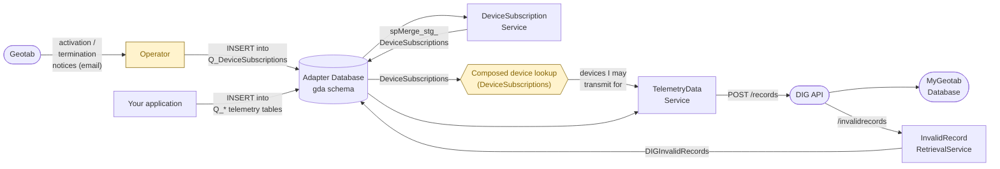
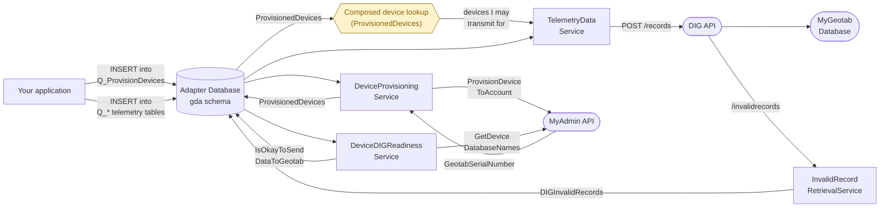
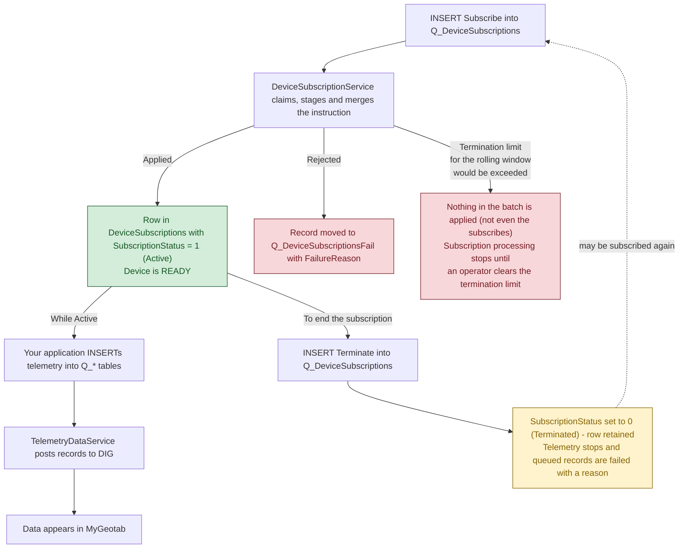
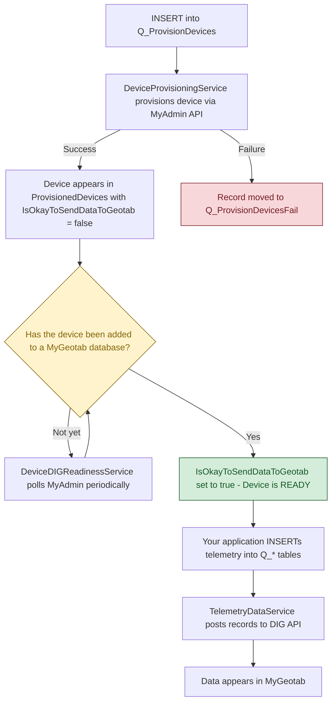
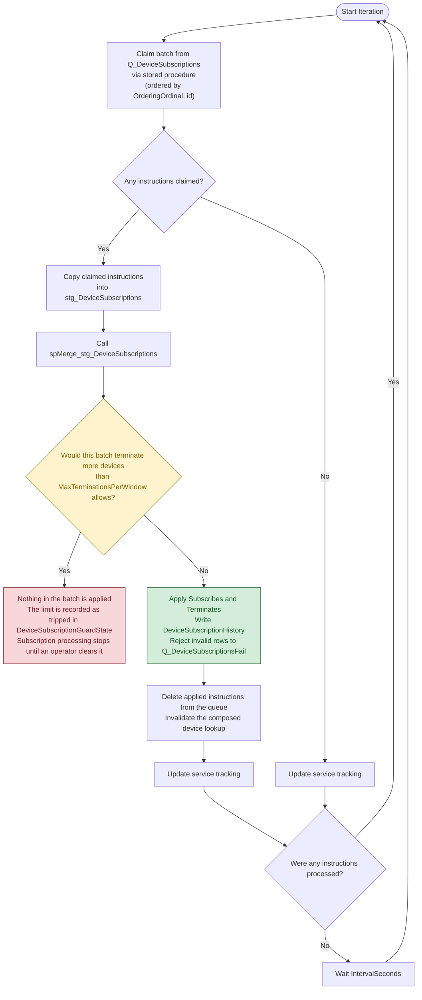
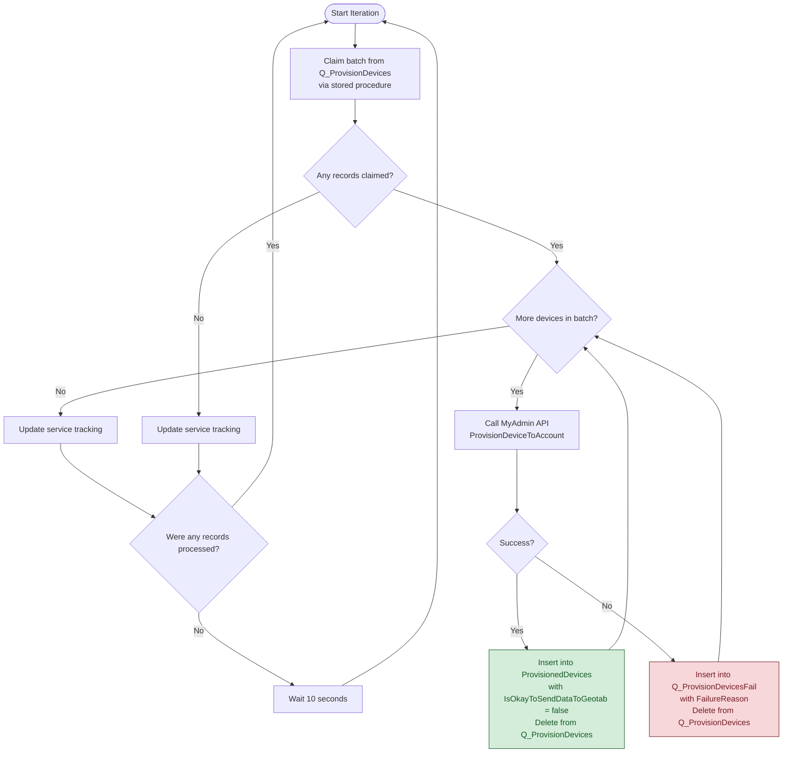
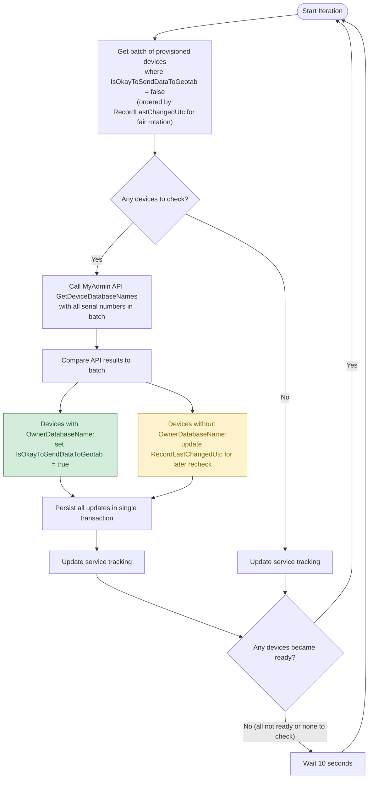
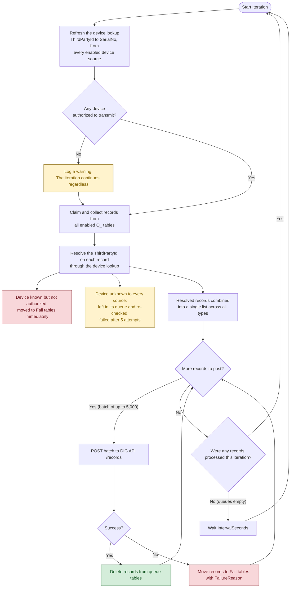
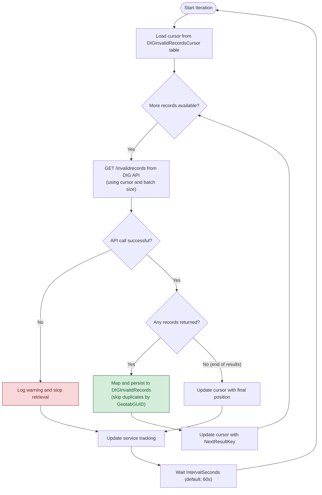

# Geotab DIG Adapter

**Current Version:** 5.2.0.0

> **Using AI to query your adapter database?** See [Section 7.9 AI-Assisted SQL Generation](#79-ai-assisted-sql-generation) for guidance on which files to provide as context to your LLM and key points that ensure accurate query results.

The Geotab [Data Intake Gateway (DIG)](https://github.com/Geotab/data-intake-gateway) enables integrators to stream telemetry data from custom (non-Geotab) telematics devices into the MyGeotab platform — handling much of the [Integrating Telematics Devices](https://docs.google.com/document/d/17Bsi6GxpadHiqajjc9S7bmlKDwv5Mz48dQ_5rm2hEoU/edit?tab=t.0#heading=h.k75aaczakk1u) process outlined in the *Asset & Trailer Tracker Playbook*. While the [MyGeotab API Adapter](https://github.com/Geotab/mygeotab-api-adapter) pulls data *out of* MyGeotab, the Geotab DIG Adapter pushes data *into* MyGeotab.

The Geotab DIG Adapter is a .NET 10.0 application that reads telemetry data from queue tables in a local database and posts it to the DIG API. It handles device subscriptions, device provisioning, readiness checking, telemetry transmission, and invalid record retrieval — providing a complete pipeline for getting custom telematics data into MyGeotab. It supports both **SQL Server** and **PostgreSQL** databases and runs on Windows, Linux, or macOS. Most deployments — OEMs and Custom Telematics Device manufacturers integrating data from their own devices into the Geotab platform — use the **device subscription** workflow; see the [Architecture Overview](#2-architecture-overview) to confirm which of the two workflows is yours.

The Geotab DIG Adapter is open source and available on [GitHub](https://github.com/Geotab/mygeotab-api-adapter). It can be used as-is or modified to meet specific requirements. At a minimum, it serves to demonstrate how a proper DIG integration may be implemented.

### Geotab DIG Adapter Highlights

- **Data Integrity** — A queue-based processing model with atomic claim/process/complete operations ensures reliable record delivery. Failed records are captured in dedicated fail tables with detailed failure reasons, and invalid records flagged by DIG are retrieved and persisted for analysis.
- **Resilience** — A state machine monitors connectivity to both the DIG API and the adapter database. When connectivity is lost, the adapter transitions to a waiting state, polls for restoration, and resumes processing where it left off once connectivity is re-established.
- **Database-Agnosticity** — Both SQL Server and PostgreSQL are supported. The [Dapper](https://github.com/DapperLib/Dapper) ORM is used to map .NET objects to database rows, and a repository pattern separates data-access code from application logic.
- **Configurability** — Via `appsettings.json`, individual telemetry record types can be enabled or disabled, batch sizes and processing intervals can be tuned, and services can be independently controlled.
- **Deployment Model** — The adapter is published using the self-contained deployment model, targeting Windows 64-bit (win-x64), Linux 64-bit (linux-x64), macOS Intel (osx-x64), and macOS Apple Silicon (osx-arm64) runtimes. No pre-installation of the .NET runtime is required.
- **Logging** — [NLog](https://nlog-project.org/) is incorporated as the logging mechanism, with log messages added strategically to assist with debugging and monitoring once the solution has been deployed.

This document provides detailed information about the Geotab DIG Adapter along with instructions related to its deployment.

> [!IMPORTANT]
> **Cost Considerations:** While the Geotab DIG Adapter itself is free and open source, there are costs associated with sending Custom Telematics Device data to the Geotab platform via the Data Intake Gateway. Before proceeding, review the [Does it cost money to build a Custom Telematics Device integration?](https://docs.google.com/document/d/1Mddnxc2qKBCNYvVu0-BXcyR-blPlHwa0Zun0mBzZt88/edit?tab=t.0#heading=h.5y68mhkb2l3k) section of the *Custom Telematics Devices and MyGeotab* reference document for details on associated costs.

> [!TIP]
> This document is written in Markdown. You can render it in any Markdown viewer, paste it into Google Docs or Microsoft Word, or view it directly on GitLab/GitHub. Mermaid diagrams require a Mermaid-compatible renderer (GitLab, GitHub, VS Code with extensions, etc.).

## Table of Contents

1. [Quick Start Guide](#1-quick-start-guide)
   - [1.1 Prerequisites](#11-prerequisites) · [1.2 Download](#12-download) · [1.3 Database Setup](#13-database-setup) · [1.4 Deploy and Configure the Application](#14-deploy-and-configure-the-application)
2. [Architecture Overview](#2-architecture-overview)
   - [End-to-End Data Flow](#end-to-end-data-flow) · [Device Lifecycle](#device-lifecycle) · [Services](#services) · [Device Subscriptions](#device-subscriptions) · [State Machine](#state-machine) · [Database Schema](#database-schema) · [Project Structure](#project-structure)
3. [Operator Guide](#3-operator-guide)
   - [3.1 Device Subscriptions](#31-device-subscriptions) · [3.2 Device Provisioning](#32-device-provisioning) · [3.3 Sending Telemetry Data](#33-sending-telemetry-data) · [3.4 Queue Processing Model](#34-queue-processing-model) · [3.5 Monitoring](#35-monitoring) · [3.6 Invalid Record Retrieval](#36-invalid-record-retrieval) · [3.7 Database Maintenance and Retention](#37-database-maintenance-and-retention)
4. [Configuration Guide](#4-configuration-guide)
   - [Settings Whose Value Is One of a Fixed Set](#settings-whose-value-is-one-of-a-fixed-set) · [Environment Variables for Sensitive Settings](#environment-variables-for-sensitive-settings-optional) · [4.1 OverrideSettings](#41-overridesettings) · [4.2 DatabaseSettings](#42-databasesettings) · [4.3 MyAdminSettings](#43-myadminsettings) · [4.4 DIGSettings](#44-digsettings) · [4.5 AppSettings](#45-appsettings) · [4.6 Complete appsettings.json Examples](#46-complete-appsettingsjson-examples)
5. [Troubleshooting Guide](#5-troubleshooting-guide)
   - [5.1 Common Failure Scenarios](#51-common-failure-scenarios) · [5.2 Interpreting Fail Table Records](#52-interpreting-fail-table-records) · [5.3 DIG API Error Codes](#53-dig-api-error-codes) · [5.4 Authentication and Token Management](#54-authentication-and-token-management) · [5.5 Database Connectivity Issues](#55-database-connectivity-issues)
6. [API Reference](#6-api-reference)
   - [6.1 DIG Record Types](#61-dig-record-types) · [6.2 Field Mappings](#62-field-mappings--queue-table-to-dig-api) · [6.3 DIG API Endpoints Used](#63-dig-api-endpoints-used) · [6.4 MyAdmin API Endpoints Used](#64-myadmin-api-endpoints-used)
7. [Database Schema Reference](#7-database-schema-reference)
   - [7.1 Subscription Tables](#71-subscription-tables) · [7.2 Device Provisioning Tables](#72-device-provisioning-tables) · [7.3 Telemetry Queue Tables](#73-telemetry-queue-tables) · [7.4 Fail Tables](#74-fail-tables) · [7.5 Invalid Records Tables](#75-invalid-records-tables) · [7.6 System Tables](#76-system-tables) · [7.7 Stored Procedures](#77-stored-procedures) · [7.8 Database Setup](#78-database-setup) · [7.9 AI-Assisted SQL Generation](#79-ai-assisted-sql-generation)
8. [Developer Guide](#8-developer-guide)
   - [8.1 Prerequisites](#81-prerequisites) · [8.2 Building from Source](#82-building-from-source) · [8.3 Development Configuration](#83-development-configuration) · [8.4 Running Tests](#84-running-tests) · [8.5 Code Architecture](#85-code-architecture)
9. [Reference Materials](#9-reference-materials)
   - [Data Intake Gateway](#data-intake-gateway) · [Custom Telematics Devices](#custom-telematics-devices) · [Feedback](#feedback)

---

## 1. Quick Start Guide

High-level steps are shown in the following table with details provided in the subsections below.

| Step | Detail |
|------|--------|
| 1 | **Ensure that Prerequisites are Met:** Ensure that all prerequisites are met. See [1.1 Prerequisites](#11-prerequisites) for details. |
| 2 | **Download the Geotab DIG Adapter:** Download the Geotab DIG Adapter application. See [1.2 Download](#12-download) for details. |
| 3 | **Set Up the Adapter Database:** Set up the `gda` schema in the adapter database. See [1.3 Database Setup](#13-database-setup) for details. |
| 4 | **Deploy and Configure the Application:** Deploy and configure the Geotab DIG Adapter application. See [1.4 Deploy and Configure the Application](#14-deploy-and-configure-the-application) for details. |

### 1.1 Prerequisites

The Geotab DIG Adapter requires the following:

| Item | Detail |
|------|--------|
| Geotab Relationship | An established partnership or integration relationship with Geotab is required to obtain the DIG API and MyAdmin API credentials needed by the Geotab DIG Adapter. If you do not yet have an existing relationship with Geotab, visit [Integrate with Geotab](https://marketplace.geotab.com/integrate-geotab/) or [Become a Reseller](https://www.geotab.com/contact-us/become-a-reseller/) to get started. |
| Custom Telematics Device Setup | Once a Geotab relationship has been established, follow the steps outlined in the [Reseller Partners and/or Integration Partners](https://docs.google.com/document/d/1Mddnxc2qKBCNYvVu0-BXcyR-blPlHwa0Zun0mBzZt88/edit?tab=t.0#heading=h.o49mnvoz5p3y) section of the [Custom Telematics Devices and MyGeotab](https://docs.google.com/document/d/1Mddnxc2qKBCNYvVu0-BXcyR-blPlHwa0Zun0mBzZt88/edit?usp=sharing) reference document to set up custom telematics devices for use with the Data Intake Gateway. This process includes obtaining a **Product ID**, which is required when provisioning devices. See [Why do I need a Product ID?](https://docs.google.com/document/d/1Mddnxc2qKBCNYvVu0-BXcyR-blPlHwa0Zun0mBzZt88/edit?tab=t.0#heading=h.i26jghdyks3) for details. |
| Operating System | Windows 64-bit (win-x64), Linux 64-bit (linux-x64), or macOS (osx-x64 / osx-arm64). The deployment packages are self-contained and include the .NET runtime, libraries and dependencies needed to run on the respective platforms. There is no need to pre-install the .NET runtime. |
| Database | SQL Server or PostgreSQL. The Geotab DIG Adapter stores its data in a `gda` schema within a database named `geotabadapterdb`. If the [MyGeotab API Adapter](https://github.com/Geotab/mygeotab-api-adapter) is also being used, the two adapters share the same database — the MyGeotab API Adapter uses the `dbo` (SQL Server) or `public` (PostgreSQL) schema while the Geotab DIG Adapter uses the `gda` schema. If the Geotab DIG Adapter is being used on its own, the `geotabadapterdb` database must be created first. See [Section 7.8 Database Setup](#78-database-setup) for complete instructions. |
| MyAdmin API Credentials | **Required only for the device provisioning workflow.** A deployment using device subscriptions needs no MyAdmin account and can omit the entire `MyAdminSettings` block — see [Section 4.3](#43-myadminsettings). Where it is required: a MyAdmin service account with the `Device_Admin` and `Third-Party-Integrator` roles. The credentials for this account are configured via the `MyAdminUser` and `MyAdminPassword` settings in `appsettings.json`. See [Service account access assignment and best practices](https://docs.google.com/document/d/1Mddnxc2qKBCNYvVu0-BXcyR-blPlHwa0Zun0mBzZt88/edit?tab=t.0#heading=h.yd5sqe939uoh) and [What are these MyAdmin roles needed for?](https://docs.google.com/document/d/1Mddnxc2qKBCNYvVu0-BXcyR-blPlHwa0Zun0mBzZt88/edit?tab=t.0#heading=h.1iyorafxnbth) in the *Custom Telematics Devices and MyGeotab* reference document for details. |
| DIG API Credentials | A separate MyAdmin service account with the `DIG-Access` role, used for sending custom telematics data to the [Data Intake Gateway](https://github.com/Geotab/data-intake-gateway). The credentials for this account are configured via the `DIGUser` and `DIGPassword` settings in `appsettings.json`. As a best practice, this should be a different account from the one used for device management. See [Service account access assignment and best practices](https://docs.google.com/document/d/1Mddnxc2qKBCNYvVu0-BXcyR-blPlHwa0Zun0mBzZt88/edit?tab=t.0#heading=h.yd5sqe939uoh) for details. |
| Networking / Firewall | The application must be able to make requests over HTTPS to the DIG API (e.g. `https://dig.geotab.com:443/`) and the MyAdmin API (e.g. `https://myadmin.geotab.com/v2/myadminapi.ashx`). If the application and database reside on separate servers, appropriate networking steps must be taken to ensure connectivity. |

### 1.2 Download

The latest version of the Geotab DIG Adapter is available on GitHub:

1. Go to [https://github.com/Geotab/mygeotab-api-adapter/releases](https://github.com/Geotab/mygeotab-api-adapter/releases)
2. The latest release will be shown first (at the top of the page). Scroll down to the **Assets** section and download the required files.

#### Application

| Operating System | File to Download |
|------------------|------------------|
| Windows 64-bit | `GeotabDIGAdapter_SCD_win-x64.zip` |
| Linux 64-bit | `GeotabDIGAdapter_SCD_linux-x64.zip` |
| macOS (Intel) | `GeotabDIGAdapter_SCD_osx-x64.zip` |
| macOS (Apple Silicon) | `GeotabDIGAdapter_SCD_osx-arm64.zip` |

#### Database Scripts

| Database | File to Download |
|----------|------------------|
| SQL Server | `SQLServer_GeotabDIGAdapter.zip` |
| PostgreSQL | `PostgreSQL_GeotabDIGAdapter.zip` |

> [!TIP]
> Developers working from source code can find the database scripts in `GeotabDIGAdapter/Scripts/SQLServer/v2/` (SQL Server) and `GeotabDIGAdapter/Scripts/PostgreSQL/v2/` (PostgreSQL).

### 1.3 Database Setup

The Geotab DIG Adapter uses its own `gda` schema within a database named `geotabadapterdb`. Follow the complete setup procedure in [Section 7.8 Database Setup](#78-database-setup) using the scripts from the downloaded database script zip file (see [Section 1.2](#12-download)). This covers creating the database (for standalone installations), the `gda` schema, the `geotabdigadapter_client` database user, and executing the schema creation script. If the MyGeotab API Adapter is already installed, the database already exists and only the DIG-specific steps are required — Section 7.8 identifies which steps to skip.

### 1.4 Deploy and Configure the Application

#### Step 1: Deployment Prerequisites

Before deploying, ensure:

1. **MyAdmin service account** for device management has been set up with the `Device_Admin` and `Third-Party-Integrator` roles (see [Prerequisites](#11-prerequisites)). **Required only for the device provisioning workflow** — a deployment that uses device subscriptions needs no MyAdmin account at all. Step 3 below is where that choice is made.
2. **DIG service account** for data transmission has been set up with the `DIG-Access` role (see [Prerequisites](#11-prerequisites)).
3. Appropriate steps (networking, firewall, etc.) have been taken to ensure **connectivity** to the DIG API endpoint — and to the MyAdmin API endpoint as well, if you are using device provisioning.
4. The **database setup** has been completed per the instructions in [Section 1.3](#13-database-setup).

#### Step 2: Install the Application

The Geotab DIG Adapter is packaged as a self-contained application that includes the .NET runtime and all dependencies. To install:

1. Copy the downloaded zip file to the desired location and extract the contents.

#### Step 3: Configure the Application

The deployment folder contains two configuration files: `appsettings.json` and `nlog.config`.

First decide **which of the two device workflows this deployment uses**. It determines most of what follows, and it is the one choice the adapter cannot make for you:

| Workflow | Use it when | MyAdmin account |
|---|---|---|
| **Device subscriptions** | Another party — typically Geotab — tells you which devices you may transmit for, and you record those instructions in the adapter. **This is what the shipped `appsettings.json` is set up for.** | Not needed |
| **Device provisioning** | You own the devices and provision them yourself through MyAdmin. The original workflow, and what every installation upgrading from an earlier version is using. | Required |

A single deployment can run both; [Section 2](#2-architecture-overview) describes what each one does and [Section 4.4](#44-digsettings) covers running them together.

1. Modify **`appsettings.json`** as needed. See the [Configuration Guide](#4-configuration-guide) for details on all settings. At minimum, configure:
   - **`DatabaseSettings`** — database provider type and connection string (see [Section 4.2](#42-databasesettings))
   - **`DIGSettings:OperatingMode`** — the workflow you chose above: `OemSubscription`, `DeviceProvisioning` or `Both`. The shipped value is `OemSubscription`. This setting and the service enable flags must agree; a configuration where they contradict each other is refused at startup, with a message naming the keys (see [Section 4.4](#44-digsettings)).
   - **`DIGSettings:Services`** — the enable flags for the workflow you chose. The shipped file enables `DeviceSubscriptionService` and disables both `DeviceProvisioningService` and `DeviceDIGReadinessService`, so **a provisioning deployment has to reverse all three.** Leaving provisioning disabled is not a startup failure — the adapter runs, and rows inserted into `Q_ProvisionDevices` simply sit there, with nothing in `Q_ProvisionDevicesFail`. It does now say so: the startup log names each disabled service and the queue it leaves unread, and every maintenance run warns for as long as that queue holds records (see [Section 3.7](#37-database-maintenance-and-retention)).
   - **`DIGSettings`** — DIG API credentials (see [Section 4.4](#44-digsettings))
   - **`DIGSettings:Services:DeviceSubscriptionService:ExpectedIdentifierTypes`** — in a subscription deployment whose identifier is not a VIN. The shipped allow-list is `"Vin"` alone, and an instruction carrying any other type is rejected, so an OEM keyed on IMEI has **every** Subscribe rejected until this is set. Watch for it in `Q_DeviceSubscriptionsFail`: the service's own success count will not show it, because a rejected instruction is counted out of the batch rather than counted as a failure (see [Section 3.5](#35-monitoring)).
   - **`MyAdminSettings`** — MyAdmin API credentials, **for the device provisioning workflow only** (see [Section 4.3](#43-myadminsettings)). A subscription-only deployment needs no MyAdmin account and can leave the block exactly as shipped, or delete it.
2. Review **`nlog.config`** and adjust logging settings if needed.

   **Where the logs go.** The shipped `nlog.config` writes to `LOG-Geotab_DIG_Adapter.log` and, for NLog’s own errors, `LOG-Geotab_DIG_Adapter-internal.log`. Both names are **relative**, so they are created in the process’s working directory:

   | How it runs | Where the log file appears |
   |---|---|
   | Run manually | The folder you ran it from |
   | Windows service | The deployment folder — the host sets the working directory to the application folder |
   | Linux systemd | Whatever `WorkingDirectory=` names in the unit file; the example above sets it to the deployment folder |
   | macOS launchd | Whatever `WorkingDirectory` names in the plist; the example above sets it to the deployment folder |

   The file rolls at 5 MB and daily, keeping up to 100 archives beside it. Logging is at `Info` and above, to both the file and the console. Give it an absolute path if you would rather the logs lived somewhere else.

#### Step 4: Run the Application

##### Option 1: Run Manually

For testing purposes, the application can be launched by running the executable directly:

- **Windows:** `GeotabDIGAdapter.exe`
- **Linux / macOS:** `./GeotabDIGAdapter`

##### Option 2: Install as a Service

For continuous operation in a production environment, install the application as a service.

> [!IMPORTANT]
> **Set the service to start automatically, and to restart on failure.** Windows defaults a new service to *demand* (manual) start, so a service created without `start= auto` does not come back after a reboot — and nothing announces that; the adapter is simply no longer running. The `sc.exe failure` line is the Windows equivalent of the systemd unit's `Restart=always` / `RestartSec=10` below, and the two paths should match. Note the space after each `=` in `sc.exe` arguments: it is required.

**Windows:**

Open PowerShell or Command Prompt as an **Administrator**:

```
sc.exe create GeotabDIGAdapter binPath="C:\<path>\GeotabDIGAdapter_SCD_win-x64\GeotabDIGAdapter.exe" start= auto
sc.exe failure GeotabDIGAdapter reset= 86400 actions= restart/10000/restart/10000/restart/10000
sc.exe start GeotabDIGAdapter
```

**Linux (systemd):**

1. Create a service unit file:
   ```
   sudo nano /etc/systemd/system/geotabdigadapter.service
   ```

2. Add the following configuration (replacing `<path>` and `<User>` as appropriate):
   ```
   [Unit]
   Description=Geotab DIG Adapter

   [Service]
   ExecStart=/<path>/GeotabDIGAdapter_SCD_linux-x64/GeotabDIGAdapter
   WorkingDirectory=/<path>/GeotabDIGAdapter_SCD_linux-x64
   User=<User>
   Restart=always
   RestartSec=10
   SyslogIdentifier=geotab-dig-adapter
   Environment=DOTNET_ENVIRONMENT=Production
   Environment=DOTNET_PRINT_TELEMETRY_MESSAGE=false

   [Install]
   WantedBy=multi-user.target
   ```

3. Enable and start:
   ```
   sudo systemctl daemon-reload
   sudo systemctl enable geotabdigadapter.service
   sudo systemctl start geotabdigadapter.service
   ```

**macOS (launchd):**

1. Create a launch daemon:
   ```
   sudo nano /Library/LaunchDaemons/com.geotab.digadapter.plist
   ```

2. Add the following, replacing `/opt/geotab/GeotabDIGAdapter_SCD_osx-arm64` with your deployment folder and `geotab` with the account the adapter should run as. Use the `osx-arm64` build on Apple silicon and `osx-x64` on Intel:
   ```xml
   <?xml version="1.0" encoding="UTF-8"?>
   <!DOCTYPE plist PUBLIC "-//Apple//DTD PLIST 1.0//EN" "http://www.apple.com/DTDs/PropertyList-1.0.dtd">
   <plist version="1.0">
   <dict>
       <key>Label</key>
       <string>com.geotab.digadapter</string>
       <key>ProgramArguments</key>
       <array>
           <string>/opt/geotab/GeotabDIGAdapter_SCD_osx-arm64/GeotabDIGAdapter</string>
       </array>
       <key>WorkingDirectory</key>
       <string>/opt/geotab/GeotabDIGAdapter_SCD_osx-arm64</string>
       <key>UserName</key>
       <string>geotab</string>
       <key>RunAtLoad</key>
       <true/>
       <key>KeepAlive</key>
       <true/>
       <key>EnvironmentVariables</key>
       <dict>
           <key>DOTNET_ENVIRONMENT</key>
           <string>Production</string>
           <key>DOTNET_PRINT_TELEMETRY_MESSAGE</key>
           <string>false</string>
       </dict>
   </dict>
   </plist>
   ```

3. Set ownership and load it:
   ```
   sudo chown root:wheel /Library/LaunchDaemons/com.geotab.digadapter.plist
   sudo chmod 644 /Library/LaunchDaemons/com.geotab.digadapter.plist
   sudo launchctl load /Library/LaunchDaemons/com.geotab.digadapter.plist
   ```

> [!NOTE]
> **`KeepAlive` and `WorkingDirectory` are both load-bearing.** `KeepAlive` is the launchd equivalent of the systemd unit’s `Restart=always` and of the Windows `sc.exe failure` line above; without it a crashed adapter stays down. `WorkingDirectory` decides where the log file lands, because `nlog.config` names it relatively — see [Step 3](#step-3-configure-the-application). launchd does not default it to the program’s own folder.
>
> If macOS refuses to run the binary because it was downloaded with a browser, clear the quarantine attribute on the deployment folder: `xattr -dr com.apple.quarantine /opt/geotab/GeotabDIGAdapter_SCD_osx-arm64`.

#### Next Steps

Once the application is running, proceed to the [Operator Guide](#3-operator-guide) to make your devices transmittable — by subscribing them, or by provisioning them — and begin sending telemetry data.

---

## 2. Architecture Overview

### End-to-End Data Flow

The adapter has **two** ways of deciding which devices it may transmit for, and one shared path for the telemetry itself. They are separate workflows — they share no tables, and each can be switched off independently — so each is shown on its own below, starting with the one most deployments use.

#### Device Subscription Workflow

**If you are an OEM, or a Custom Telematics Device manufacturer bringing data from your own devices into the Geotab platform, this is your workflow.** It is what the vast majority of DIG Adapter deployments use, and what the shipped `appsettings.json` is already configured for. For background on the integration itself, see [Custom Telematics Devices](#custom-telematics-devices).

You are not the one deciding which devices may transmit: you are **told** which devices to start transmitting for, and when to stop. Each instruction reaches the adapter as a row in `Q_DeviceSubscriptions` — today, inserted by an operator acting on the activation and termination notices Geotab sends by email — and `DeviceSubscriptionService` applies it through a merge procedure that owns ordering, validation and the audit trail. Nothing is provisioned, and **no MyAdmin account is involved anywhere in this path**, which is what makes the workflow usable by an organization that has no MyAdmin account of its own.



#### Device Provisioning Workflow

This workflow is open only to the small subset of organizations that can provision devices into their own MyAdmin (ERP) account. Those are typically organizations already running Geotab devices that want telemetry from *non-Geotab* hardware in the same platform, augmenting the data their Geotab devices already produce. Two common cases:

- A customer **migrating to Geotab from another telematics provider**, who wants historic data from the old provider's system brought across as part of the switch.
- A customer that also operates third-party [Custom Telematics Devices](#custom-telematics-devices), and wants all of its data to reside in one place — the Geotab platform.

The operator asks the adapter to provision a device, MyAdmin returns a Geotab serial number, and the device becomes transmittable once MyAdmin reports that the device has been added to a MyGeotab database.



`TelemetryDataService` reads neither `DeviceSubscriptions` nor `ProvisionedDevices` directly. It asks a **composed device lookup** that merges whichever workflows are enabled, so a deployment using one workflow never reads the other one's table. Running both at once is supported — see [Device Subscriptions](#device-subscriptions).

### Device Lifecycle

A device must become transmittable before telemetry data can flow, and each workflow makes it so in a different way. Follow the one that matches your deployment.

#### Device Subscription Lifecycle

Nothing is provisioned and no MyAdmin account is involved. An external process — or an operator working from a device list — inserts an instruction, and the device becomes transmittable when that instruction is applied. Termination is a status change, not a deletion, so the same device can be subscribed again later.



> [!WARNING]
> **A device is transmittable only while its subscription is Active, and deciding that is your application's job.** Look the device up in `gda.DeviceSubscriptions` by the `ThirdPartyId` you put on its telemetry records, and transmit only while its `SubscriptionStatus` is `1`. That is this workflow's equivalent of `IsOkayToSendDataToGeotab`, which plays no part here — it belongs to the device provisioning workflow only. [Section 3.1](#31-device-subscriptions) has a ready-made query for it alongside the operator procedures, and [Section 3.3](#33-sending-telemetry-data) covers the `ThirdPartyId` match, which is case-sensitive.
>
> **The two ways of getting it wrong behave differently.** Records naming a device the adapter has never been told about — sent before the subscription was applied, or under the wrong identifier — are held in their queue and retried, then failed after five attempts. Records naming a device whose subscription has been terminated are failed at once with a reason, as is anything still queued for it, so the queue does not accumulate.

#### Device Provisioning Lifecycle

One of these states requires action **outside** the adapter: the device must be added to a MyGeotab database by the customer or their Geotab partner.



> [!WARNING]
> **Adding the device to a MyGeotab database is an external action.** After the adapter provisions a device via the MyAdmin API, someone — typically the customer or their Geotab partner — must add that device to a MyGeotab database (e.g., via the MyGeotab user interface). The adapter cannot perform this step. The `DeviceDIGReadinessService` periodically checks the MyAdmin API to detect when this has occurred. Until it does, `IsOkayToSendDataToGeotab` remains `false` and any telemetry records for the device will **not** be sent to the DIG API. **Do not insert telemetry records into `Q_*` tables until `IsOkayToSendDataToGeotab = true`.**


### Services

The Geotab DIG Adapter runs seven background services:

| # | Service | Purpose | Prerequisite services |
|---|---------|---------|-------------|
| 1 | **Orchestrator** | Application initialization, DIG authentication, MyAdmin authentication when a MyAdmin-consuming service is enabled, and connectivity monitoring. Manages state machine transitions. | None |
| 2 | **DeviceSubscriptionService** | Reads from `Q_DeviceSubscriptions`, stages the claimed instructions, and calls `spMerge_stg_DeviceSubscriptions` to apply them to `DeviceSubscriptions`. See [Device Subscriptions](#device-subscriptions). | None |
| 3 | **DeviceProvisioningService** | Reads from `Q_ProvisionDevices`, provisions devices via the MyAdmin API, and writes results to `ProvisionedDevices` (success) or `Q_ProvisionDevicesFail` (failure). | None |
| 4 | **DeviceDIGReadinessService** | Checks provisioned devices against the MyAdmin API to determine if they have been assigned to a MyGeotab database. Sets `IsOkayToSendDataToGeotab = true` when ready. | None |
| 5 | **TelemetryDataService** | Reads from `Q_*` telemetry queue tables, maps records to DIG API format, and posts them via HTTPS. **Only processes records for devices the composed device lookup says may be transmitted for** (see [Device Lifecycle](#device-lifecycle) and [Device Subscriptions](#device-subscriptions)). Posts using the DIG API token the Orchestrator obtained; it does not authenticate itself. | `DeviceProvisioningService`, **only when `EnableDeviceProvisioningService` is `true`** |
| 6 | **InvalidRecordRetrievalService** | Polls the DIG API `/invalidrecords` endpoint using cursor-based pagination and persists rejected records to `DIGInvalidRecords` for analysis. | `DeviceProvisioningService`, **only when `EnableDeviceProvisioningService` is `true`** |
| 7 | **DatabaseMaintenanceService** | Keeps the database from growing without limit. Creates the time-based partitions the fail tables need, **deletes failure and invalid records older than the retention window**, and logs how deep every queue and fail table is. It also keeps the `gda` schema's statistics current and its indexes compact — Level 1 and Level 2 database maintenance. See [Section 3.7](#37-database-maintenance-and-retention). | None |

> [!NOTE]
> **"prerequisite service" means one specific thing.** A service listed above waits for its prerequisite to have completed at least one processing iteration before it begins its own. It is *not* a general dependency: `TelemetryDataService` does not call `DeviceDIGReadinessService`, and `InvalidRecordRetrievalService` does not call `TelemetryDataService`. Nor does either of them authenticate with the DIG API — the Orchestrator does that once, and they share the resulting token. Separately from this table, **every** service waits for the Orchestrator to finish initializing, whatever its prerequisite list says.
>
> **The check is not a one-time startup gate.** It is re-evaluated at the start of every iteration, and “has run” means the prerequisite has processed something in the **last two days** — read from its `OServiceTracking.EntitiesLastProcessedUtc`. A prerequisite that is enabled but has been wedged for more than 48 hours therefore starts pausing the services that depend on it, long after they were all running happily.
>
> The two conditional entries are what makes a subscription-only deployment possible. When `EnableDeviceProvisioningService` is `false` the prerequisite is dropped rather than waited on, so telemetry flows with the provisioning workflow switched off entirely.
>
> **`DatabaseMaintenanceService` works the other way round.** It takes no prerequisite, but the part of its work that reorganizes tables needs the other services to stand still for a moment, so it asks them to pause and waits for them to confirm. They resume as soon as it is done. This is why the state machine has an `AdapterDatabaseMaintenance` wait reason, and why a brief pause in telemetry once a day is expected rather than a fault. Level 2 database maintenance, which rebuilds indexes, pauses them too, but only for the rebuilds that block writers — see [Section 3.7](#level-1-and-level-2-maintenance).

### Device Subscriptions

This section describes how the two workflows relate to each other; each one is shown under [End-to-End Data Flow](#end-to-end-data-flow) above. In the **device subscription** workflow — the one most deployments use — the operator is *told* which devices to transmit for and when to stop, has nothing to provision, and may have no MyAdmin account at all; the adapter reads a **subscription** table that some external process populates. In the **device provisioning** workflow the operator asks the adapter to provision a device into their own MyAdmin account, and the device becomes transmittable once MyAdmin reports it ready.

The two are separate workflows. They share no tables, and the provisioning workflow is unchanged by the presence of the subscription one.

- **`DeviceProvisioningService` and `DeviceDIGReadinessService`** own `ProvisionedDevices`, and a device there is transmittable when `IsOkayToSendDataToGeotab = true`.
- **`DeviceSubscriptionService`** owns `DeviceSubscriptions`, and a device there is transmittable when `SubscriptionStatus = 1` (Active). Instructions arrive by `INSERT` into `Q_DeviceSubscriptions`; the service never writes `DeviceSubscriptions` directly, so every state change passes through the merge procedure that owns ordering, validation, the audit trail and the termination rate limit.

`TelemetryDataService` reads neither table directly. It resolves each record's device through a **composed device lookup** that merges the participating sources into a single map. A source participates only when its workflow is enabled — `ProvisionedDevices` when `EnableDeviceProvisioningService` is `true`, `DeviceSubscriptions` when `EnableDeviceSubscriptionService` is `true` — so a deployment that uses one workflow never reads the other one's table. Both are refreshed together on the interval given by `ProvisionedDeviceCacheRefreshIntervalSeconds`, so the map is always of one vintage. That interval is not how long a **new subscription** takes to take effect, though: applying an instruction invalidates the lookup immediately, so the change is picked up on the next telemetry iteration rather than at the next refresh. A newly provisioned device does wait for the refresh, because nothing in the provisioning workflow invalidates the lookup.

Running both at once is supported, and the two kinds of disagreement between the sources are not treated alike:

- **One serial number appearing under two different identifiers is corrupting.** It would post two vehicles' telemetry under a single device, silently. Every identifier involved is **excluded** and the collision is logged, because the adapter cannot tell which of the two is correct and transmitting under the wrong device is worse than not transmitting.
- **One identifier appearing in both sources is merely ambiguous.** If both name the same serial number there is nothing to resolve. If they disagree, one of them is stale, and the **more recently changed record wins** — nothing is excluded.

> [!NOTE]
> The shipped `appsettings.json` enables device subscriptions, because that is the expected deployment. To run the device provisioning workflow instead, set `OperatingMode` to `DeviceProvisioning`, enable `DeviceProvisioningService` and `DeviceDIGReadinessService`, and disable `DeviceSubscriptionService`. If the key is omitted altogether it defaults to `OemSubscription`, so an existing installation upgrading from v5.1.0.0 must add it — see the [Upgrade Guide](docs/upgrade-guides/v5.2.0.0.md#5-deploy-and-configure-application). See [Section 4.4](#44-digsettings) for configuration and [Section 7.1](#71-subscription-tables) for the schema.

### State Machine

All services coordinate through a shared state machine:

- **`Normal`** — nothing is wrong; services process on their own schedules.
- **`Waiting`** — something is wrong, or maintenance is running. The state carries a **reason**, and the reason decides whether services actually pause:

| Wait reason | Do services pause? |
|---|---|
| `ApplicationNotInitialized` | Yes — no service starts work until the Orchestrator has finished initializing. |
| `AdapterDatabaseNotAvailable` | Yes. |
| `MyGeotabNotAvailable` | Yes. |
| `AdapterDatabaseMaintenance` | Yes — while `DatabaseMaintenanceService` reorganizes tables, and while Level 2 database maintenance rebuilds indexes. See [Section 3.7](#37-database-maintenance-and-retention). |
| `DIGNotAvailable` | **No.** |
| `MyAdminNotAvailable` | **No.** |

The last two are deliberate: neither stops a service from draining its queues, and pausing on them would turn a MyAdmin or DIG outage into a telemetry outage. The Orchestrator owns recovering from those two on its own.

When a connectivity issue is detected, the Orchestrator transitions the state machine to `Waiting` with the matching reason, polls for restoration every 10 seconds, and transitions back to `Normal` when connectivity is restored.

### Database Schema

All Geotab DIG Adapter tables reside in the `gda` schema within the `geotabadapterdb` database. If the MyGeotab API Adapter is also being used, both adapters share the same database — the MyGeotab API Adapter uses the `dbo` (SQL Server) or `public` (PostgreSQL) schema while the Geotab DIG Adapter uses the `gda` schema. For detailed column definitions, see the [Database Schema Reference](#7-database-schema-reference).

### Project Structure

| Project | Description |
|---------|-------------|
| `GeotabDIGAdapter` | Main application — hosted services, DI registration, configuration, SQL scripts |
| `GeotabDIGAdapter.Core` | Core library — database models, entity mappers, DIG API client, MyAdmin API client, configuration classes |

> [!NOTE]
> The Geotab DIG Adapter shares several infrastructure projects with the MyGeotab API Adapter (database layer, configuration, helpers, logging, etc.). These shared projects appear in the solution file but are not DIG-specific. The two projects listed above contain all of the adapter application's own code. The solution also builds two demo data feeders, which are DIG-specific but are separate tools rather than part of the adapter.

---


## 3. Operator Guide

This section covers day-to-day operation: how to populate queue tables, what fields are required, and how data flows through the system.

> [!IMPORTANT]
> **Before you begin:** Read the [Device Lifecycle](#device-lifecycle) diagram in Section 2 and identify which of the two workflows your deployment uses. Telemetry for a device is transmitted only once that device is transmittable, and the two workflows make it so in different ways.
>
> - **Device subscriptions** ([Section 3.1](#31-device-subscriptions)) — the device must have an Active subscription. Nothing is provisioned and no MyAdmin account is required.
> - **Device provisioning** ([Section 3.2](#32-device-provisioning)) — the device must be provisioned **and** added to a MyGeotab database. The adapter handles provisioning, but adding the device to a MyGeotab database is an external action performed by the customer or their Geotab partner.
>
> If you are unsure which applies, check `OperatingMode` and the service enable flags in your `appsettings.json` — see [Section 4.4](#44-digsettings).

> [!NOTE]
> **SQL Server / sqlcmd users:** run `SET QUOTED_IDENTIFIER ON;` in your session before **any** statement in this section that reads or writes a `gda` table — `INSERT`, `UPDATE` and `DELETE` alike, not just the inserts. Without it the statement fails with `SET options have incorrect settings: 'QUOTED_IDENTIFIER'`. **The reason is filtered indexes:** the `gda` schema has 31 of them, including two on every queue table and one on `ProvisionedDevices` (the device provisioning workflow's table), and SQL Server refuses any DML against a table carrying one unless the session has that option set. `sqlcmd` does not set it; SQL Server Management Studio and Azure Data Studio do, which is why the same statement can work in one tool and fail in another. Under `sqlcmd` the `SET` must also be in its own batch, before a `GO` — putting it in the same batch as the statement it is meant to govern does not work.

### 3.1 Device Subscriptions

This section covers the workflow most deployments use — the one for when you are **told** which devices to transmit for rather than provisioning them yourself. If you provision your own devices through MyAdmin, use [Section 3.2](#32-device-provisioning) instead and skip this section. The two are independent; see [Device Subscriptions](#device-subscriptions) for how they relate.

> [!NOTE]
> **Where the instructions come from today.** Geotab tells you which devices to start and stop transmitting for by **email** — an activation or termination notice carrying a device list. Someone on your side applies each notice by inserting the rows below. **The adapter does not fetch subscriptions from anywhere on its own in this version**, so nothing happens until those rows exist. An endpoint that the adapter can poll is planned for a future version; when it ships, a polling service will apply the same instructions automatically and this manual step becomes optional. The table contract below does not change when that happens.
>
> **What you need from each notice.** A Subscribe needs the device's `GeotabSerialNumber` and the third-party identifier you will put on its telemetry records; a Terminate needs the `GeotabSerialNumber` alone. The serial is the part to check for, because **a subscription deployment has no way to look one up** — it makes no MyAdmin call anywhere, by design. If a notice arrives without it, that is a question for whoever sent the notice, not something the adapter can resolve.

The contract is a single table. You `INSERT` instructions into `Q_DeviceSubscriptions`; the `DeviceSubscriptionService` claims them in order, stages them, and calls the merge stored procedure that applies them to `DeviceSubscriptions`. A device with an Active row there is one the adapter may transmit for.

> [!WARNING]
> **Never write `gda.DeviceSubscriptions` directly.** The merge stored procedure is its only writer. It owns instruction ordering, validation, the audit trail in `DeviceSubscriptionHistory`, and the termination rate limit. A direct `INSERT` or `UPDATE` bypasses all four, and the next instruction that arrives for that device may overwrite your change or be discarded against it.

For column definitions, see [Q_DeviceSubscriptions](#71-subscription-tables) in the Database Schema Reference.

**Step 1: Subscribe a device**

A Subscribe instruction requires `OperationType = 1`, `ThirdPartyId` and `GeotabSerialNumber`, and you should **always supply `IdentifierType` as well**. The database accepts the row without it, but omitting it is not the same as leaving it blank: the instruction skips the `ExpectedIdentifierTypes` check and the device is recorded as a VIN. See the warning under *Things that will not behave the way you expect* below. The remaining columns are genuinely optional.

**SQL Server:**
```sql
SET QUOTED_IDENTIFIER ON;
GO

INSERT INTO gda.Q_DeviceSubscriptions
    (OperationType, ThirdPartyId, IdentifierType, GeotabSerialNumber, SubPlan, SourceReference)
VALUES
    (1, '1FTFW1E84PFA00001', 'Vin', 'G9XAB1234567', NULL, 'email:2026-05-14/activation-8842');
```

**PostgreSQL:**
```sql
INSERT INTO gda."Q_DeviceSubscriptions"
    ("OperationType", "ThirdPartyId", "IdentifierType", "GeotabSerialNumber", "SubPlan", "SourceReference")
VALUES
    (1, '1FTFW1E84PFA00001', 'Vin', 'G9XAB1234567', NULL, 'email:2026-05-14/activation-8842');
```

Substitute your own values. `IdentifierType` says what kind of identifier `ThirdPartyId` holds — `Vin`, `Imei`, or whatever else your source sends; it is a literal string, not a placeholder to be filled in with something else. When it is supplied it must appear in the `ExpectedIdentifierTypes` allow-list, or the instruction is rejected to `Q_DeviceSubscriptionsFail`. The allow-list applies **only to instructions that carry a type**; one that omits it bypasses the check altogether, which is why supplying it matters. `SubPlan` and `SourceReference` are optional; set them to `NULL` if not applicable. A `NULL` `SubPlan` means *not supplied* rather than *clear it*: on a re-subscribe any plan already stored is left in place, as `SubscribedDateTimeUtc` is. Send the new value to change a plan — there is deliberately no way to erase one back to `NULL` through the queue, because an omitted column is far more often an incomplete instruction than a request to erase. `SourceReference` is free text and is worth populating: it is the only record of which email, file or message an instruction came from. `id`, `OrderingOrdinal`, `RecordCreationTimeUtc`, `RecordLastChangedUtc`, `ProcessingStatus`, `ProcessingStartTimeUtc`, `ClaimId` and `RetryCount` are managed automatically by the database and application — never set them yourself. Two further columns, `SourceStatus` and `EffectiveDateTimeUtc`, *are* yours to set and are carried into `DeviceSubscriptionHistory`, but **nothing in this version acts on either of them**: `SourceStatus` is read only in the snapshot mode that the planned polling service will use, and `EffectiveDateTimeUtc` schedules nothing (see the warning below). Populate them for your own audit trail if it helps; do not expect behaviour from them.

**Step 2: Wait for the instruction to be applied**

The `DeviceSubscriptionService` claims a batch in `OrderingOrdinal` order, stages it, and merges it. A successfully applied Subscribe leaves an Active row in `DeviceSubscriptions` and a row in `DeviceSubscriptionHistory`; a rejected instruction is copied to `Q_DeviceSubscriptionsFail` with a `FailureReason` and removed from the queue.

**How long to wait:** the service polls every `IntervalSeconds`, which defaults to **10 seconds** (see [Section 4.4](#44-digsettings)), so an instruction inserted now is normally applied within about ten seconds. If the row is still sitting in `Q_DeviceSubscriptions` after a minute, check, in this order: that the service is enabled and running (the startup log names `DeviceSubscriptionService`); whether the termination guard has tripped (`DeviceSubscriptionGuardState` — see *Sizing and clearing the termination guard* below); and whether database maintenance is pausing the services right now (the application log records `DatabaseMaintenanceService pausing other services for database maintenance...` when a pause starts; `gda.DigMaintenanceLogs` records a maintenance run only once it has finished and the pause has ended, so it cannot show one in progress). A large backlog, such as the migration below, also takes more than one interval to drain.



**Step 3: Terminate a subscription**

A Terminate instruction requires `OperationType = 0`, and should key on **`GeotabSerialNumber`**. The column is nullable and nothing rejects a Terminate without it, so this is a strong recommendation rather than a constraint the database enforces — but keying by serial number alone is the safe form: the serial is the only identifier both directions of the workflow are guaranteed to carry, so a Terminate keyed by `ThirdPartyId` will silently miss if the terminating source sends a different kind of identifier than the activating one did.

**SQL Server:**
```sql
SET QUOTED_IDENTIFIER ON;
GO

INSERT INTO gda.Q_DeviceSubscriptions
    (OperationType, GeotabSerialNumber, TerminationReason, SourceReference)
VALUES
    (0, '<GeotabSerialNumber>', '<TerminationReason>', '<SourceReference>');
```

**PostgreSQL:**
```sql
INSERT INTO gda."Q_DeviceSubscriptions"
    ("OperationType", "GeotabSerialNumber", "TerminationReason", "SourceReference")
VALUES
    (0, '<GeotabSerialNumber>', '<TerminationReason>', '<SourceReference>');
```

Terminating sets `SubscriptionStatus` to `0` and retains the row — nothing is deleted, and the device's history is preserved. A terminated device can be subscribed again later.

`OperationType` runs in the same direction as `SubscriptionStatus`: `0` is the inactive side of both — Terminate, and Terminated — and `1` is the active side. A Subscribe instruction (`1`) produces an Active row (`1`). The column accepts only those two values; anything else is refused by a check constraint as the row is inserted, so a mistyped operation fails immediately and visibly rather than being queued.

**Things that will not behave the way you expect**

Each of the following is silent: the instruction is accepted, the log reports success, and the result is not what was intended.

> [!WARNING]
> **Never supply `OrderingOrdinal` yourself.** It is drawn from a database sequence by the column default, and it is what determines the order instructions are applied in. Hand-picking a value that is lower than — or equal to — one already applied to that device causes the instruction to be discarded as *superseded*: written to `DeviceSubscriptionHistory` for the record, never applied, and **counted as a success** in the log line.
>
> **Picking a value that is too high is worse.** Applying an instruction raises the subscription's `LastAppliedOrdinal` to whatever ordinal it carried, and the supersede filter is `<=`. So a hand-picked ordinal above the sequence's current position silently discards **every** subsequent instruction for that device — each one a logged success — until the sequence has issued enough ordinals to catch up. A Terminate does this even when it changes nothing: every later Subscribe it covers under the ordering rules below is discarded in the same way. Omit the column and let the default draw it.

> [!WARNING]
> **A `NULL` `IdentifierType` is not validated, and is then stored as `'Vin'`.** The `ExpectedIdentifierTypes` allow-list is only applied to instructions that carry a type. An instruction with no `IdentifierType` skips the check and is recorded as a VIN, so an IMEI inserted without a type is silently filed as a VIN. Always supply `IdentifierType` explicitly.

> [!WARNING]
> **Identifiers are case-sensitive.** `ThirdPartyId` and `GeotabSerialNumber` are compared with a case-sensitive collation on both providers. (`IdentifierType` is stored with the same collation, but the only comparison made against it — the `ExpectedIdentifierTypes` check — upper-cases both sides, so that one *is* case-insensitive.) Values are trimmed of surrounding whitespace but never case-folded, so `NW0000000001` and `nw0000000001` are two different devices. A case difference between your activation and termination channels makes the Terminate match nothing: it terminates no subscription, is reported as a success (see the next warning), and the device stays Active and keeps transmitting. A case difference between two Subscribes for the same device is rejected as a serial-number collision while the first subscription is Active with the identical serial number, and otherwise creates a second, separate subscription.

> [!WARNING]
> **A Terminate that matches nothing is reported as a success.** Terminating a serial number that was never subscribed, or that is already terminated, applies no change, logs no warning, and is included in the "successfully processed" count. `DeviceSubscriptionHistory` is the only place the no-op is visible. Verify against `DeviceSubscriptions` rather than trusting the count.

> [!WARNING]
> **Re-sending a termination list terminates again any device on it that has been re-subscribed since.** Instructions are ordered by `OrderingOrdinal`, which is drawn when the row is inserted, not by the date on the notice. So a Terminate inserted today outranks a Subscribe applied yesterday, even when the Terminate comes from an older list. If a device on the list was re-activated after it was terminated, inserting the list again terminates the device again. The instruction is applied and counted as a success, and the device stops transmitting. This applies both to a notice that is applied a second time and to a list that holds every termination to date rather than only recent ones.
>
> Before applying such a list, look for a Subscribe applied to each device after that device's termination date, and leave out every device the query returns. Use the termination date the list gives for each device; if it gives none, use the date the list was produced. Compare each device with its own date, not with one date for the whole list: a device that was activated and then terminated inside the list's period would otherwise be returned, and leaving it out would keep it transmitting.
>
> **SQL Server:**
> ```sql
> SET QUOTED_IDENTIFIER ON;
> GO
>
> SELECT h.GeotabSerialNumber, h.ThirdPartyId, h.AppliedDateTimeUtc, h.SourceReference
> FROM gda.DeviceSubscriptionHistory AS h
> JOIN (VALUES
>         ('<GeotabSerialNumber>', '<termination date, UTC>'),
>         ('<GeotabSerialNumber>', '<termination date, UTC>')
>      ) AS l (serial, terminated)
>   ON h.GeotabSerialNumber = l.serial
> WHERE h.OperationType = 1
>   AND h.Outcome IN (0, 1)
>   AND h.AppliedDateTimeUtc > CAST(l.terminated AS datetime2);
> ```
>
> **PostgreSQL:**
> ```sql
> SELECT h."GeotabSerialNumber", h."ThirdPartyId", h."AppliedDateTimeUtc", h."SourceReference"
> FROM gda."DeviceSubscriptionHistory" AS h
> JOIN (VALUES
>         ('<GeotabSerialNumber>', '<termination date, UTC>'),
>         ('<GeotabSerialNumber>', '<termination date, UTC>')
>      ) AS l (serial, terminated)
>   ON h."GeotabSerialNumber" = l.serial
> WHERE h."OperationType" = 1
>   AND h."Outcome" IN (0, 1)
>   AND h."AppliedDateTimeUtc" > CAST(l.terminated AS timestamp);
> ```
>
> `Outcome` `0` is Applied, and `1` is NoOp: a Subscribe for a device that was already Active. Either one means the device was confirmed active after its termination.

> [!WARNING]
> **`EffectiveDateTimeUtc` does not defer anything.** The column is recorded on the instruction and carried into `DeviceSubscriptionHistory`, but nothing schedules against it. An instruction is applied as soon as it is claimed, whatever date it carries. To subscribe or terminate a device at a future time, insert the instruction at that time.

> [!NOTE]
> **Instructions inserted while the service is disabled are not lost.** Rows accumulate in `Q_DeviceSubscriptions` and are applied in `OrderingOrdinal` order once `EnableDeviceSubscriptionService` is set to `true`. Do not re-insert them to "fix" them; the originals will still be applied, so re-inserting only duplicates the work and clutters `DeviceSubscriptionHistory`.

> [!NOTE]
> **Only a Terminate that hits an Active subscription counts against the termination guard.** A Terminate for a device that is unknown or already terminated changes nothing and consumes no budget, which is why the guard is not tripped by a termination list that is re-sent. That makes re-sending a list cheap, but not harmless: see the warning about re-sent termination lists above. The mis-keyed-identifier recovery below consumes one unit per device. A hardware swap consumes one only when its two instructions are claimed in *separate* batches: claimed together they name a single subscription, and the merge collapses them into one update of the serial number without recording a termination at all. Sizing guidance is under "Sizing and clearing the termination guard" below.

These further rules govern ordering and keys:

- **Insert instructions for one device in the order they should apply.** Ordering follows `OrderingOrdinal`, which is drawn at `INSERT` time — not wall-clock intent, and not `EffectiveDateTimeUtc`.
- **A Terminate fixes the order even when it changes nothing.** A Subscribe whose `OrderingOrdinal` is lower than that of a Terminate already applied for the same `ThirdPartyId` is recorded in `DeviceSubscriptionHistory` as `Superseded` and never takes effect — including when that Terminate found nothing Active to terminate. So a Subscribe that reaches the merge late, for example one held in a batch the termination guard refused, cannot reactivate a device that a newer Terminate told to stop. The same holds for a Subscribe naming a different identifier with the same `GeotabSerialNumber`, when the newer Terminate either terminated whichever subscription held that serial number, or named only the serial number. **A Terminate that names an identifier, and finds that identifier already terminated, counts for that identifier alone** — so a re-sent termination for a device's former owner does not stop a Subscribe for the serial number's new owner.
- **Instructions for one device that land in the same batch are collapsed, not replayed in turn.** The merge deduplicates by identifier before it applies anything, keeping the highest `OrderingOrdinal`; the others are recorded in `DeviceSubscriptionHistory` with outcome `Superseded` and never take effect. So a Subscribe and a Terminate inserted seconds apart do **not** produce a device that is subscribed and then terminated — only the later one happens. If you need both states to be observed, they have to land in different batches.
  **One exception, and the recovery below depends on it:** when two instructions collide on the same `GeotabSerialNumber` rather than the same identifier, only a **Subscribe** can be superseded. A Terminate is never dropped by that rule, so a serial-keyed Terminate and a Subscribe for the same serial in one batch both apply — the Terminate clears the old pairing and the Subscribe re-pairs the serial. That is exactly the two-step repair under *Recovering from a mis-keyed identifier*, and it would be impossible if the collapse were unconditional.
- **A Terminate carrying both a serial and a `ThirdPartyId` is validated against the stored pairing.** If they disagree, the instruction is rejected to `Q_DeviceSubscriptionsFail` rather than applied to either device. Sending the serial alone avoids the question.

**Running a subscription-only deployment**

An operator who is told which devices to transmit for has nothing to provision and may have no MyAdmin account at all. That deployment is supported, and it is what the shipped `appsettings.json` is already configured for: the two provisioning services are `false` and the subscription service is `true`.

The shipped file still carries a `MyAdminSettings` block with placeholder values. You can leave it exactly as it is — with both provisioning services off, nothing reads it and the adapter never contacts MyAdmin — or delete the whole block, which is equally valid. See [Section 4.3](#43-myadminsettings).

The relevant part of the shipped file, with the services in the order it puts them:

```json
"DIGSettings": {
    "OperatingMode": "OemSubscription",
    "DIGAPIEndpoint": "https://dig.geotab.com:443/",
    "DIGUser": "<DIGUser>",
    "DIGPassword": "<DIGPassword>",
    "Services": {
        "DeviceSubscriptionService": { "EnableDeviceSubscriptionService": true },
        "DeviceProvisioningService": { "EnableDeviceProvisioningService": false },
        "DeviceDIGReadinessService": { "EnableDeviceDIGReadinessService": false },
        "TelemetryDataService": { "EnableTelemetryDataService": true },
        "InvalidRecordRetrievalService": { "EnableInvalidRecordRetrievalService": true },
        "DatabaseMaintenanceService": { "EnableDatabaseMaintenanceService": true }
    }
}
```

> [!WARNING]
> **`DatabaseMaintenanceService` is the sixth service and it is enabled here, as it is in every deployment shape.** It is shown because leaving it out of this excerpt would suggest a subscription deployment has only five services. With the shipped settings it **permanently deletes** failure and invalid records older than 90 days, starting within seconds of first start. Read [Section 3.7](#37-database-maintenance-and-retention) before that first start, not after.

`OperatingMode` declares intent and never enables or disables anything — it exists so that a configuration which contradicts itself is refused at startup with the offending key named, instead of running in a shape you did not intend. See [Section 4.4](#44-digsettings). A DIG account is still required in every deployment; it is only the MyAdmin account that becomes unnecessary.

In this configuration `ProvisionedDevices` is never read, and `IsOkayToSendDataToGeotab` plays no part — a device is transmittable purely because it has an Active subscription.

**Migrating an existing provisioned fleet to subscriptions**

If this installation already runs the provisioning workflow and you are moving it to subscriptions, the devices do not carry over. `ProvisionedDevices` and `DeviceSubscriptions` are separate tables with separate workflows, and nothing in the adapter copies one into the other.

> [!IMPORTANT]
> **There is no automated migration path, and one field the target needs does not exist in the source.** `DeviceSubscriptions` requires an `IdentifierType` saying what kind of identifier `ThirdPartyId` is — `Vin`, `Imei`, or whatever your supplier uses. `ProvisionedDevices` has no such column: its full column set is `ThirdPartyId`, `ErpNo`, `GeotabSerialNumber`, `IsOkayToSendDataToGeotab`, `DeviceProvisionedDateTimeUtc` and `RecordLastChangedUtc`. The type has to come from outside the adapter, device by device — from whatever system told you what those identifiers were.

The reason that matters more than it looks: **omitting `IdentifierType` does not fail, it guesses.** A queue row that leaves it `NULL` is stored as `Vin`, and a `NULL` also skips the `ExpectedIdentifierTypes` allow-list entirely, so nothing rejects it and nothing warns. A bulk load built from the only table you have — which cannot tell you the type — therefore records every IMEI-keyed device as a VIN, silently. The subscription still works, because matching is by `GeotabSerialNumber`; what you lose is the ability to tell afterwards which rows were guessed.

So supply the type explicitly. If your fleet is genuinely all one type, the whole migration is one statement:

**SQL Server:**

```sql
SET QUOTED_IDENTIFIER ON;
GO
INSERT INTO gda.Q_DeviceSubscriptions
    ([OperationType], [ThirdPartyId], [IdentifierType], [GeotabSerialNumber], [SourceReference])
SELECT 1, p.[ThirdPartyId], 'Vin', p.[GeotabSerialNumber], 'migration:provisioned-fleet'
FROM gda.ProvisionedDevices p
WHERE p.[IsOkayToSendDataToGeotab] = 1
  AND NOT EXISTS (SELECT 1 FROM gda.DeviceSubscriptions d
                  WHERE d.[GeotabSerialNumber] = p.[GeotabSerialNumber]
                    AND d.[SubscriptionStatus] = 1);
GO
```

**PostgreSQL:**

```sql
INSERT INTO gda."Q_DeviceSubscriptions"
    ("OperationType", "ThirdPartyId", "IdentifierType", "GeotabSerialNumber", "SourceReference")
SELECT 1, p."ThirdPartyId", 'Vin', p."GeotabSerialNumber", 'migration:provisioned-fleet'
FROM gda."ProvisionedDevices" p
WHERE p."IsOkayToSendDataToGeotab" = true
  AND NOT EXISTS (SELECT 1 FROM gda."DeviceSubscriptions" d
                  WHERE d."GeotabSerialNumber" = p."GeotabSerialNumber"
                    AND d."SubscriptionStatus" = 1);
```

The literal `'Vin'` is the only part you must decide. If the fleet is mixed, this statement is wrong for some of it — split it by whatever your external source says the type is, and run one statement per type. The `SourceReference` is free text and is worth setting to something recognisable: it is what lets you find these rows again in `DeviceSubscriptionHistory` afterwards.

First, enable the subscription service if it is not already: set `"EnableDeviceSubscriptionService": true` under `DIGSettings:Services:DeviceSubscriptionService`, adding that block if your file has none. A provisioning deployment has it off, and `OperatingMode` on its own enables nothing, so without this the rows above wait in the queue unread. Unlike the two settings below, it stays on afterwards.

Two things to set for the duration of the migration, and then put back:

- **Run with `OperatingMode` set to `Both`, not `OemSubscription`.** Both tables are then read, so a device keeps transmitting whether its authorization has migrated yet or not, and a queue row that fails costs you nothing while you fix it. Switch to `OemSubscription` and disable provisioning only once you have confirmed the subscriptions are Active — `ProvisionedDevices` stops being read the moment provisioning is disabled.
- **Raise `MinimumExpectedDeviceCount` above its default of `0`.** It defaults to disabled, which means the one safety net that would notice a bulk load that silently went wrong is switched off during the single operation most likely to need it. Set it to roughly the fleet size you expect to end up with; an error is logged if the device lookup comes up short.

Confirm the result before you disable anything — the count below should match the number of rows you expected to migrate, and the queue should be empty:

**SQL Server:**

```sql
SELECT COUNT(*) AS Migrated FROM gda.DeviceSubscriptions
WHERE [SubscriptionStatus] = 1;
SELECT COUNT(*) AS StillQueued FROM gda.Q_DeviceSubscriptions;
SELECT COUNT(*) AS Failed FROM gda.Q_DeviceSubscriptionsFail;
```

**PostgreSQL:**

```sql
SELECT COUNT(*) AS "Migrated" FROM gda."DeviceSubscriptions"
WHERE "SubscriptionStatus" = 1;
SELECT COUNT(*) AS "StillQueued" FROM gda."Q_DeviceSubscriptions";
SELECT COUNT(*) AS "Failed" FROM gda."Q_DeviceSubscriptionsFail";
```

A large migration is also a large batch of Subscribes, which the termination guard does not count — it counts terminations only. Sizing it is still worth a thought if the same window will carry the terminations for devices you are *not* migrating; see **Sizing and clearing the termination guard** below.

**Hybrid deployments and serial number collisions**

Running both workflows at once is supported: set `OperatingMode` to `Both` and enable the services each workflow needs. The composed device lookup merges the two sources into one map.

Two kinds of disagreement are possible, and the adapter treats them differently:

- **The same `GeotabSerialNumber` claimed by different identifiers.** Every identifier involved is **excluded** and a warning is logged. **This one is not confined to hybrid deployments:** `DeviceSubscriptions` prevents it within itself with a unique index on the serial number of every Active subscription, but `ProvisionedDevices` has no equivalent index, so two provisioned rows sharing a serial collide the same way in a provisioning-only deployment. Transmitting for any of them would post more than one vehicle's telemetry under a single device, and the adapter cannot tell which claim is right. Resolve it by removing the device from whichever workflow should not own it — terminate the subscription, or delete the `ProvisionedDevices` row — and the survivor begins working on the next cache refresh.
- **The same `ThirdPartyId` present in both sources with a different serial number in each.** Here the **more recently changed record wins** and a warning is logged; nothing is excluded. One of the two sources is out of date, and the warning names both so you can correct it.

> [!NOTE]
> A device excluded by a collision is **not** the same as a device whose authorization has been withdrawn. Telemetry for a collided device is held rather than failed, because the collision is an operator error that is expected to be corrected. Telemetry for a terminated device is failed promptly with a reason, so the queue does not accumulate.
>
> **The hold is short.** A record is held for five attempts and then failed — at the shipped `IntervalSeconds` of `10` that is under a minute, so in practice a collision has to be caught by monitoring rather than resolved by hand before the telemetry reaches the fail tables. Treat the hold as the difference between losing a record and losing it *with* a reason recorded, not as a window to work in.

**Recovering from a mis-keyed identifier**

**First, check which of the two things is actually wrong — the fixes are different, and only one of them costs termination-guard budget.**

- **Only `IdentifierType` is wrong, and `ThirdPartyId` is right.** Just re-send the Subscribe with the correct type. The merge matches an existing subscription on `ThirdPartyId`, so it **repairs the row in place** — `IdentifierType` and `GeotabSerialNumber` are both overwritten, no termination is recorded, and no guard budget is consumed. Nothing below is needed.
- **`ThirdPartyId` itself is wrong.** Now you do need the two-step recovery. Re-sending a Subscribe with the right identifier inserts a *second* subscription rather than repairing the first, and because both name the same serial number the second is rejected — the serial already belongs to an Active subscription.

> [!WARNING]
> **Bulk-correcting mis-keyed identifiers can trip the termination guard.** The two-step recovery costs one unit of budget per device, so at the shipped `MaxTerminationsPerWindow` of `50` a correction run covering 51 devices refuses the whole batch — corrections and unrelated subscribes alike. Either raise the limit and restart first, or split the run across several `TerminationWindowMinutes` windows. Check whether the cheap in-place fix above applies before assuming you need any budget at all.

So **terminate the incorrect subscription first, then subscribe the device again** with the correct identifier:

**SQL Server:**
```sql
SET QUOTED_IDENTIFIER ON;
GO

INSERT INTO gda.Q_DeviceSubscriptions
    (OperationType, GeotabSerialNumber, TerminationReason, SourceReference)
VALUES
    (0, '<GeotabSerialNumber>', 'Correcting mis-keyed identifier', '<SourceReference>');

INSERT INTO gda.Q_DeviceSubscriptions
    (OperationType, ThirdPartyId, IdentifierType, GeotabSerialNumber, SubPlan, SourceReference)
VALUES
    (1, '<CorrectThirdPartyId>', '<IdentifierType>', '<GeotabSerialNumber>', '<SubPlan>', '<SourceReference>');
```

**PostgreSQL:**
```sql
INSERT INTO gda."Q_DeviceSubscriptions"
    ("OperationType", "GeotabSerialNumber", "TerminationReason", "SourceReference")
VALUES
    (0, '<GeotabSerialNumber>', 'Correcting mis-keyed identifier', '<SourceReference>');

INSERT INTO gda."Q_DeviceSubscriptions"
    ("OperationType", "ThirdPartyId", "IdentifierType", "GeotabSerialNumber", "SubPlan", "SourceReference")
VALUES
    (1, '<CorrectThirdPartyId>', '<IdentifierType>', '<GeotabSerialNumber>', '<SubPlan>', '<SourceReference>');
```

Insert both statements in that order and let the sequence assign the ordinals; the Terminate is applied first, freeing the serial number for the corrected Subscribe. The incorrect subscription is retained as a terminated row, and both instructions appear in `DeviceSubscriptionHistory`. Note that the correction consumes one unit of termination-guard budget.

**Sizing and clearing the termination guard**

The guard is a rolling-window rate limit: if a batch would push the number of terminations within `TerminationWindowMinutes` past `MaxTerminationsPerWindow`, the merge applies **nothing at all** — including the Subscribe instructions in the same batch — records the trip in `DeviceSubscriptionGuardState`, and stops processing until an operator clears it.

Size it against **the most terminations you would legitimately expect within one `TerminationWindowMinutes`**, not against one batch and not against the average. The two settings are sized together: the count the limit is compared against is the window total, so a termination run split into several smaller inserts still sums to the same number if they land inside the same window. A limit below a routine end-of-month termination run will stop the adapter every month; a limit far above your entire fleet protects nothing.

Two common corrections cost less budget than they look like they should, because the merge resolves each batch before the guard counts anything:

- The **mis-keyed-identifier recovery** above consumes one unit per device. The two instructions name *different* identifiers, so both survive into the batch and the Terminate is counted.
- A **hardware swap** that keeps the same `ThirdPartyId` consumes **none**. Both instructions name the same subscription, so the merge collapses them into a single update of the serial number and no termination is recorded at all. It does consume one unit if the pair happens to be claimed in *separate* batches, where the Terminate is applied on its own.

Setting `MaxTerminationsPerWindow` to `0` disables the guard entirely.

When it trips, do not clear it first — read it first. **The numbers you need are in the guard row itself:** `TrippedTerminationCount` is what the refused batch would have terminated, `TrippedWindowCount` is how many terminations the rolling window already held, and `TrippedReason` records both alongside the limit that was exceeded.

**SQL Server:**
```sql
SELECT * FROM gda.DeviceSubscriptionGuardState WITH (NOLOCK) WHERE id = 1;

-- The Terminate instructions in the refused batch, if you want to see them:
SELECT * FROM gda.Q_DeviceSubscriptions WITH (NOLOCK)
WHERE ProcessingStatus = 1 AND OperationType = 0
ORDER BY OrderingOrdinal;
```

**PostgreSQL:**
```sql
SELECT * FROM gda."DeviceSubscriptionGuardState" WHERE "id" = 1;

-- The Terminate instructions in the refused batch, if you want to see them:
SELECT * FROM gda."Q_DeviceSubscriptions"
WHERE "ProcessingStatus" = 1 AND "OperationType" = 0
ORDER BY "OrderingOrdinal";
```

> [!NOTE]
> **The second query is a list, not the count.** It returns every Terminate instruction in the claimed batch, but the guard counts only those that resolve to a **currently Active** subscription — a Terminate naming a device that is unknown, or already terminated, appears in this list and was never counted toward the limit. Read the number from `TrippedTerminationCount` and the identities from here.

Once the terminations have been confirmed as legitimate, clear the trip with the `UPDATE` statement for your provider in [SCHEMA_REFERENCE.md](SCHEMA_REFERENCE.md#devicesubscriptionguardstate). Never `DELETE` from that table — it is a single fixed row.

If the batch is legitimately larger than the current limit, raising `MaxTerminationsPerWindow` is part of the same recovery, and the order matters:

1. Edit `MaxTerminationsPerWindow` in `appsettings.json`.
2. **Restart the adapter.** Configuration is read once, at startup — a running process never picks up an edited `appsettings.json`. Changing the value without restarting leaves the old limit in force, and the guard trips again on the retry.
3. Clear the trip.

Processing then resumes on the service's next iteration, but **the refused batch is not retried at once.** Its records are still claimed — `ProcessingStatus = 1` — and a claimed record only becomes available again after it has sat for 30 minutes. That threshold is fixed in the service and is not configurable, so expect up to half an hour between clearing the trip and seeing the batch applied. The drain described below is measured from the trip, not from the moment you clear it, and it does not pause while you investigate.

> [!WARNING]
> **A tripped guard is not free to leave tripped, and the default gives you about three hours.** While it is set, every claimed instruction is refused and left claimed, then claimed again once it has sat for 30 minutes, which increments its `RetryCount`. An instruction whose `RetryCount` has reached `MaxClaimAttempts` is treated as poison the next time its claim goes stale, and moved to `Q_DeviceSubscriptionsFail`. At the default `MaxClaimAttempts` of `5` that is the first claim and then five reclaims 30 minutes apart, so **the queued batch starts draining into the fail table roughly 3 hours after the trip** — the Subscribe instructions caught up in the batch along with the terminations. Once they have drained, clearing the guard no longer replays them: the queue rows are gone and the instructions must be re-issued.
>
> **A re-issued instruction draws a new, higher `OrderingOrdinal`,** so it is ordered after everything inserted since the trip. Before re-issuing a drained Subscribe, check that no later instruction has terminated that device, or the Subscribe will reactivate it. The statements below copy the drained instructions back into the queue in the order they were first issued, drawing fresh ordinals from the sequence; replace `<trip time>` with when the guard tripped (`TrippedDateTimeUtc` in `DeviceSubscriptionGuardState`), and run the `SELECT` on its own first to review what will be re-issued. On SQL Server:
>
> ```sql
> INSERT INTO gda.Q_DeviceSubscriptions (OrderingOrdinal, OperationType, ThirdPartyId, IdentifierType, GeotabSerialNumber, SubPlan, SourceStatus, EffectiveDateTimeUtc, TerminationReason, SourceReference)
> SELECT NEXT VALUE FOR gda.SeqDeviceSubscriptionOrdinal OVER (ORDER BY OriginalOrderingOrdinal),
>        OperationType, ThirdPartyId, IdentifierType, GeotabSerialNumber, SubPlan, SourceStatus, EffectiveDateTimeUtc, TerminationReason, SourceReference
> FROM gda.Q_DeviceSubscriptionsFail
> WHERE FailureReason LIKE 'Exceeded % claim attempts.'
>   AND RecordCreationTimeUtc >= '<trip time>';
> ```
>
> On PostgreSQL:
>
> ```sql
> INSERT INTO gda."Q_DeviceSubscriptions" ("OperationType", "ThirdPartyId", "IdentifierType", "GeotabSerialNumber", "SubPlan", "SourceStatus", "EffectiveDateTimeUtc", "TerminationReason", "SourceReference")
> SELECT "OperationType", "ThirdPartyId", "IdentifierType", "GeotabSerialNumber", "SubPlan", "SourceStatus", "EffectiveDateTimeUtc", "TerminationReason", "SourceReference"
> FROM gda."Q_DeviceSubscriptionsFail"
> WHERE "FailureReason" LIKE 'Exceeded % claim attempts.'
>   AND "RecordCreationTimeUtc" >= '<trip time>'
> ORDER BY "OriginalOrderingOrdinal";
> ```
>
> The 30-minute reclaim interval is fixed and not configurable. If you need a longer window to investigate, raise `MaxClaimAttempts` **and restart the adapter** before the batch drains — each extra attempt buys 30 minutes. The restart is not optional: like every other setting, `MaxClaimAttempts` is read once at startup, so an edit on its own changes nothing.

You can monitor subscription status by querying:

**SQL Server:**
```sql
-- Devices currently authorized to transmit:
SELECT TOP 100 * FROM gda.DeviceSubscriptions WITH (NOLOCK)
WHERE SubscriptionStatus = 1;

-- Devices whose subscription has been terminated:
SELECT TOP 100 * FROM gda.DeviceSubscriptions WITH (NOLOCK)
WHERE SubscriptionStatus = 0;

-- Instructions waiting to be applied (0 = pending, 1 = in progress):
SELECT TOP 100 * FROM gda.Q_DeviceSubscriptions WITH (NOLOCK)
ORDER BY OrderingOrdinal;

-- Instructions that were rejected (most recent first):
SELECT TOP 100 * FROM gda.Q_DeviceSubscriptionsFail WITH (NOLOCK)
ORDER BY RecordCreationTimeUtc DESC;

-- What actually happened to each instruction, including no-ops and superseded ones:
SELECT TOP 100 * FROM gda.DeviceSubscriptionHistory WITH (NOLOCK)
ORDER BY AppliedDateTimeUtc DESC;

-- Is the termination guard tripped?
SELECT * FROM gda.DeviceSubscriptionGuardState WITH (NOLOCK) WHERE id = 1;
```

**PostgreSQL:**
```sql
-- Devices currently authorized to transmit:
SELECT * FROM gda."DeviceSubscriptions"
WHERE "SubscriptionStatus" = 1 LIMIT 100;

-- Devices whose subscription has been terminated:
SELECT * FROM gda."DeviceSubscriptions"
WHERE "SubscriptionStatus" = 0 LIMIT 100;

-- Instructions waiting to be applied (0 = pending, 1 = in progress):
SELECT * FROM gda."Q_DeviceSubscriptions"
ORDER BY "OrderingOrdinal" LIMIT 100;

-- Instructions that were rejected (most recent first):
SELECT * FROM gda."Q_DeviceSubscriptionsFail"
ORDER BY "RecordCreationTimeUtc" DESC LIMIT 100;

-- What actually happened to each instruction, including no-ops and superseded ones:
SELECT * FROM gda."DeviceSubscriptionHistory"
ORDER BY "AppliedDateTimeUtc" DESC LIMIT 100;

-- Is the termination guard tripped?
SELECT * FROM gda."DeviceSubscriptionGuardState" WHERE "id" = 1;
```

### 3.2 Device Provisioning

Before telemetry data can be sent to the DIG API, devices must be provisioned and confirmed as ready. This is a three-step process:

**Step 1: Insert into `Q_ProvisionDevices`**

Your application inserts one row per device:

**SQL Server:**
```sql
SET QUOTED_IDENTIFIER ON;
GO

INSERT INTO gda.Q_ProvisionDevices
    (ThirdPartyId, ErpNo, ProductId, HardwareId, PromoCode, SubPlan)
VALUES
    ('MY-DEVICE-001', '<ErpNo>', <ProductId>, NULL, NULL, NULL);
```

**PostgreSQL:**
```sql
INSERT INTO gda."Q_ProvisionDevices"
    ("ThirdPartyId", "ErpNo", "ProductId", "HardwareId", "PromoCode", "SubPlan")
VALUES
    ('MY-DEVICE-001', '<ErpNo>', <ProductId>, NULL, NULL, NULL);
```

For column definitions, see [Q_ProvisionDevices](#72-device-provisioning-tables) in the Database Schema Reference. Only `ThirdPartyId` and `ProductId` are required.

`ProductId` is an integer that Geotab issues to you as part of the Custom Telematics Device setup — it identifies your device type to the platform, it is the same value for every device of that type, and there is no way to derive or guess it. If you do not have one yet, that setup step has not been completed; see [Prerequisites](#11-prerequisites), which links the reference document covering how to obtain it and what it is for. Nothing in this repository can supply it. `ErpNo`, `HardwareId`, `PromoCode`, and `SubPlan` are optional — set to `NULL` if not applicable. **`ErpNo` is the account ERP number the device is activated against**: it names the MyAdmin account that will own the device, and must resolve to an account the credentials in `MyAdminSettings` can reach. The adapter passes it to MyAdmin only when the queue row supplies one, and never reads it back or matches on it afterwards — it is copied to `ProvisionedDevices` as a record of where the device was provisioned. Supply it if your Geotab contact gave you one; leave it `NULL` otherwise. All other columns (`id`, `RecordCreationTimeUtc`, `RecordLastChangedUtc`, `ProcessingStatus`, `ProcessingStartTimeUtc`, `RetryCount`) are managed automatically by the database and application.

**Step 2: Wait for provisioning**

The `DeviceProvisioningService` picks up the record, calls the MyAdmin API `ProvisionDeviceToAccount`, and writes the result:
- **Success** — a row is inserted into `ProvisionedDevices` with the `GeotabSerialNumber` assigned by MyAdmin. The device's `IsOkayToSendDataToGeotab` flag is initially set to `false`.
- **Failure** — a row is inserted into `Q_ProvisionDevicesFail` with the `FailureReason`.



> [!NOTE]
> Each device is provisioned and persisted individually (not batched). This ensures that if the adapter crashes mid-batch, devices already provisioned are not lost.

**Step 3: Add the device to a MyGeotab database (external action)**

After provisioning, the device exists in the Geotab platform but is **not yet assigned to a MyGeotab database**. Someone — typically the customer or their Geotab partner — must add the device to a MyGeotab database (e.g., via the MyGeotab user interface). **The adapter cannot perform this step.**

The `DeviceDIGReadinessService` periodically checks each provisioned device (where `IsOkayToSendDataToGeotab = false`) by calling the MyAdmin API `GetDeviceDatabaseNames`. Once a device has been assigned to a MyGeotab database, the flag is set to `true` and telemetry data for that device will be processed.



> [!WARNING]
> **Do not insert telemetry records into `Q_*` tables for a device until its `IsOkayToSendDataToGeotab` flag is `true`.** Records inserted before then are **not** held until the device becomes ready. They are moved to the `Q_*Fail` tables on the first iteration that claims them, with no hold and no retry.
>
> The reason is that a device already present in `ProvisionedDevices` with the flag still `false` is classified as having had its authorisation *withdrawn*, not as *unknown*. Only an unknown device — one no device lookup source has heard of at all — is held and re-checked. The failure reason recorded against each record therefore reads *“no longer authorised … has withdrawn authorisation”*, which during onboarding means only that transmission started before the device was ready.

You can monitor provisioning status by querying:

**SQL Server:**
```sql
-- Devices successfully provisioned and ready for telemetry:
SELECT TOP 100 * FROM gda.ProvisionedDevices WITH (NOLOCK)
WHERE IsOkayToSendDataToGeotab = 1;

-- Devices provisioned but not yet assigned to a database:
SELECT TOP 100 * FROM gda.ProvisionedDevices WITH (NOLOCK)
WHERE IsOkayToSendDataToGeotab = 0;

-- Devices that failed provisioning (most recent first):
SELECT TOP 100 * FROM gda.Q_ProvisionDevicesFail WITH (NOLOCK)
ORDER BY RecordCreationTimeUtc DESC;
```

**PostgreSQL:**
```sql
-- Devices successfully provisioned and ready for telemetry:
SELECT * FROM gda."ProvisionedDevices"
WHERE "IsOkayToSendDataToGeotab" = true LIMIT 100;

-- Devices provisioned but not yet assigned to a database:
SELECT * FROM gda."ProvisionedDevices"
WHERE "IsOkayToSendDataToGeotab" = false LIMIT 100;

-- Devices that failed provisioning (most recent first):
SELECT * FROM gda."Q_ProvisionDevicesFail"
ORDER BY "RecordCreationTimeUtc" DESC LIMIT 100;
```

#### Setting `IsOkayToSendDataToGeotab` Yourself

A provisioning deployment that leaves `EnableDeviceDIGReadinessService` at `false` takes on the one job that service does: deciding that a provisioned device has been added to a MyGeotab database, and recording that decision by setting `IsOkayToSendDataToGeotab` to `true`. **Nothing else in the adapter ever sets that flag.** Until you set it, the device sits in `ProvisionedDevices` and no telemetry is transmitted for it. Doing this yourself is supported — it is why the adapter warns rather than refuses to start — but the statement is yours to run.

Set both columns, exactly as `DeviceDIGReadinessService` would:

**SQL Server:**
```sql
SET QUOTED_IDENTIFIER ON;
GO

-- The device is ready: it has been added to a MyGeotab database.
UPDATE gda.ProvisionedDevices
SET IsOkayToSendDataToGeotab = 1,
    RecordLastChangedUtc = SYSUTCDATETIME()
WHERE ThirdPartyId = 'MY-DEVICE-001';
```

**PostgreSQL:**
```sql
-- The device is ready: it has been added to a MyGeotab database.
UPDATE gda."ProvisionedDevices"
SET "IsOkayToSendDataToGeotab" = true,
    "RecordLastChangedUtc" = (now() AT TIME ZONE 'UTC')
WHERE "ThirdPartyId" = 'MY-DEVICE-001';
```

Three things about that statement:

- **Updating `RecordLastChangedUtc` is not decoration.** In a deployment running both workflows it is the tiebreaker: when the same `ThirdPartyId` appears in `ProvisionedDevices` and in `DeviceSubscriptions` with a different `GeotabSerialNumber` in each, the more recently changed record wins and the adapter logs the other as out of date. A row left with a stale timestamp loses a collision it should win.
- **The change takes effect on the next cache refresh**, within `ProvisionedDeviceCacheRefreshIntervalSeconds` (300 by default) — not immediately. The whole table is re-read each refresh, so there is no watermark to satisfy and no restart required.
- **Set it only once the device really is in a MyGeotab database.** That is the condition `DeviceDIGReadinessService` checks through the MyAdmin API, and the condition transmission depends on. Setting it early does not queue telemetry for later; it transmits.

To find the devices still waiting, use the *devices provisioned but not yet assigned to a database* query above.

Reversing the decision — a device removed from its MyGeotab database — is the same statement with the flag set back to `0` / `false`. Be aware of what that does to telemetry already queued for it: the adapter then reads the device as having had its **authorisation withdrawn** rather than as unknown, so queued records are moved to the `Q_*Fail` tables on the first iteration that claims them, with a reason and with no hold and no retry.

### 3.3 Sending Telemetry Data

Once a device is transmittable, you can insert telemetry records into the appropriate `Q_*` queue tables. The `TelemetryDataService` processes all enabled record types in each iteration. "Transmittable" depends on the workflow your deployment uses: a provisioned device with `IsOkayToSendDataToGeotab = true` ([Section 3.2](#32-device-provisioning)), or a device with an Active subscription ([Section 3.1](#31-device-subscriptions)).

> [!IMPORTANT]
> The `ThirdPartyId` in every telemetry record must match a `ThirdPartyId` that an **enabled** workflow authorizes — `ProvisionedDevices` when device provisioning is enabled, `DeviceSubscriptions` when device subscriptions are. Records with unrecognized `ThirdPartyId` values will not be processed. Note that `ThirdPartyId` is compared case-sensitively.

#### GPS Records

For column definitions, see [Q_GpsRecords](#73-telemetry-queue-tables) in the Database Schema Reference.

**SQL Server:**
```sql
SET QUOTED_IDENTIFIER ON;
GO

INSERT INTO gda.Q_GpsRecords
    (ThirdPartyId, [DateTime], Latitude, Longitude, Speed, IsGpsValid, IsIgnitionOn,
     IsAuxiliary1On, IsAuxiliary2On, IsAuxiliary3On, IsAuxiliary4On,
     IsAuxiliary5On, IsAuxiliary6On, IsAuxiliary7On, IsAuxiliary8On)
VALUES
    ('MY-DEVICE-001', '2026-04-08 12:00:00', 43.6532, -79.3832, 55.5, 1, 1,
     NULL, NULL, NULL, NULL,
     NULL, NULL, NULL, NULL);
```

**PostgreSQL:**
```sql
INSERT INTO gda."Q_GpsRecords"
    ("ThirdPartyId", "DateTime", "Latitude", "Longitude", "Speed", "IsGpsValid", "IsIgnitionOn",
     "IsAuxiliary1On", "IsAuxiliary2On", "IsAuxiliary3On", "IsAuxiliary4On",
     "IsAuxiliary5On", "IsAuxiliary6On", "IsAuxiliary7On", "IsAuxiliary8On")
VALUES
    ('MY-DEVICE-001', '2026-04-08 12:00:00', 43.6532, -79.3832, 55.5, true, true,
     NULL, NULL, NULL, NULL,
     NULL, NULL, NULL, NULL);
```

#### Generic Status Records

For column definitions, see [Q_GenericStatusRecords](#73-telemetry-queue-tables) in the Database Schema Reference.

**SQL Server:**
```sql
SET QUOTED_IDENTIFIER ON;
GO

INSERT INTO gda.Q_GenericStatusRecords (ThirdPartyId, [DateTime], Code, Value)
VALUES ('MY-DEVICE-001', '2026-04-08 12:00:00', 5, 123456);
```

**PostgreSQL:**
```sql
INSERT INTO gda."Q_GenericStatusRecords" ("ThirdPartyId", "DateTime", "Code", "Value")
VALUES ('MY-DEVICE-001', '2026-04-08 12:00:00', 5, 123456);
```

#### Generic Fault Records

For column definitions, see [Q_GenericFaultRecords](#73-telemetry-queue-tables) in the Database Schema Reference.

**SQL Server:**
```sql
SET QUOTED_IDENTIFIER ON;
GO

INSERT INTO gda.Q_GenericFaultRecords (ThirdPartyId, [DateTime], Code, FaultStateActive)
VALUES ('MY-DEVICE-001', '2026-04-08 12:00:00', 523, 1);
```

**PostgreSQL:**
```sql
INSERT INTO gda."Q_GenericFaultRecords" ("ThirdPartyId", "DateTime", "Code", "FaultStateActive")
VALUES ('MY-DEVICE-001', '2026-04-08 12:00:00', 523, true);
```

#### Other Record Types

For column definitions for the remaining record types, see [Section 7.3 Telemetry Queue Tables](#73-telemetry-queue-tables) in the Database Schema Reference:

- **Q_AccelerationRecords** — 3-axis accelerometer data (X, Y, Z in milli-g)
- **Q_BinaryRecords** — raw binary payload data
- **Q_BluetoothRecords** — Bluetooth beacon/device detection
- **Q_DriverChangeRecords** — driver login/logout events
- **Q_J1708FaultRecords** — J1708 protocol fault codes
- **Q_J1939FaultRecords** — J1939 protocol fault codes
- **Q_ObdiiFaultRecords** — OBDII diagnostic trouble codes
- **Q_VinRecords** — Vehicle Identification Number

#### Clearing queued records for devices that will never be authorized

**In almost every case, do nothing — the adapter clears them itself.** A queued record naming a device no
lookup source authorizes is not stranded: a device a source holds but does not authorize is failed on the
first iteration that claims it, and a device no source has heard of is held, re-checked five times, and then
failed. Either way the record leaves the queue and lands in the matching `Q_*Fail` table with a reason, and
retention reclaims it later. A queue that keeps growing is a sign that **something upstream is still
inserting**, not that records are stuck — stop the feeder first, and the backlog drains on its own.

> [!WARNING]
> **Do not delete from a live `Q_*` queue table on a filter like `ProcessingStatus = 0` alone.** That is a
> plausible-looking statement with two real hazards: it destroys records for devices that *are* authorized
> and simply have not been claimed yet, and it leaves no trace — unlike the adapter's own path, which
> preserves every record in a fail table with the reason it failed. Retention deliberately never touches the
> live queues for the same reason (see [Section 3.7](#37-database-maintenance-and-retention)).

If you genuinely must remove rows by hand — a feeder that flooded the queue with records you do not want
recorded even as failures — scope the delete to the identifiers concerned, and exclude claimed rows so you
cannot delete a record the adapter is mid-way through transmitting:

**SQL Server:**
```sql
SET QUOTED_IDENTIFIER ON;
GO

DELETE FROM gda.Q_GpsRecords
WHERE ProcessingStatus = 0
  AND ThirdPartyId IN ('<ThirdPartyId>', '<ThirdPartyId>');
```

**PostgreSQL:**
```sql
DELETE FROM gda."Q_GpsRecords"
WHERE "ProcessingStatus" = 0
  AND "ThirdPartyId" = ANY (ARRAY['<ThirdPartyId>', '<ThirdPartyId>']);
```

Run the equivalent `SELECT COUNT(*)` first. Repeat per record type — there is no single table holding all
telemetry.

### 3.4 Queue Processing Model

All queue tables follow the same processing pattern:

1. **INSERT** — Your application inserts records with `ProcessingStatus = 0` (the default).
2. **CLAIM** — A stored procedure (`spClaimQ*Batch`) atomically selects and locks a batch of pending records using `FOR UPDATE SKIP LOCKED` (PostgreSQL) or `UPDLOCK, READPAST` (SQL Server), so concurrent callers do not block on one another. This is not a guarantee that two adapter instances sharing a database would never claim the same records — see [Section 7.7](#77-stored-procedures).
3. **PROCESS** — The service maps queue records to DIG API format and posts them.
4. **PERSIST** — On success, the queue record is deleted. On failure, the record is moved to the corresponding `Fail` table with a `FailureReason`.

Stale records (claimed but not completed within 30 minutes) are automatically released for reprocessing.



### 3.5 Monitoring

Use the `OServiceTracking` table to monitor service health:

**SQL Server:**
```sql
SELECT ServiceId, AdapterVersion, AdapterMachineName,
       EntitiesLastProcessedUtc, LastBatchSize,
       SuccessCount, FailureCount, RecordLastChangedUtc
FROM gda.OServiceTracking WITH (NOLOCK)
ORDER BY ServiceId;
```

**PostgreSQL:**
```sql
SELECT "ServiceId", "AdapterVersion", "AdapterMachineName",
       "EntitiesLastProcessedUtc", "LastBatchSize",
       "SuccessCount", "FailureCount", "RecordLastChangedUtc"
FROM gda."OServiceTracking"
ORDER BY "ServiceId";
```

Key indicators:
- **`EntitiesLastProcessedUtc`** — when the service last processed records. A stale timestamp indicates the service is idle or stuck.
- **`SuccessCount` / `FailureCount`** — cumulative counters. A rising failure count warrants investigation.
- **`LastBatchSize`** — the number of records processed in the most recent iteration. Consistently hitting a service's batch size limit may mean it should be raised. The key differs by service: `BatchSizePerType` for `TelemetryDataService`, `BatchSize` for `DeviceSubscriptionService` and `InvalidRecordRetrievalService`. The provisioning and readiness services have no such setting — their batch sizes are fixed in code.

> [!NOTE]
> **For the `DeviceSubscriptionService`, `SuccessCount` means "not rejected", not "changed something".** It is the batch total minus the rejections, so an instruction that was superseded by a higher ordinal, and a Terminate that named nothing active, are both counted as successes here and in the service's own log line. The same caveat applies to the two warnings in [Section 3.1](#31-device-subscriptions). Use this counter to spot a *rising* failure count, not to confirm that a particular batch took effect — `DeviceSubscriptionHistory.Outcome` is the only place that distinguishes Applied from NoOp and Superseded. (A Rejected instruction is also copied to `Q_DeviceSubscriptionsFail` with its reason, so that outcome has a second home; the other two do not.)

`OServiceTracking` shows whether each service is *running*. It says nothing about whether the database is *filling up* — for that, the `DatabaseMaintenanceService` logs a table depth report once per run, giving the record count of every queue and fail table and how far each has moved since the previous report. A backlog is visible there weeks before it becomes a disk problem. See [Section 3.7](#37-database-maintenance-and-retention) for how to read it and for equivalent SQL.

### 3.6 Invalid Record Retrieval

The `InvalidRecordRetrievalService` periodically polls the DIG API `/invalidrecords` endpoint to retrieve records that were rejected after submission. These are records that the DIG API accepted (HTTP 200) but subsequently flagged as invalid during processing. Retrieved records are persisted to the `DIGInvalidRecords` table for analysis.

The service uses cursor-based pagination to ensure that only newly flagged records are retrieved on each polling cycle. Duplicate records (based on `GeotabGUID`) are automatically skipped.



> [!NOTE]
> The cursor is persisted after each page, not just at the end. If the adapter restarts mid-retrieval, it resumes from the last saved position without re-fetching previously retrieved records.

### 3.7 Database Maintenance and Retention

**Read this before your first production start.** It describes the one part of the adapter that deletes data, and two settings that cannot be changed afterwards.

Two kinds of record accumulate in this database and nothing else removes them. When a telemetry record cannot be transmitted it is moved to a **fail table** so the reason survives; when the DIG API accepts a record and later rejects it, the rejection is stored in **`DIGInvalidRecords`**. Both are diagnostic history — useful for weeks, rarely useful for years — and both grow for as long as the adapter runs. Left alone they eventually fill the disk, which stops the adapter and, in a shared database, the MyGeotab API Adapter alongside it.

The `DatabaseMaintenanceService` is what stops that happening. It runs once a day by default and does four things: it counts every queue and fail table and logs how deep they are; it creates the time-based partitions the fail tables are divided into; it drops the partitions that have aged out; and it deletes invalid records older than the same cutoff.

It also performs **Level 1 and Level 2 database maintenance** on the `gda` schema — keeping table statistics current, and rebuilding indexes that have become fragmented or bloated — on intervals of their own. Those are described in [Level 1 and Level 2 maintenance](#level-1-and-level-2-maintenance) below; the rest of this section is about partitions and retention.

**The first of those runs is not a day away.** The service performs one complete iteration as soon as the adapter starts — typically within seconds — and only then begins waiting out `IntervalMinutes`. Creating partitions and reclaiming them are two steps of the same iteration, not two phases separated by a day. Level 1 and Level 2 maintenance also run in that first iteration, unless `gda.DigMaintenanceLogs` records that they ran recently.

> [!WARNING]
> **Retention is enabled by default and it deletes data permanently.** With the shipped configuration, failure records and invalid records older than **90 days** are removed on the first maintenance run and every run thereafter — and that first run happens within seconds of the adapter starting, not a day later.
>
> So if you are starting this version against a database holding six months of history, the first run creates partitions covering all six months and then permanently drops roughly the oldest three, before you have had time to watch it. The partitions are created from the oldest record forward, so nothing is stranded outside the scheme — but nothing is spared either. There is no archive, no recycle bin, and no undo — dropping a partition is not a `DELETE` that can be rolled back after the fact.
>
> This is deliberate: a deployment that never reclaims space eventually fails, and most operators will never read this section. If you need that history kept, decide **now**, before the first run:
>
> - To keep everything forever, set `EnableAutomaticRetention` to `false`. Partitions are still created, so nothing else changes.
> - To keep it longer, raise `FailTableRetentionDays`. The maximum, `36500`, is a hundred years — effectively "never", while leaving retention switched on.
>
> Both are in [Section 4.4](#44-digsettings). Whatever you choose, take a backup before the first run of a new version against a database that already holds records you care about.

#### The two settings you cannot change later

The first maintenance run writes its configuration to `gda.DigPartitionInfo` and every later run is checked against it. Two values are **pinned permanently** at that moment:

| Pinned value | Where it comes from | Why it cannot change |
|---|---|---|
| **Partition interval** | `PartitionInterval` — `monthly` (default), `weekly` or `daily` | Existing partitions were cut on the old boundaries. Changing it would leave the table divided two different ways at once, so the procedures refuse the new value and log an error instead. |
| **Start date** | Not configured — the adapter reads the **oldest record already in the fail tables** on the first run, and uses today's date only if they are empty | Partitions are created forward from this date. If it were set later than the oldest record, those records would sit permanently in the catch-all partition where retention can never reclaim them by period. |

Neither is a setting you tune later, so **if `monthly` is not what you want, change it before the first start.** Choose `weekly` or `daily` only if the fail tables take very large volumes and you want space returned sooner; each period is a separate partition, and thousands of them cost more than they save.

#### The shortest path

For most deployments there is nothing to do. Leave the shipped settings alone, start the adapter, and confirm after the first run that maintenance happened:

```
Table depth report. Live queues: 0 record(s) (delta: initial); fail tables: 0 (delta: initial); ...
```

If you want a different retention window, change `FailTableRetentionDays` before the first start and you are done.

#### What a maintenance run does, in order

1. **The depth report** is logged first, before anything else, so it still appears on a run that is later abandoned — which is exactly the kind of run during which a backlog is building.
2. **Level 1 maintenance**, when it is due. It is online work, so it runs here, *before* the other services are asked to pause, and holds nothing still.
3. **The start date is worked out.** On the first run this scans the fail tables for their oldest record; afterwards it is read from `gda.DigPartitionInfo`.
4. **The other services are asked to pause**, and maintenance waits for them to confirm. Reorganizing a table takes exclusive locks, so this is not optional. **The request reaches only the services running in the same process**, because it is made through the adapter's in-memory state machine and nothing backs it in the database - so `DatabaseMaintenanceService` must run on the host that runs the queue-writing services. See [Section 7.7](#77-stored-procedures). If they have not all paused within **5 minutes** the run is abandoned — it does not force its way through — and it is attempted again, Level 2 included, in **5 minutes**.
5. **Partitions are created**, always, whether or not retention is enabled. A table with no partition covering the current period would have nowhere to put the records written while maintenance runs.
6. **Aged-out partitions are dropped**, only when `EnableAutomaticRetention` is `true`.
7. **The other services resume** — including when maintenance failed.
8. **Invalid records older than the cutoff are deleted**, only when `EnableAutomaticRetention` is `true`, and deliberately *after* the pause is released. This is an ordinary batched `DELETE` taking only short-lived row locks on rows older than anything being written, and a first run against a long backlog can keep going for minutes; there is no reason to hold telemetry still for it. It stops after 10 minutes and resumes on the next run, logging a warning that says so.
9. **Level 2 maintenance**, when it is due — last, and deliberately *after* retention, because rebuilding an index on a partition that is about to be dropped is wasted work. It finds the indexes that need work only now, with the other services running: on PostgreSQL it first drops the leftovers of interrupted concurrent rebuilds, then it reads the Level 2 view. A run that finds nothing to do is recorded, and pauses nothing.
10. **Level 2's offline rebuilds**, with the other services paused again, as in step 4. A plain `REINDEX` (PostgreSQL) or `REBUILD` (SQL Server) blocks its table's writers, so it is only ever used on a table this adapter alone writes. If the services have not all paused within **5 minutes**, the Level 2 run is recorded as failed, and waits for its interval like any other failed run.
11. **Level 2's online operations**, after that pause is released. `REINDEX CONCURRENTLY` (PostgreSQL) and `REORGANIZE` (SQL Server) block no writer, and are how every live queue's index is maintained, so a concurrent rebuild waiting for a long transaction delays only itself. Then the Level 2 run is recorded.

> [!NOTE]
> **A short daily pause in telemetry is normal.** During steps 4–7, and during step 10 when Level 2 has offline rebuilds to do, the state machine reports `AdapterDatabaseMaintenance` and the other services wait. Nothing is lost — queued records stay queued and are transmitted when the services resume. Level 2's pause lasts only as long as its offline rebuilds of tables this adapter alone writes: the indexes to maintain are found with the other services running, and its online operations — every live queue's among them — run after its pause is released, so a Level 2 run with no offline rebuild pauses nothing. On a large database an offline rebuild can take minutes; see [Level 1 and Level 2 maintenance](#level-1-and-level-2-maintenance).

#### Records can outlive the retention window, and that is expected

The fail tables and `DIGInvalidRecords` are reclaimed by different mechanisms, so the cutoff means slightly different things:

- **`DIGInvalidRecords`** is swept by a `DELETE`, so the cutoff applies to **each record exactly**. A record one day older than the window is removed on the next run.
- **The fail tables** are reclaimed by dropping whole partitions, so a partition survives until **all** of it precedes the cutoff. With the default monthly `PartitionInterval` and a 90-day `FailTableRetentionDays`, the newest record in a table can therefore be up to a month older than 90 days before its partition is dropped.

This is a property of partitioning, not a fault. If you need a hard age limit, shorten `PartitionInterval` — but see the warning about that being permanent.

> [!IMPORTANT]
> **Retention never touches the live `Q_*` queue tables.** Those are work queues, not history: a record sits there only until it is transmitted or failed. Deleting from them on a timer would silently discard records that were never processed, so retention is scoped to the `Q_*Fail` tables and `DIGInvalidRecords` only.

#### Monitoring it

The depth report is logged once per run at `Info`, and any table over `QueueDepthWarningThreshold` (default 100,000) also gets a `Warn` saying what a depth that size means for that kind of table. To read the same numbers directly:

**SQL Server:**
```sql
SELECT s.name + '.' + t.name AS TableName, SUM(p.rows) AS Depth
FROM sys.tables t
JOIN sys.schemas s ON s.schema_id = t.schema_id
JOIN sys.partitions p ON p.object_id = t.object_id AND p.index_id IN (0, 1)
WHERE s.name = 'gda' AND (t.name LIKE 'Q[_]%' OR t.name = 'DIGInvalidRecords')
GROUP BY s.name, t.name
HAVING SUM(p.rows) > 0
ORDER BY Depth DESC;
```

**PostgreSQL:**
```sql
SELECT c.relname AS "TableName",
       CASE WHEN c.reltuples < 0 THEN 'unknown - never analyzed'
            ELSE c.reltuples::bigint::text END AS "ApproximateDepth"
FROM pg_catalog.pg_class c
JOIN pg_catalog.pg_namespace n ON n.oid = c.relnamespace
WHERE n.nspname = 'gda' AND c.relkind IN ('r', 'p') AND c.relispartition = false
  AND (c.relname LIKE 'Q\_%' OR c.relname = 'DIGInvalidRecords')
  AND c.reltuples <> 0
ORDER BY c.reltuples DESC;
```

> [!NOTE]
> Both queries above read catalog statistics, which are fast but approximate and only as current as the last `ANALYZE` (PostgreSQL) or statistics update (SQL Server). The adapter's own report counts exactly, because a queue that fills between two analyses is precisely the case worth seeing. Use `SELECT COUNT(*)` on a single table when you need the exact number.

> [!WARNING]
> **On PostgreSQL, `unknown` does not mean empty.** A table that has never been analyzed reports `reltuples = -1`, not `0`, so the query lists it as `unknown` rather than reporting a depth. On a fresh deployment that is every table. It also persists for the partitioned `Q_*Fail` parents, because autovacuum analyzes leaf partitions and not the parent they hang from. Run `ANALYZE gda."<TableName>";` to get a number, or `SELECT COUNT(*)` for an exact one. Do not read `unknown` as a healthy queue.

What the depths mean:

| Table | Healthy | A large depth means |
|---|---|---|
| `Q_*` (live queues) | Near zero | Records are arriving faster than they are transmitted, or they belong to devices that are not authorized to send and are being held. Check `TelemetryDataService` throughput and the composed device lookup. |
| `Q_*Fail` | Bounded by retention | Records are still being failed at a rate worth investigating. The reason is recorded on each record — see [Section 5.2](#52-interpreting-fail-table-records). |
| `DIGInvalidRecords` | Bounded by retention | The DIG API is still rejecting records. See [Section 3.6](#36-invalid-record-retrieval). |

To see what maintenance has pinned:

```sql
-- SQL Server
SELECT * FROM gda.DigPartitionInfo;
-- PostgreSQL
SELECT * FROM gda."DigPartitionInfo";
```

#### Level 1 and Level 2 maintenance

Partitions and retention keep the database from *growing*; they do nothing for how quickly it answers. The queue tables are the busiest tables in the adapter — every record is inserted, claimed and then deleted — so on a busy deployment their statistics drift out of date and their indexes fill with empty space, and both make the queries that claim work slower. Two further kinds of maintenance deal with that, modelled on the MyGeotab API Adapter's, and **both are enabled by default**:

| | What it does | Pauses telemetry? | Default interval |
|---|---|---|---|
| **Level 1** | **SQL Server:** `UPDATE STATISTICS` on each table with more than 1,000 modifications since its statistics were last updated, where those modifications exceed 10% of the table's rows. **PostgreSQL:** `VACUUM` and `ANALYZE` on each table whose dead tuples exceed 0.2 of its live tuples or number more than 1,000, and `ANALYZE` alone where its modifications since the last analyze exceed 0.1 of its live tuples. | **No** — these are online operations, and run before the pause. | 30 minutes |
| **Level 2** | **SQL Server:** `REORGANIZE` an index partition more than 10% fragmented, `REBUILD` one more than 30% fragmented, and rebuild the whole index instead where more than half of its partitions are — except a live `Q_*` queue's index, which is only ever reorganized. **PostgreSQL:** `REINDEX` an index whose free space exceeds 0.3 of its size, if it is larger than 1,000 bytes — `CONCURRENTLY` for a live `Q_*` queue's index. | **Only for its offline rebuilds** — a plain `REINDEX` or `REBUILD`, only ever of a table this adapter alone writes. | 1440 minutes (daily) |

Both are confined to the `gda` schema, on both providers. Each run writes a row to `gda.DigMaintenanceLogs` (except a Level 2 run the maintenance window closes on before it maintains anything, which writes none, logs a `Warn`, and runs in the next window), and the interval until the next run is measured from the *start* of the last successful one, or from the *end* of a failed one, so a failure that recurs is retried once per interval, not every time the service wakes, and a run that failed after running longer than its interval is not retried at once. A Level 2 run that cannot start because another service did not pause is recorded as a failed run.

**Every maintenance statement is given a single attempt of up to an hour** — each Level 1 and Level 2 statement and view read, and likewise partition management, partition retirement and each batch of the invalid record sweep — whatever `TimeoutSecondsForDatabaseTasks` is set to. One that times out is not retried: the other services resume, its run is recorded as failed, and it is attempted again at the next interval. The record is written only after they have resumed, so nothing that holds up that write can extend the pause. So an index rebuild that cannot complete holds telemetry paused for about an hour at most. A deadlock, or a failure to open a database connection, is still retried, up to three times. A connection lost part-way through a statement is not retried; nor, on PostgreSQL, is a statement stopped by a `lock_timeout` or `statement_timeout` that an administrator has set for the adapter's login or database — that counts as a timeout, and ends its run.

> [!WARNING]
> **Level 2 pauses telemetry only for its offline rebuilds.** A plain `REINDEX` (PostgreSQL) or `REBUILD` (SQL Server) takes locks the other services' work would collide with, so those rebuilds run with the other services paused — only ever on tables this adapter alone writes — and on a large database that pause can last minutes rather than seconds. Everything else Level 2 does runs with the services running. It reads the Level 2 view to find its candidates before it pauses anything, and the live `Q_*` queues, which your own application keeps writing throughout, have their indexes rebuilt without blocking it — `REINDEX INDEX CONCURRENTLY` on PostgreSQL, `REORGANIZE` rather than `REBUILD` on SQL Server — after the pause is released, so that a concurrent rebuild waiting for a long transaction, such as a nightly `pg_dump`, delays only itself. A Level 2 run with no offline rebuild to do pauses nothing. Nothing is lost while the services are paused: records queue, and are transmitted when they resume. If that is unacceptable at some hours, confine Level 2 to a daily window with `EnableLevel2DigMaintenanceWindow`, `Level2DigMaintenanceWindowStartTimeUTC` and `Level2DigMaintenanceWindowMaxMinutes` ([Section 4.4](#44-digsettings)). A run then starts only while the window is open, and starts no new index operation once it has closed; an operation already under way is allowed to finish. With the window disabled — the default — a run starts whenever its interval has elapsed and processes every candidate.

**The service now wakes more often than once a day**, but only to look. It checks for due work at the shortest of the intervals it has to honour — every 30 minutes with the shipped settings — and partition maintenance, retention and the depth report still run only once per `IntervalMinutes`. An operator who changes nothing sees the same daily cadence for those as before.

> [!IMPORTANT]
> **On PostgreSQL, Level 2 needs the `pgstattuple` extension**, which is what measures an index's free space. The schema script creates it — which requires a superuser — and grants `geotabdigadapter_client` permission to use it. If the script could not create it, it prints a `WARNING` and installs everything else. Level 2 then does not run: before each Level 2 run the adapter checks, and if the extension is missing, in another schema, too old, or not usable by it, it logs a `Warn` naming the statements that fix it — usually the two below — records the run as skipped in `gda.DigMaintenanceLogs`, and tries again after the next interval. Nothing else is affected, and no restart or schema change is needed once it is fixed. A superuser fixes it with:
>
> ```sql
> CREATE EXTENSION IF NOT EXISTS pgstattuple WITH SCHEMA public;
> GRANT EXECUTE ON FUNCTION public.pgstattuple(regclass) TO geotabdigadapter_client;
> ```
>
> **If the extension is already installed in another schema** — some managed services keep extensions in a schema of their own — the first statement does nothing, because the extension exists. Move it instead, then grant: `ALTER EXTENSION pgstattuple SET SCHEMA public;` followed by the `GRANT` above — first checking that nothing else refers to it by its current schema. **If it is in `public` but is an old version** without `pgstattuple(regclass)` — carried forward by `pg_upgrade`, say — update it instead: `ALTER EXTENSION pgstattuple UPDATE;`, then the `GRANT`. The schema script and the adapter's warning both say which case applies.

> [!NOTE]
> **If the MyGeotab API Adapter shares this database, each adapter maintains only its own schema** — this adapter `gda`, and the API Adapter `dbo` on SQL Server and `public` on PostgreSQL — **provided the API Adapter is at version 5.2.0.0 or later.** Before 5.2.0.0 the API Adapter's SQL Server views were not confined to its schema, so with its Level 1 or Level 2 enabled it also updated statistics on, and rebuilt indexes of, `gda` tables — on its own intervals, and inside its own pause, which does not pause this adapter's services. Upgrade the two together. This adapter's views are confined to `gda` on both providers, so it never maintains the API Adapter's tables.

To see when each kind of maintenance last ran, and whether it succeeded:

```sql
-- SQL Server
SELECT MaintenanceTypeId, StartTimeUtc, EndTimeUtc, Success
FROM gda.DigMaintenanceLogs
WHERE id IN (SELECT MAX(id) FROM gda.DigMaintenanceLogs GROUP BY MaintenanceTypeId)
ORDER BY MaintenanceTypeId;
-- PostgreSQL
SELECT "MaintenanceTypeId", "StartTimeUtc", "EndTimeUtc", "Success"
FROM gda."DigMaintenanceLogs"
WHERE "id" IN (SELECT max("id") FROM gda."DigMaintenanceLogs" GROUP BY "MaintenanceTypeId")
ORDER BY "MaintenanceTypeId";
```

`MaintenanceTypeId` is `1` for Level 1, `2` for Level 2, `3` for partition maintenance and `4` for retention. A row with `Success` false is a run that failed, or a Level 2 run skipped because it could not be performed; the adapter's log says which. To see what each level would consider, query `gda.vwStatsForLevel1DigMaintenance` or `gda.vwStatsForLevel2DigMaintenance` — but note that the Level 2 view reads every `gda` index: in full on PostgreSQL, and on SQL Server the pages above each leaf level. Both are described in [SCHEMA_REFERENCE.md](SCHEMA_REFERENCE.md#views).

#### Turning it off

Setting `EnableDatabaseMaintenanceService` to `false` disables everything this section describes — no partitions are created, nothing is reclaimed, no depth report is logged, and no Level 1 or Level 2 maintenance is performed. Inserts keep working, because every partitioned table has a catch-all partition for periods no other partition covers, but everything accumulates there and **nothing will ever reclaim it**. Only do this if something else manages the database's growth.

To keep the partition maintenance and the depth report while retaining all history, leave the service enabled and set `EnableAutomaticRetention` to `false` instead. That is the supported way to keep everything.

To keep partitions and retention but leave statistics and indexes to your own tooling, set `EnableLevel1DigMaintenance` and `EnableLevel2DigMaintenance` to `false`.

---

## 4. Configuration Guide

All configuration is in `appsettings.json` (located in the `GeotabDIGAdapter` project directory). The structure is organized into five sections.

> [!IMPORTANT]
> **Every setting is read once, at startup. Nothing here is reloaded while the adapter runs.** Editing `appsettings.json`, or changing an environment variable, has no effect until the process is restarted — and there is no warning that an edit has not taken hold, so a change made during an incident can look like a fix that did not work. Restart after any change.

### Settings Whose Value Is One of a Fixed Set

Three settings take a value chosen from a short list of names rather than a number, a date or a free string: `DatabaseProviderType` ([Section 4.2](#42-databasesettings)), and `OperatingMode` and `PartitionInterval` ([Section 4.4](#44-digsettings)).

**The name is matched without regard to case, and surrounding whitespace is ignored** — `PostgreSQL`, `postgresql` and `POSTGRESQL` are equivalent. A value matching none of the names is refused at startup with a message naming the setting, the value you supplied, and the values that would have been accepted.

> [!NOTE]
> A number is not a substitute for a name. These settings accept only the names listed with them.

### Environment Variables for Sensitive Settings (Optional)

Credentials and connection strings can be entered directly into `appsettings.json` — this is the simplest approach and is perfectly acceptable for many deployments. However, organizations that use credential vaults or automated processes to manage secrets may prefer to populate environment variables instead of hard-coding credentials in configuration files. To do so, leave the placeholder values in `appsettings.json` as-is and create environment variables using the .NET configuration naming convention — replace each `:` in the setting path with `__` (double underscore).

**Windows (PowerShell):**
```powershell
[System.Environment]::SetEnvironmentVariable("DatabaseSettings__DatabaseConnectionString", "Server=myserver;Database=geotabadapterdb;User Id=geotabdigadapter_client;Password=mypassword;MultipleActiveResultSets=True;TrustServerCertificate=True", "Machine")
[System.Environment]::SetEnvironmentVariable("MyAdminSettings__MyAdminUser", "myadmin_user@example.com", "Machine")
[System.Environment]::SetEnvironmentVariable("MyAdminSettings__MyAdminPassword", "myadmin_password", "Machine")
[System.Environment]::SetEnvironmentVariable("DIGSettings__DIGUser", "dig_user@example.com", "Machine")
[System.Environment]::SetEnvironmentVariable("DIGSettings__DIGPassword", "dig_password", "Machine")
```

**Linux (systemd service):**

Add `Environment=` lines to the `[Service]` section of the service unit file:
```
Environment="DatabaseSettings__DatabaseConnectionString=Server=myserver;Port=5432;Database=geotabadapterdb;User Id=geotabdigadapter_client;Password=mypassword"
Environment="MyAdminSettings__MyAdminUser=myadmin_user@example.com"
Environment="MyAdminSettings__MyAdminPassword=myadmin_password"
Environment="DIGSettings__DIGUser=dig_user@example.com"
Environment="DIGSettings__DIGPassword=dig_password"
```

> [!WARNING]
> **Quote the whole assignment, as shown above.** An `Environment=` line takes a *space-separated list* of assignments, so systemd stops reading a value at the first space unless the assignment is quoted. The connection string above contains one, in `User Id=` — unquoted, systemd sets `DatabaseConnectionString` truncated at `…;Database=geotabadapterdb;User` and creates a stray `Id` variable from the remainder. Passwords containing a space have the same problem. **This failure is silent:** an environment variable overrides `appsettings.json`, so a correct configuration file is replaced by the truncated value, and the connection string is written to the startup log masked as `************`. What you see is a database authentication failure that looks like a bad credential.

> [!NOTE]
> Environment variables take precedence over values in `appsettings.json`. A setting supplied this way does not need a JSON entry at all, so leaving the shipped placeholders in place is the convenient option rather than a requirement — they keep the file readable as a list of what the deployment uses. The exception is a key the adapter requires: if you delete it from the JSON you must supply it as an environment variable, or startup fails naming that key. `MyAdminSettings` is the one block you may remove outright, and only when neither provisioning service is enabled — see [Section 4.3](#43-myadminsettings).

### 4.1 OverrideSettings

```json
"OverrideSettings": {
    "DisableMachineNameValidation": false
}
```

| Setting | Default | Description |
|---------|---------|-------------|
| `DisableMachineNameValidation` | `false` | Indicates whether machine name validation should be disabled. In most cases, the value should be `false`. It can be set to `true` only in cases where the application is deployed to a hosted environment in which machine names are not guaranteed to be static. **WARNING:** Extreme caution must be used when setting this value to `true`! Improper deployment could lead to application instability and data integrity issues! |

### 4.2 DatabaseSettings

```json
"DatabaseSettings": {
    "DatabaseProviderType": "SQLServer",
    "DatabaseConnectionString": "Server=<Server>;Database=geotabadapterdb;User Id=geotabdigadapter_client;Password=<Password>;MultipleActiveResultSets=True;TrustServerCertificate=True"
}
```

| Setting | Default | Range | Description |
|---------|---------|-------|-------------|
| `DatabaseProviderType` | `"SQLServer"` | `"SQLServer"` or `"PostgreSQL"` | The database provider. |
| `DatabaseConnectionString` | — | — | The database connection string. See examples below. |

> [!NOTE]
> **Two settings were removed here in 5.2.0.0.** `EnableLevel1DatabaseMaintenance` and `Level1DatabaseMaintenanceIntervalMinutes` never did anything in this adapter. They were carried over from the MyGeotab API Adapter, where they are real settings, and nothing here ever read them. They are removed rather than left in place because 5.2.0.0 adds a maintenance service that deletes data by default, and two inert keys named after database maintenance sitting at the top of this section were an obvious thing to reach for as its off switch. **Database maintenance and retention are controlled by `DIGSettings:Services:DatabaseMaintenanceService`** — see [Section 3.7](#37-database-maintenance-and-retention) and [Section 4.4](#44-digsettings). A carried-forward `appsettings.json` that still contains the two keys starts normally; they are ignored, and the adapter logs a warning saying so.
>
> **This adapter does now have Level 1 maintenance, and those two keys still do not control it.** Its switches are `EnableLevel1DigMaintenance` and `Level1DigMaintenanceIntervalMinutes` in the `DatabaseMaintenanceService` section, and Level 1 is enabled by default. Setting the old `EnableLevel1DatabaseMaintenance` to `false` does not switch it off — which is why the adapter warns when it finds either old key.

**SQL Server connection string:**
```
Server=<Server>;Database=geotabadapterdb;User Id=geotabdigadapter_client;Password=<Password>;MultipleActiveResultSets=True;TrustServerCertificate=True
```

**PostgreSQL connection string:**
```
Server=<Server>;Port=<Port>;Database=geotabadapterdb;User Id=geotabdigadapter_client;Password=<Password>
```

> [!IMPORTANT]
> **`TrustServerCertificate=True` is in the SQL Server sample, and it is not free.** The connection is still encrypted; what the setting switches off is the *validation* of the server’s certificate — the client stops checking that the certificate was issued by a trusted authority and that its name matches the server it reached. That is what makes the connection work against the self-signed certificate a SQL Server instance generates for itself, and it is also what stops the client noticing if something else answers in that server’s place.
>
> It is in the sample because a default SQL Server installation has exactly that self-signed certificate, and without the setting the adapter cannot connect at all. Keep it for a local or private-network instance; **remove it once the server presents a certificate your host trusts**, which is the right answer for anything crossing a network you do not control. Azure SQL Database presents a trusted certificate, so it does not need the setting.
>
> PostgreSQL has no equivalent in the sample: Npgsql does not require the server to present a certificate at all unless you ask for one.

### 4.3 MyAdminSettings

```json
"MyAdminSettings": {
    "MyAdminAPIEndpoint": "https://myadmin.geotab.com/v2/myadminapi.ashx",
    "MyAdminUser": "<MyAdminUser>",
    "MyAdminPassword": "<MyAdminPassword>",
    "PromoCode": "<PromoCode>"
}
```

| Setting | Description |
|---------|-------------|
| `MyAdminAPIEndpoint` | MyAdmin API URL. Use `https://myadmin.geotab.com/v2/myadminapi.ashx` for production. |
| `MyAdminUser` | MyAdmin service account username. The account must have the `Device_Admin` and `Third-Party-Integrator` roles. See [Prerequisites](#11-prerequisites) for details. |
| `MyAdminPassword` | MyAdmin service account password. |
| `PromoCode` | Promotional code for device provisioning, if one was provided when establishing a relationship with Geotab. Optional, and never required: no part of the adapter reads this setting. The promo code that actually reaches MyAdmin is the per-row `PromoCode` value on the `Q_ProvisionDevices` record. Leave the placeholder, set it to an empty string, or omit the key — all three are accepted. |

> [!NOTE]
> **The entire `MyAdminSettings` block is optional when no service needs it.** `MyAdminAPIEndpoint`, `MyAdminUser` and `MyAdminPassword` are required only when `EnableDeviceProvisioningService` or `EnableDeviceDIGReadinessService` is `true`. With both `false` the adapter never contacts MyAdmin, does not authenticate against it at startup, and you may delete the whole block from `appsettings.json`. This is what allows an operator with no MyAdmin account to run the adapter — see [Device Subscriptions](#device-subscriptions) and [Section 3.1](#31-device-subscriptions).
>
> When one of those services *is* enabled and a setting is missing or blank, startup fails with a message naming every missing key at once, rather than one per restart.

#### Obtaining the MyAdmin account

The account this section configures is not one you create yourself, and it is not a person’s MyAdmin login. It is a **service account** — an account that exists to be used by software, with roles granted to it deliberately — and it is issued through your Geotab relationship.

1. **You need a Geotab relationship first.** The account is granted to a partner, reseller or integrator; it is not something anyone can sign up for. If you do not have that relationship, start at [Integrate with Geotab](https://marketplace.geotab.com/integrate-geotab/) or [Become a Reseller](https://www.geotab.com/contact-us/become-a-reseller/). This is the same prerequisite that gets you a `ProductId`, and the same conversation.
2. **Ask your Geotab contact for a MyAdmin service account with the roles you need**, naming them: `Device_Admin` and `Third-Party-Integrator` for this adapter’s device provisioning, and `DIG-Access` for sending telemetry. The roles are what the request is *for*; an account without them authenticates and then fails on the first call.
3. **Ask for two accounts, not one.** One for device management and a separate one for DIG access is the documented best practice, and it is why this file has `MyAdminUser` and `DIGUser` as separate settings rather than one credential used twice.

What each role permits, and how service-account access is assigned, is covered in [Service account access assignment and best practices](https://docs.google.com/document/d/1Mddnxc2qKBCNYvVu0-BXcyR-blPlHwa0Zun0mBzZt88/edit?tab=t.0#heading=h.yd5sqe939uoh) and [What are these MyAdmin roles needed for?](https://docs.google.com/document/d/1Mddnxc2qKBCNYvVu0-BXcyR-blPlHwa0Zun0mBzZt88/edit?tab=t.0#heading=h.1iyorafxnbth) in the *Custom Telematics Devices and MyGeotab* reference document.

> [!NOTE]
> **A subscription deployment needs none of this.** A MyAdmin account is required only when `EnableDeviceProvisioningService` or `EnableDeviceDIGReadinessService` is `true`; with both `false` the adapter never contacts MyAdmin, so there is no account to obtain — see the note above and [Section 3.1](#31-device-subscriptions). Such a deployment still needs the `DIG-Access` account, which is configured under [Section 4.4](#44-digsettings) rather than here.

### 4.4 DIGSettings

> [!NOTE]
> **What the Default column means here.** Most numeric settings in this section are **required** — the application will not start if the key is missing, and the value shown is the one the shipped `appsettings.json` carries. It is not a value you can fall back on by deleting the key. Separately, a value that parses but falls **outside** the stated range does not stop startup: the adapter logs a warning and substitutes an internal fallback, which for three settings is not the shipped value — `TimeoutSecondsForDatabaseTasks` and `TimeoutSecondsForDIGTasks` fall back to `30`, and `InvalidRecordRetrievalService:IntervalSeconds` falls back to `3600`. Rows that really are optional say so in their description.

```json
"DIGSettings": {
    "OperatingMode": "OemSubscription",
    "DIGAPIEndpoint": "https://dig.geotab.com:443/",
    "DIGUser": "<DIGUser>",
    "DIGPassword": "<DIGPassword>",
    "Services": {
        "DeviceSubscriptionService": { ... },
        "DeviceProvisioningService": { ... },
        "DeviceDIGReadinessService": { ... },
        "TelemetryDataService": { ... },
        "InvalidRecordRetrievalService": { ... },
        "DatabaseMaintenanceService": { ... }
    }
}
```

| Setting | Description |
|---------|-------------|
| `OperatingMode` | Which device workflow this deployment uses: `OemSubscription` (default), `DeviceProvisioning`, or `Both`. **It never enables or disables a service** — it declares intent, and the application refuses to start if the declaration contradicts the enable flags below, naming the offending key. See [Device Subscriptions](#device-subscriptions). |
| `DIGAPIEndpoint` | DIG API URL. Use `https://dig.geotab.com:443/` for production. |
| `DIGUser` | DIG API username. This is a MyAdmin service account with the `DIG-Access` role — as a best practice, a separate account from the one used for `MyAdminUser`. See [Prerequisites](#11-prerequisites) for details. |
| `DIGPassword` | DIG API password for the `DIG-Access` service account. |

#### DeviceSubscriptionService

Applies device subscription instructions from `Q_DeviceSubscriptions` to `DeviceSubscriptions`. This is the device subscription workflow described in [Device Subscriptions](#device-subscriptions), and the one the **shipped `appsettings.json` enables**. An installation that uses the device provisioning workflow instead can disable it and skip ahead to [DeviceProvisioningService](#deviceprovisioningservice). For the operator procedures — how to subscribe and terminate a device — see [Section 3.1](#31-device-subscriptions).

```json
"DeviceSubscriptionService": {
    "EnableDeviceSubscriptionService": true,
    "IntervalSeconds": 10,
    "BatchSize": 1000,
    "MaxClaimAttempts": 5,
    "ExpectedIdentifierTypes": "Vin",
    "MaxTerminationsPerWindow": 50,
    "TerminationWindowMinutes": 60,
    "StaleStagingBatchMinutes": 30,
    "MinimumExpectedDeviceCount": 0
}
```

| Setting | Default | Range | Description |
|---------|---------|-------|-------------|
| `EnableDeviceSubscriptionService` | `false` when the key is absent; the shipped file sets `true` | — | Master switch for the subscription workflow. It does **two** things: it runs the service that applies queued instructions, and it makes `DeviceSubscriptions` participate in the composed device lookup that `TelemetryDataService` reads. While it is `false`, the table is never read and telemetry is authorized by `ProvisionedDevices` alone. Note the asymmetry with the two provisioning flags: those keys are mandatory, this one may be omitted. |
| `IntervalSeconds` | `10` | 1 – 3,600 | Seconds to wait before the next processing iteration when no instructions were processed in the current iteration. When instructions are processed, the next iteration begins immediately. |
| `BatchSize` | `1000` | 1 – 5,000 | Number of `Q_DeviceSubscriptions` records to claim and apply per iteration. |
| `MaxClaimAttempts` | `5` | 1 – 100 | Number of times a queue record may be claimed again, after its first claim, before it is treated as poison, moved to `Q_DeviceSubscriptionsFail` and removed from the queue. Without a cap, a record that fails validation every time would be reclaimed forever and block the records behind it. |
| `ExpectedIdentifierTypes` | `"Vin"` | — | Comma-separated allow-list of accepted `IdentifierType` values. An instruction carrying a type outside the list is rejected to `Q_DeviceSubscriptionsFail` rather than applied, which catches a source that has begun sending a different identifier. **The adapter defines no fixed set of legal types** — `IdentifierType` is free text up to 20 characters, and this setting is the only thing that constrains it. `Vin` and `Imei` are the two in practical use; if your source sends something else, name it here. Matching is case-insensitive and surrounding whitespace is ignored, so `"Vin, Imei"` and `"VIN,IMEI"` behave identically. **Always name at least one type.** A value holding no entries at all — only whitespace, or only commas — switches the allow-list **off** rather than rejecting everything, so every type is then accepted; an entirely empty value is replaced by the `"Vin"` default before it reaches the procedure. A record whose `IdentifierType` is `NULL` bypasses the check entirely; see the warning under [Section 3.1](#31-device-subscriptions). |
| `MaxTerminationsPerWindow` | `50` | 0 – 1,000,000 | The most subscriptions that may be terminated within `TerminationWindowMinutes`. See the warning below. Set to `0` to disable the guard entirely. |
| `TerminationWindowMinutes` | `60` | 1 – 43,200 | Length of the rolling window over which terminations are counted against `MaxTerminationsPerWindow`. The maximum is 30 days. |
| `StaleStagingBatchMinutes` | `30` | 1 – 1,440 | Age at which rows left in `stg_DeviceSubscriptions` by an interrupted run are swept away. Staging is committed before the merge runs, so a crash in between can strand a batch; the sweep reclaims it. A sweep is logged as a warning because it means a run stopped part-way. The instructions themselves are not lost: queue records are deleted only after the merge that consumed them has committed, and a batch whose staged rows are gone by the time its merge runs is not merged at all — its queue records stay claimed and are applied when they are claimed again, 30 minutes later. With more than one instance running this service, keep the value at 30 or more, so that one instance's sweep cannot remove a batch another is still merging. |
| `MinimumExpectedDeviceCount` | `0` | 0 – 1,000,000 | An absolute floor on the size of the composed device lookup. If the lookup holds fewer devices than this, an error is logged on every refresh. Set it to a number comfortably below the expected fleet size to detect a workflow that has been emptied. `0` disables the check. A relative drop of 20% between refreshes is always warned about and is not configurable; the floor exists because each lower count becomes the baseline for the next relative comparison, so a fleet that shrinks repeatedly never trips it. |

> [!WARNING]
> **The termination guard stops the service until an operator clears it.** A batch that would push the number of terminations in the window past `MaxTerminationsPerWindow` is refused **in its entirety** — including the subscribe instructions in it — the guard is recorded in `DeviceSubscriptionGuardState`, and processing stops. The trip is sticky and survives a restart. This is deliberate: the failure it exists to catch is an upstream source that reports far more terminations than it should, and applying most of a bad batch is worse than applying none of it. Size the limit against the most terminations you would legitimately expect within one `TerminationWindowMinutes` — not against a single batch, since the guard counts the window total and splitting a run into smaller inserts does not reduce it. Clearing the guard is a deliberate operator action once the terminations have been confirmed as legitimate — see [DeviceSubscriptionGuardState](#devicesubscriptionguardstate) for the procedure.

> [!NOTE]
> `Q_DeviceSubscriptions` is claimed in `OrderingOrdinal` order and instructions are applied in that order, so `BatchSize` affects throughput but never which instruction wins. `MinimumExpectedDeviceCount` is listed here because it belongs to the subscription workflow, but it is evaluated against the **composed** lookup, so it counts provisioned devices too when both workflows are enabled.

#### DeviceProvisioningService

```json
"DeviceProvisioningService": {
    "EnableDeviceProvisioningService": false,
    "MaxClaimAttempts": 5
}
```

| Setting | Default | Range | Description |
|---------|---------|-------|-------------|
| `EnableDeviceProvisioningService` | *(required)* | — | Indicates whether the device provisioning service should be enabled. The key is mandatory — the application will not start if it is absent. The shipped `appsettings.json` sets it to `false`, because the shipped configuration is a subscription-only deployment. |
| `MaxClaimAttempts` | `5` | 1 – 100 | Number of times a `Q_ProvisionDevices` record may be claimed before it is treated as poison and moved to `Q_ProvisionDevicesFail`, with the reason recorded. A record is only reclaimed after it has sat claimed for 30 minutes, so the default gives a record about two and a half hours of retries before it is set aside. |

The provisioning batch size (5,000) and iteration interval (10 seconds) are not configurable — they are set to optimal values in the code.

> [!NOTE]
> **Turning this off is supported.** `TelemetryDataService` and `InvalidRecordRetrievalService` take `DeviceProvisioningService` as a prerequisite **only when it is enabled**. Setting `EnableDeviceProvisioningService` to `false` drops the prerequisite rather than leaving those services waiting on a service that will never run, so telemetry continues to flow using whichever workflow *is* enabled. Disabling it also means the adapter no longer needs a MyAdmin account — see [MyAdminSettings](#43-myadminsettings).
>
> What you must not do is disable **every** workflow. With both `EnableDeviceProvisioningService` and `EnableDeviceSubscriptionService` set to `false`, nothing would authorize any device and the composed device lookup would have no participating source — so **the adapter refuses to start**, naming both keys, rather than running and transmitting nothing. Since 5.2.0.0 this is a startup error, not a silent condition to discover later.

#### DeviceDIGReadinessService

```json
"DeviceDIGReadinessService": {
    "EnableDeviceDIGReadinessService": false
}
```

| Setting | Default | Description |
|---------|---------|-------------|
| `EnableDeviceDIGReadinessService` | *(required)* | Indicates whether the device DIG readiness checking service should be enabled. The key is mandatory — the application will not start if it is absent. The shipped `appsettings.json` sets it to `false`, because the shipped configuration is a subscription-only deployment. **A provisioning deployment must set it to `true`** — see the warning below. |

> [!WARNING]
> **This service is what makes a provisioned device transmittable, and it ships disabled.** If `EnableDeviceDIGReadinessService` is `false`, provisioned devices never have their `IsOkayToSendDataToGeotab` flag set to `true` — even if the devices have been manually added to a MyGeotab database — and `TelemetryDataService` therefore never processes any telemetry record for them. Nothing else in the adapter sets that flag.
>
> A provisioning deployment that starts from the shipped `appsettings.json`, sets `OperatingMode` and `EnableDeviceProvisioningService`, and leaves this key at its shipped `false` gets a clean start, devices that provision successfully into `ProvisionedDevices`, and **no telemetry, ever**. Since 5.2.0.0 that combination logs a warning at startup naming this key. Setting `IsOkayToSendDataToGeotab` yourself is a supported alternative — which is why it is a warning and not a refusal — but it has to be a deliberate choice. The statement to do it is in [Setting `IsOkayToSendDataToGeotab` Yourself](#setting-isokaytosenddatatogeotab-yourself).

#### TelemetryDataService

```json
"TelemetryDataService": {
    "EnableTelemetryDataService": true,
    "BatchSizePerType": 1000,
    "MaxClaimAttempts": 10,
    "IntervalSeconds": 10,
    "ProvisionedDeviceCacheRefreshIntervalSeconds": 300,
    "EnableAccelerationRecords": true,
    "EnableBinaryRecords": true,
    "EnableBluetoothRecords": true,
    "EnableDriverChangeRecords": true,
    "EnableGenericFaultRecords": true,
    "EnableGenericStatusRecords": true,
    "EnableGpsRecords": true,
    "EnableJ1708FaultRecords": true,
    "EnableJ1939FaultRecords": true,
    "EnableObdiiFaultRecords": true,
    "EnableVinRecords": true
}
```

| Setting | Default | Range | Description |
|---------|---------|-------|-------------|
| `EnableTelemetryDataService` | `true` | — | Master switch for telemetry processing. |
| `BatchSizePerType` | `1000` | 1 – 5,000 | Number of records to claim per record type per iteration. The DIG API limit is 5,000 records per call. |
| `MaxClaimAttempts` | `10` | 6 – 100 | Number of times a telemetry queue record may be claimed before it is treated as poison and moved to that queue's fail table, with the reason recorded. Applies to all eleven telemetry queues. A record is only reclaimed after it has sat claimed for 30 minutes, so the default gives a record about five hours of retries before it is set aside. Raise it if your DIG connectivity is intermittent for longer than that; lower it to clear bad records sooner. The floor is `6` rather than `1` because this counter is shared with the device-lookup hold, which holds a record whose `ThirdPartyId` resolves to no device for up to 5 iterations: a ceiling at or below that would fail such a record as a claim exhaustion before the hold could report the identifier as unknown. A value outside `6` to `100` is **not refused** - it is replaced by the default of `10` and a warning is logged naming both the value supplied and the value applied, so check the startup log if the ceiling does not behave as you set it. In particular `0` does not disable this cap, unlike `MaxTerminationsPerWindow`. |
| `IntervalSeconds` | `10` | 1 – 3,600 | Seconds to wait before the next processing iteration when no records were processed in the current iteration. When records are processed, the next iteration begins immediately. |
| `ProvisionedDeviceCacheRefreshIntervalSeconds` | `300` | 10 – 86,400 | How often the in-memory cache of devices the adapter may transmit for is refreshed from the database (in seconds). Despite its name, this governs the **composed** device lookup, so it applies to `DeviceSubscriptions` as well as `ProvisionedDevices` when both workflows are enabled. Both sources are refreshed together, so the map is always of one vintage. |
| `Enable{RecordType}Records` | `true` | — | Per-type enable flags. Set to `false` to skip processing for specific record types. |

**Tuning recommendations:**
- **High-throughput environments:** Increase `BatchSizePerType` toward 5,000 and decrease `IntervalSeconds` toward 1.
- **Low-volume environments:** Default values are appropriate. Increasing `IntervalSeconds` reduces database polling overhead.
- **Selective record types:** Disable record types you don't use to skip unnecessary database queries each iteration.

#### InvalidRecordRetrievalService

```json
"InvalidRecordRetrievalService": {
    "EnableInvalidRecordRetrievalService": true,
    "IntervalSeconds": 60,
    "BatchSize": 1000
}
```

| Setting | Default | Range | Description |
|---------|---------|-------|-------------|
| `EnableInvalidRecordRetrievalService` | `true` | — | Enables/disables invalid record retrieval. |
| `IntervalSeconds` | `60` | 60 – 86,400 | Seconds between polling the DIG API for invalid records. Required. An out-of-range value falls back to `3600`, not to `60`. |
| `BatchSize` | `1000` | 1 – 50,000 | Number of invalid records to retrieve per API call. |

#### DatabaseMaintenanceService

Keeps the database from growing without limit: creates the partitions the fail tables are divided into, reclaims the ones that have aged out, deletes expired invalid records, and logs how deep every queue and fail table is. It also performs Level 1 and Level 2 database maintenance on the `gda` schema. **This is the service that deletes data.** Read [Section 3.7](#37-database-maintenance-and-retention) before changing anything here — two of these settings are pinned permanently by the first run.

```json
"DatabaseMaintenanceService": {
    "EnableDatabaseMaintenanceService": true,
    "IntervalMinutes": 1440,
    "PartitionInterval": "monthly",
    "EnableAutomaticRetention": true,
    "FailTableRetentionDays": 90,
    "QueueDepthWarningThreshold": 100000,
    "EnableLevel1DigMaintenance": true,
    "Level1DigMaintenanceIntervalMinutes": 30,
    "EnableLevel2DigMaintenance": true,
    "Level2DigMaintenanceIntervalMinutes": 1440,
    "EnableLevel2DigMaintenanceWindow": false,
    "Level2DigMaintenanceWindowStartTimeUTC": "2020-06-23T06:00:00Z",
    "Level2DigMaintenanceWindowMaxMinutes": 60
}
```

| Setting | Default | Range | Description |
|---------|---------|-------|-------------|
| `EnableDatabaseMaintenanceService` | `true` | — | Enables/disables the service. Setting it to `false` stops partition creation, retention, the depth report and Level 1 and Level 2 maintenance alike — inserts keep working, but nothing is ever reclaimed. |
| `IntervalMinutes` | `1440` | 1 – 43,200 | Minutes between runs of partition maintenance, retention and the depth report. The default is 24 hours. A run that cannot pause the other services within 5 minutes is abandoned, and its partition management and retention are attempted again in 5 minutes, regardless of this value. Level 1 and Level 2 have intervals of their own, below; the service wakes at the shortest of them, but each task runs only once its own interval has elapsed. |
| `PartitionInterval` | `"monthly"` | `monthly`, `weekly`, `daily` | The period each fail-table partition covers. **Pinned permanently by the first run** — later runs refuse a different value, because existing partitions were already cut on the old boundaries. Set it before the first start or not at all. |
| `EnableAutomaticRetention` | `true` | — | **Whether old records are deleted.** `true` removes failure and invalid records older than `FailTableRetentionDays`, permanently and with no archive. `false` keeps everything forever while still creating partitions. |
| `FailTableRetentionDays` | `90` | 1 – 36,500 | How long failure and invalid records are kept. Applied to each invalid record exactly; applied to fail tables a whole partition at a time, so a record can outlive the window by up to one `PartitionInterval`. The maximum is 100 years — effectively "never" with retention still on. |
| `QueueDepthWarningThreshold` | `100000` | 0 – 1,000,000,000 | Records in a single table before the depth report escalates from `Info` to `Warn`. Set it to `0` to keep the report and switch the warnings off entirely. |
| `EnableLevel1DigMaintenance` | `true` | — | Whether Level 1 maintenance runs: statistics updates, and on PostgreSQL `VACUUM` and `ANALYZE`. Online work; the other services are not paused for it. See [Level 1 and Level 2 maintenance](#level-1-and-level-2-maintenance). |
| `Level1DigMaintenanceIntervalMinutes` | `30` | 10 – 43,200 | Minutes from the start of one successful Level 1 run, or the end of a failed one, to the next. |
| `EnableLevel2DigMaintenance` | `true` | — | Whether Level 2 maintenance runs: index reorganizing and rebuilding, or on PostgreSQL `REINDEX`. **The other services are paused only for its offline rebuilds.** On PostgreSQL it also needs the `pgstattuple` extension; without it Level 2 is skipped with a warning. |
| `Level2DigMaintenanceIntervalMinutes` | `1440` | 10 – 43,200 | Minutes from the start of one successful Level 2 run, or the end of a failed one, to the next. Daily, rather than the MyGeotab API Adapter's hourly, because its offline rebuilds pause telemetry. |
| `EnableLevel2DigMaintenanceWindow` | `false` | — | Whether Level 2 is confined to a daily window. `false` lets a run start whenever its interval has elapsed and process every candidate. |
| `Level2DigMaintenanceWindowStartTimeUTC` | `"2020-06-23T06:00:00Z"` | Any date and time | When the daily window opens. **Only the time of day is used**, and it is read as UTC — the date is ignored. Has no effect unless the window is enabled. |
| `Level2DigMaintenanceWindowMaxMinutes` | `60` | 10 – 720 | How long the window stays open. A run starts only while it is open - judged when the pause is about to be taken, not when the service woke - and starts no new index operation after it closes; an operation already under way finishes. A run that the window closes on before it has maintained anything is not recorded, so it runs in the next window. A window may cross midnight UTC. |

> [!NOTE]
> **An out-of-range value is replaced by the default, not refused.** This applies to every numeric setting in this section, as it does elsewhere in the adapter, and the value actually applied is logged at startup.

> [!WARNING]
> **The shipped configuration deletes data.** `EnableAutomaticRetention` defaults to `true` and `FailTableRetentionDays` to `90`, so on a database that already holds older failure or invalid records, **the first maintenance run removes them permanently**. Dropping a partition is not a transaction you can roll back afterwards. If that history matters, set `EnableAutomaticRetention` to `false` or raise `FailTableRetentionDays` *before* starting the adapter, and take a backup first. The adapter logs a `Warn` naming the window at every startup while retention is enabled, so the setting is never silent.

> [!NOTE]
> **There is no start-date setting, by design.** The first run reads the oldest record already in the fail tables and creates partitions forward from there, recording the result in `gda.DigPartitionInfo`. A configurable start date that was set too late would strand every older record in the catch-all partition, where retention could never reclaim it by period.

### 4.5 AppSettings

```json
"AppSettings": {
    "GeneralSettings": {
        "TimeoutSecondsForDatabaseTasks": 600,
        "TimeoutSecondsForDIGTasks": 3600
    }
}
```

| Setting | Default | Range | Description |
|---------|---------|-------|-------------|
| `TimeoutSecondsForDatabaseTasks` | `600` | 10 – 10,800 | Timeout for database operations (in seconds). Increase if large batch operations are timing out. It does not govern the database maintenance statements, each of which is allowed a single attempt of up to an hour — see [Level 1 and Level 2 maintenance](#level-1-and-level-2-maintenance). It does still govern two reads the maintenance service makes: the exact row counts of the table-depth report, and on its first run the search of the partitioned tables for their oldest record — raise it if either times out on a very large database. A value above 3,600 is accepted but acts as 3,600: no single attempt is given longer than an hour. Required; an out-of-range value falls back to `30`. |
| `TimeoutSecondsForDIGTasks` | `3600` | 10 – 10,800 | Timeout for DIG API calls (in seconds). Increase for high-latency network environments. Required; an out-of-range value falls back to `30`. |

> [!NOTE]
> The defaults shown above reflect the values in the shipped `appsettings.json` file, which are intentionally generous to avoid timeouts out-of-the-box. The validated range is 10 – 10,800 seconds.

### 4.6 Complete `appsettings.json` Examples

The sections above document each setting on its own. These are the whole files, one per workflow, so that a new installation has something to copy rather than assemble. Replace every `<Placeholder>` with a real value; everything else can be left as shown.

#### Device subscriptions

**This is what ships.** A new installation that uses the subscription workflow needs only the `<Placeholder>` values filled in, and `MyAdminSettings` may be deleted outright — no service in this configuration contacts MyAdmin.

```json
{
  "OverrideSettings": {
    "DisableMachineNameValidation": false
  },
  "DatabaseSettings": {
    //"DatabaseProviderType": "PostgreSQL",
    //"DatabaseConnectionString": "Server=<Server>;Port=<Port>;Database=geotabadapterdb;User Id=geotabdigadapter_client;Password=<Password>"
    "DatabaseProviderType": "SQLServer",
    "DatabaseConnectionString": "Server=<Server>;Database=geotabadapterdb;User Id=geotabdigadapter_client;Password=<Password>;MultipleActiveResultSets=True;TrustServerCertificate=True"
  },
  "MyAdminSettings": {
    "MyAdminAPIEndpoint": "https://myadmin.geotab.com/v2/myadminapi.ashx",
    "MyAdminUser": "<MyAdminUser>",
    "MyAdminPassword": "<MyAdminPassword>",
    "PromoCode": "<PromoCode>"
  },
  "DIGSettings": {
    "OperatingMode": "OemSubscription",
    "DIGAPIEndpoint": "https://dig.geotab.com:443/",
    "DIGUser": "<DIGUser>",
    "DIGPassword": "<DIGPassword>",
    "Services": {
      "DeviceSubscriptionService": {
        "EnableDeviceSubscriptionService": true,
        "IntervalSeconds": 10,
        "BatchSize": 1000,
        "MaxClaimAttempts": 5,
        "ExpectedIdentifierTypes": "Vin",
        "MaxTerminationsPerWindow": 50,
        "TerminationWindowMinutes": 60,
        "StaleStagingBatchMinutes": 30,
        "MinimumExpectedDeviceCount": 0
      },
      "DeviceProvisioningService": {
        "EnableDeviceProvisioningService": false,
        "MaxClaimAttempts": 5
      },
      "DeviceDIGReadinessService": {
        "EnableDeviceDIGReadinessService": false
      },
      "TelemetryDataService": {
        "EnableTelemetryDataService": true,
        "BatchSizePerType": 1000,
        "MaxClaimAttempts": 10,
        "IntervalSeconds": 10,
        "ProvisionedDeviceCacheRefreshIntervalSeconds": 300,
        "EnableAccelerationRecords": true,
        "EnableBinaryRecords": true,
        "EnableBluetoothRecords": true,
        "EnableDriverChangeRecords": true,
        "EnableGenericFaultRecords": true,
        "EnableGenericStatusRecords": true,
        "EnableGpsRecords": true,
        "EnableJ1708FaultRecords": true,
        "EnableJ1939FaultRecords": true,
        "EnableObdiiFaultRecords": true,
        "EnableVinRecords": true
      },
      "InvalidRecordRetrievalService": {
        "EnableInvalidRecordRetrievalService": true,
        "IntervalSeconds": 60,
        "BatchSize": 1000
      },
      // WARNING: with EnableAutomaticRetention set to true, failure records and invalid records
      // older than FailTableRetentionDays are DELETED and cannot be recovered. Set it to false to
      // keep them.
      // PartitionInterval is pinned the first time partitions are created and cannot be changed afterward.
      // Level 2 maintenance PAUSES the other services for its offline rebuilds, so no telemetry is transmitted
      // while they run. Set EnableLevel2DigMaintenanceWindow to true to confine it to a daily window.
      "DatabaseMaintenanceService": {
        "EnableDatabaseMaintenanceService": true,
        "IntervalMinutes": 1440,
        "PartitionInterval": "monthly",
        "EnableAutomaticRetention": true,
        "FailTableRetentionDays": 90,
        "QueueDepthWarningThreshold": 100000,
        "EnableLevel1DigMaintenance": true,
        "Level1DigMaintenanceIntervalMinutes": 30,
        "EnableLevel2DigMaintenance": true,
        "Level2DigMaintenanceIntervalMinutes": 1440,
        "EnableLevel2DigMaintenanceWindow": false,
        "Level2DigMaintenanceWindowStartTimeUTC": "2020-06-23T06:00:00Z",
        "Level2DigMaintenanceWindowMaxMinutes": 60
      }
    }
  },
  "AppSettings": {
    "GeneralSettings": {
      "TimeoutSecondsForDatabaseTasks": 600,
      "TimeoutSecondsForDIGTasks": 3600
    }
  }
}
```

#### Device provisioning

The same file with **four keys changed** — the operating mode and the three service enable flags — and `MyAdminSettings` filled in rather than deleted. Those four are the whole difference; if you are editing the shipped file rather than copying this one, they are the only lines you need to touch.

| Key | Shipped | Here |
|---|---|---|
| `DIGSettings:OperatingMode` | `OemSubscription` | `DeviceProvisioning` |
| `EnableDeviceSubscriptionService` | `true` | `false` |
| `EnableDeviceProvisioningService` | `false` | `true` |
| `EnableDeviceDIGReadinessService` | `false` | `true` |

<!-- docaudit:settings-variant deviceProvisioning -->
```json
{
  "OverrideSettings": {
    "DisableMachineNameValidation": false
  },
  "DatabaseSettings": {
    //"DatabaseProviderType": "PostgreSQL",
    //"DatabaseConnectionString": "Server=<Server>;Port=<Port>;Database=geotabadapterdb;User Id=geotabdigadapter_client;Password=<Password>"
    "DatabaseProviderType": "SQLServer",
    "DatabaseConnectionString": "Server=<Server>;Database=geotabadapterdb;User Id=geotabdigadapter_client;Password=<Password>;MultipleActiveResultSets=True;TrustServerCertificate=True"
  },
  "MyAdminSettings": {
    "MyAdminAPIEndpoint": "https://myadmin.geotab.com/v2/myadminapi.ashx",
    "MyAdminUser": "<MyAdminUser>",
    "MyAdminPassword": "<MyAdminPassword>",
    "PromoCode": "<PromoCode>"
  },
  "DIGSettings": {
    "OperatingMode": "DeviceProvisioning",
    "DIGAPIEndpoint": "https://dig.geotab.com:443/",
    "DIGUser": "<DIGUser>",
    "DIGPassword": "<DIGPassword>",
    "Services": {
      "DeviceSubscriptionService": {
        "EnableDeviceSubscriptionService": false,
        "IntervalSeconds": 10,
        "BatchSize": 1000,
        "MaxClaimAttempts": 5,
        "ExpectedIdentifierTypes": "Vin",
        "MaxTerminationsPerWindow": 50,
        "TerminationWindowMinutes": 60,
        "StaleStagingBatchMinutes": 30,
        "MinimumExpectedDeviceCount": 0
      },
      "DeviceProvisioningService": {
        "EnableDeviceProvisioningService": true,
        "MaxClaimAttempts": 5
      },
      "DeviceDIGReadinessService": {
        "EnableDeviceDIGReadinessService": true
      },
      "TelemetryDataService": {
        "EnableTelemetryDataService": true,
        "BatchSizePerType": 1000,
        "MaxClaimAttempts": 10,
        "IntervalSeconds": 10,
        "ProvisionedDeviceCacheRefreshIntervalSeconds": 300,
        "EnableAccelerationRecords": true,
        "EnableBinaryRecords": true,
        "EnableBluetoothRecords": true,
        "EnableDriverChangeRecords": true,
        "EnableGenericFaultRecords": true,
        "EnableGenericStatusRecords": true,
        "EnableGpsRecords": true,
        "EnableJ1708FaultRecords": true,
        "EnableJ1939FaultRecords": true,
        "EnableObdiiFaultRecords": true,
        "EnableVinRecords": true
      },
      "InvalidRecordRetrievalService": {
        "EnableInvalidRecordRetrievalService": true,
        "IntervalSeconds": 60,
        "BatchSize": 1000
      },
      // WARNING: with EnableAutomaticRetention set to true, failure records and invalid records
      // older than FailTableRetentionDays are DELETED and cannot be recovered. Set it to false to
      // keep them.
      // PartitionInterval is pinned the first time partitions are created and cannot be changed afterward.
      // Level 2 maintenance PAUSES the other services for its offline rebuilds, so no telemetry is transmitted
      // while they run. Set EnableLevel2DigMaintenanceWindow to true to confine it to a daily window.
      "DatabaseMaintenanceService": {
        "EnableDatabaseMaintenanceService": true,
        "IntervalMinutes": 1440,
        "PartitionInterval": "monthly",
        "EnableAutomaticRetention": true,
        "FailTableRetentionDays": 90,
        "QueueDepthWarningThreshold": 100000,
        "EnableLevel1DigMaintenance": true,
        "Level1DigMaintenanceIntervalMinutes": 30,
        "EnableLevel2DigMaintenance": true,
        "Level2DigMaintenanceIntervalMinutes": 1440,
        "EnableLevel2DigMaintenanceWindow": false,
        "Level2DigMaintenanceWindowStartTimeUTC": "2020-06-23T06:00:00Z",
        "Level2DigMaintenanceWindowMaxMinutes": 60
      }
    }
  },
  "AppSettings": {
    "GeneralSettings": {
      "TimeoutSecondsForDatabaseTasks": 600,
      "TimeoutSecondsForDIGTasks": 3600
    }
  }
}
```

> [!IMPORTANT]
> **Leaving `EnableDeviceDIGReadinessService` at its shipped `false` is the trap here.** The deployment starts, devices provision successfully, and no telemetry is ever transmitted for them, because nothing sets `IsOkayToSendDataToGeotab`. The adapter warns at startup when it sees that combination. Setting the flag yourself is the supported alternative — see [Setting `IsOkayToSendDataToGeotab` Yourself](#setting-isokaytosenddatatogeotab-yourself).

> [!NOTE]
> **To run both workflows in one deployment**, set `OperatingMode` to `Both` and enable all three services. Read [Section 4.4](#44-digsettings) on how the two device sources are combined first, and in particular what happens when the same identifier appears in both.

---

## 5. Troubleshooting Guide

### 5.1 Common Failure Scenarios

#### Devices Not Appearing in MyGeotab

| Symptom | Cause | Resolution |
|---------|-------|------------|
| Device has no Active subscription — no row in `DeviceSubscriptions`, or `SubscriptionStatus = 0` | The Subscribe instruction was rejected, superseded, or never inserted; or a Terminate has since been applied. | Check `Q_DeviceSubscriptionsFail` for a `FailureReason`, and the instruction's `Outcome` in `DeviceSubscriptionHistory` (`0` = Applied, `3` = Rejected) — see [Section 3.1](#31-device-subscriptions). |
| Device stuck in `ProvisionedDevices` with `IsOkayToSendDataToGeotab = 0` | Device has not yet been added to a MyGeotab database. This is an external action — see [Device Lifecycle](#device-lifecycle). | Ensure someone (the customer or their Geotab partner) has added the device to a MyGeotab database. The `DeviceDIGReadinessService` will detect this automatically — check its status in `OServiceTracking`. If that service is disabled, nothing will detect it and the flag is yours to set: see [Setting `IsOkayToSendDataToGeotab` Yourself](#setting-isokaytosenddatatogeotab-yourself). |
| Device appears in `Q_ProvisionDevicesFail` | Provisioning failed — check `FailureReason`. | Common causes: invalid `ProductId`, invalid credentials, duplicate `ThirdPartyId`. |
| Device appears in MyGeotab but shows "Stopped" | `IsGpsValid` is not set to `true` on GPS records. | Ensure `IsGpsValid = true` in your GPS queue inserts. |
| GPS data sent but no trips detected | `IsIgnitionOn` not set on GPS records. | DIG uses `IsIgnitionOn` on GPS records (not status codes) for trip boundary detection. Set `IsIgnitionOn = true` when the vehicle is running. |

#### Telemetry Data Not Flowing

| Symptom | Cause | Resolution |
|---------|-------|------------|
| Queue tables growing, records not being processed | Service is paused (state machine in `Waiting`). | Check application logs for the wait reason. Common: database connectivity, DIG API unreachable, MyAdmin API unreachable. |
| Records processed but appear in fail tables | DIG API rejected the records. | Check `FailureReason` in the fail table. See [DIG API Error Codes](#53-dig-api-error-codes). |
| `SuccessCount` increasing but data not in MyGeotab | Records may be appearing as invalid on the DIG side. | Check `DIGInvalidRecords` table and the DIG API `/invalidrecords` endpoint. |
| Generic status records silently disappearing | Diagnostic codes 128-1999 are reserved for faults. | DIG accepts the API call but drops GenericStatusRecords with codes in the 128-1999 range. Use codes <=127 or >=2000 only. |

#### Service Not Starting

| Symptom | Cause | Resolution |
|---------|-------|------------|
| Application exits immediately, log names a database version | Database schema version mismatch. | Run the appropriate schema creation/upgrade script. Check `gda.MiddlewareVersionInfo` for the current version. |
| Application exits immediately, log says the configuration is contradictory | `OperatingMode` disagrees with the service enable flags — for example `DeviceProvisioning` with `EnableDeviceSubscriptionService` set to `true`. **New in 5.2.0.0.** | The message names every offending key. Set `OperatingMode` to the workflow you actually run, or to `Both`. See [Section 4.4](#44-digsettings). |
| Application exits immediately, log names a `MyAdminSettings` key | A MyAdmin-consuming service is enabled but `MyAdminAPIEndpoint`, `MyAdminUser` or `MyAdminPassword` is blank. **New in 5.2.0.0.** | Supply the setting, or disable `DeviceProvisioningService` and `DeviceDIGReadinessService` — with both off, no MyAdmin setting is required at all. See [Section 4.3](#43-myadminsettings). |
| Application exits immediately, log names `OperatingMode` or `PartitionInterval` | The value is not one the adapter recognises. **New in 5.2.0.0.** | `OperatingMode` accepts `OemSubscription`, `DeviceProvisioning` or `Both`; `PartitionInterval` accepts `monthly`, `weekly` or `daily`. Case does not matter, but the value must be one of those names — a number is not accepted in place of one. The message lists the accepted names. |
| `FATAL` log on startup | `DIGInvalidRecordsCursor` table is empty. | Insert the tracking row — see examples below. **Confirm it is genuinely empty first**: the schema scripts seed this row, `id` is fixed at `1` by a primary key and a check constraint, and inserting over an existing row fails with a constraint violation rather than repairing anything. |
| Machine name validation error | Another adapter instance is running on this machine, or the machine name changed. | Stop the other instance, or set `DisableMachineNameValidation = true` in development environments. |

**Restore the tracking row.** Run `SELECT * FROM gda."DIGInvalidRecordsCursor";` first — if it returns a row, this is not your problem and the `INSERT` below will simply fail.

**Restore the tracking row — SQL Server:**
```sql
INSERT INTO gda.DIGInvalidRecordsCursor (id, NextResultKey, LastUpdatedUtc)
VALUES (1, 0, SYSUTCDATETIME());
```

**Restore the tracking row — PostgreSQL:**
```sql
INSERT INTO gda."DIGInvalidRecordsCursor" ("id", "NextResultKey", "LastUpdatedUtc")
VALUES (1, 0, (now() AT TIME ZONE 'UTC'));
```

#### Database Maintenance and Retention

See [Section 3.7](#37-database-maintenance-and-retention) for how this works; this table covers what goes wrong with it.

| Symptom | Cause | Resolution |
|---------|-------|------------|
| Old failure records are gone and nobody deleted them | Automatic retention is enabled — this is the shipped default — and removed everything older than `FailTableRetentionDays`. | Expected behaviour, and not recoverable from the database: dropping a partition cannot be rolled back after the fact. Restore from backup if the history is needed, then set `EnableAutomaticRetention` to `false` or raise `FailTableRetentionDays` before restarting. |
| Log says *"Abandoning this database maintenance iteration"* | The other services did not all confirm a pause within 5 minutes. Usually one is mid-way through a long DIG API call or a large batch. | Usually self-correcting. If it was partition management and retention that could not get the pause, they are attempted again in 5 minutes, with a Level 2 run that was due after them; if it was a Level 2 run, pausing for its offline rebuilds, that run is recorded as failed and attempted again after `Level2DigMaintenanceIntervalMinutes`. The warning says which. If it repeats every time, look for a service stuck on a long operation, and consider lowering `BatchSizePerType` so iterations finish sooner. |
| Log says the configured partition interval does not match the recorded one | `PartitionInterval` was changed after the first maintenance run. The value is pinned in `gda.DigPartitionInfo` and the procedures refuse a different one, because existing partitions were cut on the old boundaries. | Put the setting back to the recorded value. Changing it genuinely requires rebuilding the partitioned tables, which is not an operational task. |
| Fail tables still hold records older than the retention window | Expected. Partitions are dropped whole, so a partition survives until *all* of it precedes the cutoff — up to one `PartitionInterval` of slack. | Nothing to do. For a harder limit, a shorter `PartitionInterval` would be needed, but it cannot be changed after the first run. |
| A depth warning names a live `Q_*` queue | Records are arriving faster than they are transmitted, or they are for devices not authorized to send. Retention does not touch live queues, so this will not clear itself. | Check `TelemetryDataService` throughput and the composed device lookup — see [Section 3.3](#33-sending-telemetry-data) and [Section 3.1](#31-device-subscriptions). Raise `QueueDepthWarningThreshold` only once you know the depth is normal for this deployment. |
| Log warns that invalid record retention stopped after 10 minutes | A first run against a long backlog. The sweep is time-bounded so it cannot run unbounded. | Expected, and self-correcting — the remainder is deleted on subsequent runs until the backlog clears. |
| No depth report and no partitions being created | `EnableDatabaseMaintenanceService` is `false`. | Set it to `true`. Note that inserts continue to work without it, so nothing fails visibly — the tables simply grow forever. |
| Log warns that *"Level 2 database maintenance is due but CANNOT RUN"* (PostgreSQL) | The `pgstattuple` extension is not installed in the database, is installed in another schema, is an old version without `pgstattuple(regclass)`, or `geotabdigadapter_client` may not execute it — the warning says which. The schema script creates it only when run by a superuser. | Have a superuser run the statements the warning names — they are also in [Level 1 and Level 2 maintenance](#level-1-and-level-2-maintenance). No restart is needed; the next Level 2 run picks it up. Until then only Level 2 is affected. |
| Telemetry pauses for minutes, about once a day | Level 2 maintenance is rebuilding indexes offline, with the other services paused — only ever indexes of tables this adapter alone writes. Finding them, and maintaining the live queues' indexes, happens with the services running. | Expected, and nothing is lost — records queue and are sent afterwards. To move the pause to a quiet hour, enable `EnableLevel2DigMaintenanceWindow` and set the window. To see how long it took, read `gda.DigMaintenanceLogs` for `MaintenanceTypeId` 2. |
| Log shows an `ERROR` saying *"Level 1 database maintenance failed"* or *"Level 2 database maintenance failed"* | One of its statements failed — a lock timeout on a busy table is the usual cause. The run is recorded with `Success` false and the rest of the iteration carries on; the adapter is not stopped. | Usually self-correcting at the next interval. The preceding log lines name the table or index. If it repeats, check for long-running transactions holding locks on that table. |
| Log warns that `DatabaseSettings:EnableLevel1DatabaseMaintenance` is not read | The configuration still carries a key this adapter never used. It does not control Level 1 maintenance. | Remove it, and use `EnableLevel1DigMaintenance` in the `DatabaseMaintenanceService` section instead — see [Section 4.4](#44-digsettings). |

### 5.2 Interpreting Fail Table Records

Every queue table has a corresponding `*Fail` table. When a record fails processing, the original record data is copied to the fail table along with:

- **`OriginalQueueId`** — the `id` of the original queue record (for traceability).
- **`OriginalRecordLastChangedUtc`** — the timestamp of the original record.
- **`FailureReason`** — a text description of why processing failed.

Common failure reasons:

| FailureReason Pattern | Meaning | Action |
|-----------------------|---------|--------|
| `"HTTP 401 Unauthorized"` | DIG API authentication token expired. | The adapter automatically re-authenticates. If persistent, check DIG credentials. |
| `"HTTP 429 Too Many Requests"` | DIG API rate limit exceeded. | The adapter has built-in rate limiting. If persistent, increase `IntervalSeconds`. |
| `"HTTP 400 Bad Request"` | Invalid record data. | Check the record fields — likely a malformed value or unsupported field combination. |
| `"No device found for ThirdPartyId..."` | No device lookup source has heard of that identifier at all. The record was held and re-checked before being failed. | Confirm the identifier the feeder sends matches the one the adapter was given — comparison is case-sensitive. In a subscription deployment check `DeviceSubscriptions`; in a provisioning deployment check `ProvisionedDevices`. |
| `"The adapter is no longer authorised to transmit for ThirdPartyId..."` | A source holds the device but does not authorize it: a terminated subscription, or a provisioned device whose `IsOkayToSendDataToGeotab` is still `false`. Failed on the first attempt, with no hold. | If the device should be transmitting, subscribe it again or wait for readiness before queueing telemetry — see [Section 3.2](#32-device-provisioning). If it should not be, stop the feeder. |
| `"Exceeded N claim attempts."` | The record was claimed `MaxClaimAttempts` times without being accepted and was moved aside so it stops taking a place in every batch. A claim is counted once per stale reclaim, at a fixed 30 minutes, and on a telemetry queue also once each time the device-lookup hold holds the record back. | Look for the earlier failures for the same records in the log - this reason records that the retries ran out, not why they failed. Raise `MaxClaimAttempts` if the cause was a long DIG outage. |
| `"Connection refused"` / `"timeout"` | Network connectivity issue to DIG API. | Check network, firewall rules, and `DIGAPIEndpoint` configuration. |

### 5.3 DIG API Error Codes

The DIG API returns standard HTTP status codes:

| Code | Meaning | Adapter Behavior |
|------|---------|-----------------|
| 200 | Success | Records deleted from queue, `SuccessCount` incremented. |
| 400 | Bad Request — invalid record format | Records moved to fail table with error details. |
| 401 | Unauthorized — token expired | Automatic re-authentication using refresh token, then retry. |
| 403 | Forbidden — insufficient permissions | Records moved to fail table. Check DIG user permissions. |
| 429 | Rate Limited | Built-in rate limiter with backoff. Records remain in queue for next iteration. |
| 500+ | Server Error | Records remain in queue. Adapter retries with exponential backoff (Polly). |

### 5.4 Authentication and Token Management

The adapter manages DIG API authentication automatically:

1. **Initial authentication** — the **Orchestrator** authenticates on startup using the username and password configured in `DIGSettings`. It authenticates once for the whole application: the DIG API client is a singleton, and every service shares the token it holds. An authentication failure therefore appears in the Orchestrator's log lines, not in those of the service whose records failed to post.
2. **Token refresh** — when a bearer token expires, the adapter uses the refresh token to obtain a new bearer token without re-authenticating.
3. **Re-authentication** — if the refresh token has also expired, the adapter performs a full re-authentication using the original credentials.
4. **Thread safety** — re-authentication is protected by a semaphore to prevent concurrent re-auth attempts from multiple threads.

If authentication fails persistently:
- Verify `DIGUser` and `DIGPassword` in `appsettings.json`.
- Verify `DIGAPIEndpoint` is reachable from the adapter host.
- Check the DIG API status — the adapter will automatically reconnect when the API is restored.

### 5.5 Database Connectivity Issues

The adapter monitors database connectivity and automatically pauses all services when the database is unreachable. When connectivity is restored, services resume automatically.

For SQL Server, ensure:
- `MultipleActiveResultSets=True` is in the connection string (required for concurrent operations).
- `TrustServerCertificate=True` is included if using self-signed certificates.
- The `geotabdigadapter_client` user has permissions on the `gda` schema.

For PostgreSQL, ensure:
- The `geotabdigadapter_client` role has `USAGE` and appropriate permissions on the `gda` schema.
- The PostgreSQL server's `pg_hba.conf` allows connections from the adapter host.

---

## 6. API Reference

### 6.1 DIG Record Types

The Geotab DIG Adapter supports 11 telemetry record types. Each maps from a queue table (`gda.Q_*`) to a DIG API record type.

| # | Queue Table | DIG API Type | Config Flag | Description |
|---|------------|--------------|-------------|-------------|
| 1 | `Q_GpsRecords` | `GpsRecord` | `EnableGpsRecords` | GPS position, speed, ignition, auxiliary inputs |
| 2 | `Q_AccelerationRecords` | `AccelerationRecord` | `EnableAccelerationRecords` | 3-axis accelerometer data (milli-g) |
| 3 | `Q_BinaryRecords` | `BinaryRecord` | `EnableBinaryRecords` | Raw binary payload data |
| 4 | `Q_BluetoothRecords` | `BluetoothRecord` | `EnableBluetoothRecords` | Bluetooth beacon/device detection |
| 5 | `Q_DriverChangeRecords` | `DriverChangeRecord` | `EnableDriverChangeRecords` | Driver login/logout events |
| 6 | `Q_GenericFaultRecords` | `GenericFaultRecord` | `EnableGenericFaultRecords` | Generic diagnostic fault codes |
| 7 | `Q_GenericStatusRecords` | `GenericStatusRecord` | `EnableGenericStatusRecords` | Generic diagnostic status values |
| 8 | `Q_J1708FaultRecords` | `J1708FaultRecord` | `EnableJ1708FaultRecords` | J1708 protocol fault codes |
| 9 | `Q_J1939FaultRecords` | `J1939FaultRecord` | `EnableJ1939FaultRecords` | J1939 protocol fault codes |
| 10 | `Q_ObdiiFaultRecords` | `ObdiiFaultRecord` | `EnableObdiiFaultRecords` | OBDII diagnostic trouble codes |
| 11 | `Q_VinRecords` | `VinRecord` | `EnableVinRecords` | Vehicle Identification Number |

### 6.2 Field Mappings — Queue Table to DIG API

Each queue table record is mapped to a DIG API JSON record by an entity mapper. The mapping is straightforward — field names are preserved. The DIG API JSON format follows this structure:

```json
{
    "Type": "GpsRecord",
    "DateTime": "2026-04-08T12:00:00Z",
    "SerialNo": "GA1234567890",
    "Latitude": 43.6532,
    "Longitude": -79.3832,
    "Speed": 55.5,
    "IsGpsValid": true,
    "IsIgnitionOn": true
}
```

Key mapping details:
- **`SerialNo`** is resolved from the record's `ThirdPartyId` through the composed device lookup. In a subscription deployment it comes from `DeviceSubscriptions.GeotabSerialNumber`; in a provisioning deployment, from the `GeotabSerialNumber` that MyAdmin assigned and `ProvisionedDevices` holds.
- **`DateTime`** is serialized as ISO 8601 UTC format.
- **`Type`** is set automatically by the mapper based on the record type.
- Processing/system columns (`id`, `ProcessingStatus`, `ProcessingStartTimeUtc`, `RetryCount`, `RecordCreationTimeUtc`, `RecordLastChangedUtc`) are not sent to the DIG API.

### 6.3 DIG API Endpoints Used

| Endpoint | Method | Service | Purpose |
|----------|--------|---------|---------|
| `/authenticate` | POST | Orchestrator | Obtain bearer and refresh tokens |
| `/refreshtoken` | POST | TelemetryDataService | Refresh an expired bearer token |
| `/records` | POST | TelemetryDataService | Submit telemetry records (up to 5,000 per call) |
| `/invalidrecords` | GET | InvalidRecordRetrievalService | Retrieve records rejected by DIG (cursor-paginated) |

### 6.4 MyAdmin API Endpoints Used

| Method | Service | Purpose |
|--------|---------|---------|
| `Authenticate` | Orchestrator | Obtain MyAdmin API session |
| `ProvisionDeviceToAccount` | DeviceProvisioningService | Provision a custom telematics device and get its Geotab serial number |
| `GetDeviceDatabaseNames` | DeviceDIGReadinessService | Check if a provisioned device has been assigned to a MyGeotab database |

---

## 7. Database Schema Reference

All tables are in the `gda` schema. The schema is created by the initialization scripts in `GeotabDIGAdapter/Scripts/`.

> [!TIP]
> **SQL Query Writing:** For a concise, query-oriented reference optimized for AI tools and LLMs, see [SCHEMA_REFERENCE.md](SCHEMA_REFERENCE.md). It includes INSERT examples for every queue table, provider-specific syntax differences, enum value mappings, and common query patterns for both SQL Server and PostgreSQL.

In the tables below, the **MSSQL / PG Type** column shows the SQL Server type first, then the PostgreSQL type separated by a slash (e.g., `bit / boolean`). Where both databases use the same type, it is listed once. The **Nullable** column indicates whether the column is nullable (`YES`) or required (`NO`).

### 7.1 Subscription Tables

These tables hold device subscription state and the instruction flow that maintains it. They are independent of the device provisioning tables described in [Section 7.2](#72-device-provisioning-tables) — no table is shared between the two, and the provisioning workflow is unaffected by them.

`DeviceSubscriptions` is written **only** by the `spMerge_stg_DeviceSubscriptions` stored procedure (see [Section 7.7](#77-stored-procedures)). Do not INSERT or UPDATE it directly.

#### DeviceSubscriptions

Device subscription state. Terminated devices are retained with `SubscriptionStatus = 0` rather than deleted, so a re-subscription is an update rather than a new row.

| Column | MSSQL / PG Type | Nullable | Description |
|--------|----------------|----------|-------------|
| `id` | bigint | NO | The unique identifier for the record in this table. Entirely unrelated to the Geotab system. |
| `ThirdPartyId` | varchar(50) | NO | Your device identifier (unique index) |
| `IdentifierType` | varchar(20) | NO | What kind of identifier `ThirdPartyId` holds (default: `Vin`) |
| `GeotabSerialNumber` | varchar(50) | NO | Geotab-assigned serial number (unique among active subscriptions) |
| `SubscriptionStatus` | tinyint / smallint | NO | `0` = terminated, `1` = active (default: `1`) |
| `SubPlan` | varchar(50) | YES | Subscription plan |
| `LastAppliedOrdinal` | bigint | NO | Ordering high-water mark. Instructions at or below this value are ignored as out-of-date (default: `0`). A Subscribe is also ignored at or below the ordinal of any Terminate already merged for the same identifier, including one that changed nothing and so raised no row's mark, and of any Terminate that cleared the same serial number or named only that serial number (see `DeviceSubscriptionHistory` and the ordering rules in section 3.1). |
| `SubscribedDateTimeUtc` | datetime2 / timestamp | YES | When the current subscription began |
| `TerminatedDateTimeUtc` | datetime2 / timestamp | YES | When the subscription was terminated |
| `TerminationReason` | varchar(200) | YES | Reason supplied with the terminating instruction |
| `LastSeenInSnapshotUtc` | datetime2 / timestamp | YES | Last time the device appeared in a snapshot batch |
| `RecordCreationTimeUtc` | datetime2 / timestamp | NO | A timestamp, in Coordinated Universal Time (UTC), indicating when the subject record was inserted into this table. Auto-set on insert. |
| `RecordLastChangedUtc` | datetime2 / timestamp | NO | A timestamp, in Coordinated Universal Time (UTC), indicating the last time that the subject record was updated in this table. |

Two of this table's indexes are deliberately asymmetric, and it is worth knowing why before changing either:

| Index | Filtered? | Why |
|-------|-----------|-----|
| `IX_DeviceSubscriptions_ThirdPartyId` | No | It is the merge's conflict/join target. Filtering it would allow a second row for an identifier that already has a terminated one, and the upsert would stop being an upsert. |
| `IX_DeviceSubscriptions_GeotabSerialNumber_Active` | Yes — `SubscriptionStatus = 1` | One identifier per serial number holds for the life of a subscription, but terminate-then-reprovision can legitimately re-pair a serial number to a different identifier. An unfiltered index would encode "one identifier per serial number forever" and would block re-provisioning. |

> [!WARNING]
> **Identifier comparison is case-sensitive.** On SQL Server the identifier columns are pinned to the `SQL_Latin1_General_CP1_CS_AS` collation so that comparison does not vary with the database collation. Identifiers are trimmed but never case-folded, so two values differing only in case are treated as two different devices.

#### Q_DeviceSubscriptions

Subscription instruction queue. Insert Subscribe and Terminate instructions here; the adapter claims, stages and merges them. Unlike `DeviceSubscriptions`, this table is not unique on `ThirdPartyId` — a device can be subscribed, terminated and subscribed again.

| Column | MSSQL / PG Type | Nullable | Description |
|--------|----------------|----------|-------------|
| `id` | bigint | NO | The unique identifier for the record in this table. Entirely unrelated to the Geotab system. |
| `OrderingOrdinal` | bigint | NO | Ordering key, defaulted from the `gda.SeqDeviceSubscriptionOrdinal` sequence. Determines the order in which instructions are applied. |
| `OperationType` | tinyint / smallint | NO | `0` = Terminate, `1` = Subscribe; CHECK constraint permits no other value |
| `ThirdPartyId` | varchar(50) | YES | Your device identifier |
| `IdentifierType` | varchar(20) | YES | What kind of identifier `ThirdPartyId` holds |
| `GeotabSerialNumber` | varchar(50) | YES | Geotab-assigned serial number |
| `SubPlan` | varchar(50) | YES | Subscription plan |
| `SourceStatus` | varchar(30) | YES | Status verbatim from the source system. Recorded for audit; it gates application only in snapshot mode, which a hand-inserted instruction never uses. |
| `EffectiveDateTimeUtc` | datetime2 / timestamp | YES | When the instruction takes effect **according to the source**. Recorded and carried into `DeviceSubscriptionHistory`, but **not honoured as a schedule** — an instruction is applied as soon as it is claimed, whatever date this holds. |
| `TerminationReason` | varchar(200) | YES | Reason, for Terminate instructions |
| `SourceReference` | varchar(500) | YES | Free-text provenance, such as the source file or message the instruction came from |
| `RecordCreationTimeUtc` | datetime2 / timestamp | NO | A timestamp, in Coordinated Universal Time (UTC), indicating when the subject record was inserted into this table. Auto-set on insert. |
| `RecordLastChangedUtc` | datetime2 / timestamp | NO | A timestamp, in Coordinated Universal Time (UTC), indicating the last time that the subject record was updated in this table. |
| `ProcessingStatus` | tinyint / smallint | NO | `0` = pending, `1` = in progress (default: `0`) |
| `ProcessingStartTimeUtc` | datetime2 / timestamp | YES | Set when claimed for processing |
| `ClaimId` | uniqueidentifier / uuid | YES | Identifies the claiming batch, for traceability |
| `RetryCount` | tinyint / smallint | NO | Incremented on stale reclaim, and capped by the claim procedure (default: `0`) |

> [!IMPORTANT]
> **SQL Server:** this table carries a filtered index, so ad-hoc INSERT/UPDATE/DELETE statements against it require `SET QUOTED_IDENTIFIER ON`. Without it the statement fails with error 1934.

#### Q_DeviceSubscriptionsFail

Rejected subscription instructions, with the reason for rejection.

| Column | MSSQL / PG Type | Nullable | Description |
|--------|----------------|----------|-------------|
| `id` | bigint | NO | The unique identifier for the record in this table. Entirely unrelated to the Geotab system. |
| `OriginalQueueId` | bigint | YES | Reference to original `Q_DeviceSubscriptions.id`. Nullable, because a rejected row does not always originate from a queue record. |
| `OriginalOrderingOrdinal` | bigint | YES | The `OrderingOrdinal` value from the original queue record |
| `OperationType` | tinyint / smallint | NO | `0` = Terminate, `1` = Subscribe |
| `ThirdPartyId` | varchar(50) | YES | Your device identifier |
| `IdentifierType` | varchar(20) | YES | What kind of identifier `ThirdPartyId` holds |
| `GeotabSerialNumber` | varchar(50) | YES | Geotab-assigned serial number |
| `SubPlan` | varchar(50) | YES | Subscription plan |
| `SourceStatus` | varchar(30) | YES | Status verbatim from the source system |
| `EffectiveDateTimeUtc` | datetime2 / timestamp | YES | When the instruction would have taken effect |
| `TerminationReason` | varchar(200) | YES | Reason, for Terminate instructions |
| `SourceReference` | varchar(500) | YES | Free-text provenance |
| `OriginalRecordCreationTimeUtc` | datetime2 / timestamp | YES | The `RecordCreationTimeUtc` value from the original queue record |
| `OriginalRecordLastChangedUtc` | datetime2 / timestamp | YES | The `RecordLastChangedUtc` value from the original queue record |
| `FailureReason` | nvarchar(max) / text | NO | Why the instruction was rejected |
| `RecordCreationTimeUtc` | datetime2 / timestamp | NO | A timestamp, in Coordinated Universal Time (UTC), indicating when this failure record was inserted into this table. Auto-set on insert. |

#### stg_DeviceSubscriptions

Staging table. Instructions are written here and then merged into `DeviceSubscriptions` in a single operation. Rows are scoped by `BatchId` and deleted by the merge once applied; rows left behind by an interrupted run are swept using `StagedDateTimeUtc`.

| Column | MSSQL / PG Type | Nullable | Description |
|--------|----------------|----------|-------------|
| `id` | bigint | NO | The unique identifier for the record in this table. Entirely unrelated to the Geotab system. |
| `BatchId` | uniqueidentifier / uuid | NO | Scopes every operation the merge performs |
| `OperationType` | tinyint / smallint | NO | `0` = Terminate, `1` = Subscribe; CHECK constraint permits no other value |
| `Ordinal` | bigint | NO | Ordering key compared against `DeviceSubscriptions.LastAppliedOrdinal` |
| `OriginalQueueId` | bigint | YES | Source `Q_DeviceSubscriptions.id`, when the row came from the queue |
| `ThirdPartyId` | varchar(50) | YES | Your device identifier |
| `IdentifierType` | varchar(20) | YES | What kind of identifier `ThirdPartyId` holds |
| `GeotabSerialNumber` | varchar(50) | YES | Geotab-assigned serial number |
| `SubPlan` | varchar(50) | YES | Subscription plan |
| `SourceStatus` | varchar(30) | YES | Status verbatim from the source system |
| `EffectiveDateTimeUtc` | datetime2 / timestamp | YES | When the instruction takes effect |
| `TerminationReason` | varchar(200) | YES | Reason, for Terminate instructions |
| `SourceReference` | varchar(500) | YES | Free-text provenance |
| `StagedDateTimeUtc` | datetime2 / timestamp | NO | A timestamp, in Coordinated Universal Time (UTC), indicating when the row was staged. Auto-set on insert. |

#### DeviceSubscriptionHistory

Append-only audit of subscription instructions. A row is written for every **applied instruction**, not for every state change — so instructions that were superseded, that changed nothing, or that were rejected are all still recorded.

| Column | MSSQL / PG Type | Nullable | Description |
|--------|----------------|----------|-------------|
| `id` | bigint | NO | The unique identifier for the record in this table. Entirely unrelated to the Geotab system. |
| `ThirdPartyId` | varchar(50) | YES | Your device identifier |
| `IdentifierType` | varchar(20) | YES | What kind of identifier `ThirdPartyId` holds |
| `GeotabSerialNumber` | varchar(50) | YES | Geotab-assigned serial number. For an applied Terminate, the serial number of the subscription it terminated, even when your instruction named only the identifier |
| `SubPlan` | varchar(50) | YES | Subscription plan |
| `SourceStatus` | varchar(30) | YES | Status verbatim from the source system |
| `OperationType` | tinyint / smallint | NO | `0` = Terminate, `1` = Subscribe |
| `Outcome` | tinyint / smallint | NO | `0` = Applied, `1` = NoOp, `2` = Superseded, `3` = Rejected |
| `PreviousStatus` | tinyint / smallint | YES | `SubscriptionStatus` before the instruction |
| `NewStatus` | tinyint / smallint | YES | `SubscriptionStatus` after the instruction |
| `Ordinal` | bigint | NO | Ordering key of the instruction |
| `EffectiveDateTimeUtc` | datetime2 / timestamp | YES | When the instruction took effect |
| `TerminationReason` | varchar(200) | YES | Reason, for Terminate instructions |
| `AppliedDateTimeUtc` | datetime2 / timestamp | NO | A timestamp, in Coordinated Universal Time (UTC), indicating when the instruction was applied. Auto-set on insert. |
| `SourceReference` | varchar(500) | YES | Free-text provenance |

#### DeviceSubscriptionGuardState

A single-row table (`id` is always `1`) holding the state of the **termination limit** — a safety limit on how many devices may be terminated within a rolling time window. If a batch would exceed the limit, the merge applies **nothing at all** and records a trip here rather than terminating part of the batch.

The trip is sticky: it survives a restart and remains set until an operator clears it. This is deliberate — without persistence, restarting the adapter would silently retry the very reconciliation the limit refused.

| Column | MSSQL / PG Type | Nullable | Description |
|--------|----------------|----------|-------------|
| `id` | tinyint / smallint | NO | Must always be `1` |
| `IsTripped` | bit / boolean | NO | `true` once the termination limit has been tripped (default: `false`) |
| `TrippedDateTimeUtc` | datetime2 / timestamp | YES | When the limit was tripped |
| `TrippedReason` | varchar(500) | YES | Why the limit was tripped |
| `TrippedTerminationCount` | int / integer | YES | Number of terminations the refused batch would have applied |
| `TrippedWindowCount` | int / integer | YES | Number of terminations already recorded within the rolling window |
| `RecordLastChangedUtc` | datetime2 / timestamp | NO | A timestamp, in Coordinated Universal Time (UTC), indicating the last time that the subject record was updated in this table. |

Never DELETE from this table. To clear a tripped termination limit once the terminations have been confirmed as legitimate, see [SCHEMA_REFERENCE.md](SCHEMA_REFERENCE.md#devicesubscriptionguardstate) for the UPDATE statement for each provider.

### 7.2 Device Provisioning Tables

#### ProvisionedDevices

Successfully provisioned devices.

| Column | MSSQL / PG Type | Nullable | Description |
|--------|----------------|----------|-------------|
| `id` | bigint | NO | The unique identifier for the record in this table. Entirely unrelated to the Geotab system. |
| `ThirdPartyId` | varchar(50) | NO | Your device identifier (unique index) |
| `ErpNo` | varchar(50) | YES | Account ERP number the device is activated against — the MyAdmin account that will own it. Used only by the device provisioning workflow. Optional; sent to MyAdmin only when supplied |
| `GeotabSerialNumber` | varchar(50) | NO | Geotab-assigned serial number |
| `IsOkayToSendDataToGeotab` | bit / boolean | NO | `true` when device is ready for telemetry |
| `DeviceProvisionedDateTimeUtc` | datetime2 / timestamp | YES | When provisioned |
| `RecordLastChangedUtc` | datetime2 / timestamp | NO | A timestamp, in Coordinated Universal Time (UTC), indicating the last time that the subject record was updated in this table. |

> [!NOTE]
> **This table carries no `IdentifierType`**, which is why moving a provisioned fleet onto subscriptions is not a `SELECT` from here into the queue. See [Section 3.1 — Migrating an existing provisioned fleet to subscriptions](#31-device-subscriptions).

#### Q_ProvisionDevices

Device provisioning queue.

| Column | MSSQL / PG Type | Nullable | Description |
|--------|----------------|----------|-------------|
| `id` | bigint | NO | The unique identifier for the record in this table. Entirely unrelated to the Geotab system. |
| `ThirdPartyId` | varchar(50) | NO | Your unique device identifier |
| `ErpNo` | varchar(50) | YES | Account ERP number the device is activated against — the MyAdmin account that will own it. Used only by the device provisioning workflow. Optional; sent to MyAdmin only when supplied |
| `HardwareId` | int / integer | YES | Hardware identifier |
| `ProductId` | int / integer | NO | Product ID assigned by Geotab during integrator onboarding |
| `PromoCode` | varchar(50) | YES | Promotional code |
| `SubPlan` | varchar(50) | YES | Subscription plan |
| `RecordCreationTimeUtc` | datetime2 / timestamp | NO | A timestamp, in Coordinated Universal Time (UTC), indicating when the subject record was inserted into this table. Auto-set on insert. |
| `RecordLastChangedUtc` | datetime2 / timestamp | NO | A timestamp, in Coordinated Universal Time (UTC), indicating the last time that the subject record was updated in this table. |
| `ProcessingStatus` | tinyint / smallint | NO | `0` = pending, `1` = in progress (default: `0`) |
| `ProcessingStartTimeUtc` | datetime2 / timestamp | YES | Set when claimed for processing |
| `RetryCount` | tinyint / smallint | NO | Incremented on retry (default: `0`) |

#### Q_ProvisionDevicesFail

Failed device provisioning attempts.

| Column | MSSQL / PG Type | Nullable | Description |
|--------|----------------|----------|-------------|
| `id` | bigint | NO | The unique identifier for the record in this table. Entirely unrelated to the Geotab system. |
| `OriginalQueueId` | bigint | NO | Reference to original `Q_ProvisionDevices.id` |
| `ThirdPartyId` | varchar(50) | NO | Device identifier |
| `ErpNo` | varchar(50) | YES | Account ERP number the device is activated against — the MyAdmin account that will own it. Used only by the device provisioning workflow. Optional; sent to MyAdmin only when supplied |
| `HardwareId` | int / integer | YES | Hardware identifier |
| `ProductId` | int / integer | NO | Product identifier |
| `PromoCode` | varchar(50) | YES | Promotional code |
| `SubPlan` | varchar(50) | YES | Subscription plan |
| `OriginalRecordLastChangedUtc` | datetime2 / timestamp | NO | The `RecordLastChangedUtc` value from the original queue record. |
| `FailureReason` | nvarchar(max) / text | NO | Why provisioning failed |
| `RecordCreationTimeUtc` | datetime2 / timestamp | NO | A timestamp, in Coordinated Universal Time (UTC), indicating when this failure record was inserted into this table. Auto-set on insert. |

### 7.3 Telemetry Queue Tables

Each telemetry record type has a queue table and a corresponding fail table. All queue tables include the following common columns in addition to their record-specific columns:

| Column | MSSQL / PG Type | Nullable | Description |
|--------|----------------|----------|-------------|
| `id` | bigint | NO | The unique identifier for the record in this table. Entirely unrelated to the Geotab system. |
| `ThirdPartyId` | varchar(50) | NO | Device identifier. Must be transmittable: an Active row in `DeviceSubscriptions`, or a row in `ProvisionedDevices` with `IsOkayToSendDataToGeotab = true`, depending on which workflow the deployment runs |
| `DateTime` | datetime2 / timestamp | NO | A timestamp, in Coordinated Universal Time (UTC), indicating when the subject data was captured or generated by the third-party device. |
| `RecordCreationTimeUtc` | datetime2 / timestamp | NO | A timestamp, in Coordinated Universal Time (UTC), indicating when the subject record was inserted into this table. Auto-set on insert. |
| `RecordLastChangedUtc` | datetime2 / timestamp | NO | A timestamp, in Coordinated Universal Time (UTC), indicating the last time that the subject record was updated in this table. |
| `ProcessingStatus` | tinyint / smallint | NO | `0` = pending, `1` = in progress (default: `0`) |
| `ProcessingStartTimeUtc` | datetime2 / timestamp | YES | Set when claimed for processing |
| `RetryCount` | tinyint / smallint | NO | Incremented on retry (default: `0`) |

The record-specific columns for each queue table are:

**Q_GpsRecords:**

| Column | MSSQL / PG Type | Nullable | Description |
|--------|----------------|----------|-------------|
| `Latitude` | real | NO | Latitude in decimal degrees |
| `Longitude` | real | NO | Longitude in decimal degrees |
| `Speed` | real | YES | Speed in km/h |
| `IsGpsValid` | bit / boolean | YES | Indicates whether the GPS coordinates are valid. When `false`, the rules engine considers the coordinates as inaccurate and ignores them, and the device shows as stopped on the live Map. Must be `true` for the device to show as active in MyGeotab. |
| `IsIgnitionOn` | bit / boolean | YES | Ignition state — DIG uses this for trip boundary detection |
| `IsAuxiliary1On` ... `IsAuxiliary8On` | bit / boolean | YES | Auxiliary input states (8 columns) |

**Q_AccelerationRecords:**

| Column | MSSQL / PG Type | Nullable | Description |
|--------|----------------|----------|-------------|
| `X` | smallint | NO | X-axis acceleration (forward or backward) in milli-g |
| `Y` | smallint | NO | Y-axis acceleration (right or left) in milli-g |
| `Z` | smallint | NO | Z-axis acceleration (up or down) in milli-g |

**Q_BinaryRecords:**

| Column | MSSQL / PG Type | Nullable | Description |
|--------|----------------|----------|-------------|
| `Data` | varbinary(max) / bytea | NO | Arbitrary binary or string data, base64-encoded. Used to store data that falls outside the supported MyGeotab record data schemas. |

**Q_BluetoothRecords:**

| Column | MSSQL / PG Type | Nullable | Description |
|--------|----------------|----------|-------------|
| `Address` | varchar(17) | NO | Bluetooth MAC address |
| `Data` | real | NO | Bluetooth data value |
| `DataType` | tinyint / smallint | NO | Bluetooth data type identifier |

**Q_DriverChangeRecords:**

| Column | MSSQL / PG Type | Nullable | Description |
|--------|----------------|----------|-------------|
| `KeyType` | tinyint / smallint | NO | Driver key type identifier. Use `84` for Custom key type. |
| `DriverId` | varbinary(239) / bytea | NO | The driver's key identifier (e.g., key fob serial number), base64-encoded. This value must match the Driver ID key value configured for the driver in MyGeotab (see the [DIG API Endpoint Workflow Guide](https://docs.google.com/document/d/1XFHQ1s-um6HcW3qPRNiKX7bj-_X-O--4Fj4_j_An8U0/edit) for details on driver assignment). |

**Q_GenericFaultRecords:**

| Column | MSSQL / PG Type | Nullable | Description |
|--------|----------------|----------|-------------|
| `Code` | int / integer | NO | Fault diagnostic code (valid range: 128–1999 inclusive) |
| `FaultStateActive` | bit / boolean | NO | Whether the fault is currently active |

**Q_GenericStatusRecords:**

| Column | MSSQL / PG Type | Nullable | Description |
|--------|----------------|----------|-------------|
| `Code` | int / integer | NO | Diagnostic code (codes <=127 and >=2000 supported; 128-1999 silently dropped by DIG) |
| `Value` | int / integer | NO | Raw value (DIG applies conversion: `FinalValue = (RawValue x Conversion) + Offset`) |

**Q_J1708FaultRecords:**

| Column | MSSQL / PG Type | Nullable | Description |
|--------|----------------|----------|-------------|
| `MessageId` | tinyint / smallint | NO | J1708 MID (Message Identifier) |
| `ParameterId` | smallint | YES | J1708 PID (Parameter Identifier) |
| `SubsystemId` | smallint | YES | J1708 SID (Subsystem Identifier) |
| `FailureModeIdentifier` | tinyint / smallint | NO | J1708 FMI (Failure Mode Identifier) |
| `OccurrenceCount` | tinyint / smallint | NO | Number of fault occurrences |
| `FaultStateActive` | bit / boolean | NO | Whether the fault is currently active |

**Q_J1939FaultRecords:**

| Column | MSSQL / PG Type | Nullable | Description |
|--------|----------------|----------|-------------|
| `SuspectParameterNumber` | int / integer | NO | J1939 SPN (Suspect Parameter Number) |
| `FailureModeIdentifier` | tinyint / smallint | NO | J1939 FMI (Failure Mode Identifier) |
| `OccurrenceCount` | tinyint / smallint | NO | Number of fault occurrences |
| `SourceAddress` | tinyint / smallint | NO | J1939 source address |
| `MalfunctionLamp` | bit / boolean | YES | Malfunction indicator lamp state |
| `RedStopLamp` | bit / boolean | YES | Red stop lamp state |
| `AmberWarningLamp` | bit / boolean | YES | Amber warning lamp state |
| `ProtectWarningLamp` | bit / boolean | YES | Protect warning lamp state |
| `FaultStateActive` | bit / boolean | NO | Whether the fault is currently active |

**Q_ObdiiFaultRecords:**

| Column | MSSQL / PG Type | Nullable | Description |
|--------|----------------|----------|-------------|
| `Code` | varchar(10) | NO | OBDII DTC code (e.g., `P0301`) |
| `FaultStateActive` | bit / boolean | NO | Whether the fault is currently active |

**Q_VinRecords:**

| Column | MSSQL / PG Type | Nullable | Description |
|--------|----------------|----------|-------------|
| `VehicleIdentificationNumber` | varchar(17) | NO | Vehicle Identification Number |

### 7.4 Fail Tables

The eleven telemetry fail tables (`Q_*RecordsFail`) share these common columns, in addition to the record-specific columns from the corresponding queue table. `Q_ProvisionDevicesFail` and `Q_DeviceSubscriptionsFail` follow the same shape but have **no `DateTime` column**, because a provisioning or subscription instruction carries no capture timestamp:

| Column | MSSQL / PG Type | Nullable | Description |
|--------|----------------|----------|-------------|
| `id` | bigint | NO | The unique identifier for the record in this table. Entirely unrelated to the Geotab system. |
| `OriginalQueueId` | bigint | NO | Reference to original queue record `id` |
| `ThirdPartyId` | varchar(50) | NO | Device identifier |
| `DateTime` | datetime2 / timestamp | NO | Original record timestamp |
| *(record-specific columns)* | — | — | Copied from the original queue record (same types and nullability) |
| `OriginalRecordLastChangedUtc` | datetime2 / timestamp | NO | The `RecordLastChangedUtc` value from the original queue record. |
| `FailureReason` | nvarchar(max) / text | NO | Why the record failed |
| `RecordCreationTimeUtc` | datetime2 / timestamp | NO | A timestamp, in Coordinated Universal Time (UTC), indicating when this failure record was inserted into this table. Auto-set on insert. Also the **partitioning key** — see below. |

**All 13 fail tables are range-partitioned on `RecordCreationTimeUtc`.** This is what lets old failure records be reclaimed by dropping a whole period rather than deleting row by row, and it is managed entirely by the `DatabaseMaintenanceService` — see [Section 3.7](#37-database-maintenance-and-retention).

Two consequences are visible in the schema:

- **The primary key is composite**, not `id` alone — `([RecordCreationTimeUtc], [id])` on SQL Server, `("id", "RecordCreationTimeUtc")` on PostgreSQL. Both engines require the partitioning column to participate in the primary key of a partitioned table. The column order differs on purpose: on SQL Server the primary key is the clustered index, which *is* the table, so leading with the partitioning column is what places the rows on the partition scheme; PostgreSQL's index order has no such effect and keeps `id` first. `id` remains unique in practice — it is still generated from a per-table identity/sequence — but it is no longer the sole declared key.
- **Every table has a catch-all partition** for periods no other partition covers: a `DEFAULT` partition on PostgreSQL, and the open-ended topmost range on SQL Server. Inserts therefore never fail because a period is missing; records simply land there until maintenance files them.

Partitioning is transparent to writers. `INSERT` statements, and the PostgreSQL `COPY … FROM STDIN` path the adapter actually uses, target the table by name exactly as before.

### 7.5 Invalid Records Tables

#### DIGInvalidRecords

Records rejected by the DIG API, retrieved via the `/invalidrecords` endpoint.

| Column | MSSQL / PG Type | Nullable | Description |
|--------|----------------|----------|-------------|
| `id` | bigint | NO | The unique identifier for the record in this table. Entirely unrelated to the Geotab system. |
| `GeotabGUID` | nvarchar(50) / varchar(50) | NO | DIG-assigned record identifier (unique index) |
| `RecordType` | nvarchar(50) / varchar(50) | NO | Record type that was rejected |
| `SerialNo` | nvarchar(50) / varchar(50) | NO | Device serial number |
| `RecordDateTime` | datetime2 / timestamp | NO | Original record timestamp |
| `BaseRecordJson` | nvarchar(max) / text | NO | Full JSON of the rejected record |
| `Cause` | nvarchar(1000) / varchar(1000) | NO | Reason for rejection |
| `TimeStamp` | datetime2 / timestamp | NO | DIG server timestamp |
| `UserId` | nvarchar(100) / varchar(100) | NO | DIG user that submitted the record |
| `RetrievedAtUtc` | datetime2 / timestamp | NO | When the adapter retrieved the record (default: current UTC time) |
| `RecordCreationTimeUtc` | datetime2 / timestamp | NO | A timestamp, in Coordinated Universal Time (UTC), indicating when the subject record was inserted into this table. Auto-set on insert. Indexed by `IX_DIGInvalidRecords_RecordCreationTimeUtc` to support retention. |

> [!NOTE]
> **This table is deliberately *not* partitioned**, unlike the fail tables. Its unique index on `GeotabGUID` alone is what makes duplicate retrieval impossible, and PostgreSQL requires the partitioning column to appear in every unique index on a partitioned table — so partitioning it would mean giving that guarantee up. It is reclaimed by a batched `DELETE` on `RecordCreationTimeUtc` instead, which is affordable here because the adapter controls this table's insert rate itself by polling the DIG API. The practical difference for an operator is that the retention cutoff applies to **each record exactly**, rather than a whole period at a time. See [Section 3.7](#37-database-maintenance-and-retention).

#### DIGInvalidRecordsCursor

Maintains the pagination cursor for the `/invalidrecords` endpoint.

| Column | MSSQL / PG Type | Nullable | Description |
|--------|----------------|----------|-------------|
| `id` | int / integer | NO | The unique identifier for the record in this table. Enforced as `1` by a CHECK constraint (single-row table). |
| `NextResultKey` | int / integer | NO | Cursor for next page of results (default: 0) |
| `LastUpdatedUtc` | datetime2 / timestamp | NO | When the cursor was last updated (default: current UTC time) |

> [!CAUTION]
> This table must always contain exactly one row (the tracking row, `id = 1`). Never DELETE from this table — use UPDATE to reset the cursor. If the row is missing, the `InvalidRecordRetrievalService` will crash on startup. To restore, see the tracking row examples in [Section 5.1](#51-common-failure-scenarios).

### 7.6 System Tables

#### MiddlewareVersionInfo

Tracks the database schema version. The adapter validates this on startup.

| Column | MSSQL / PG Type | Nullable | Description |
|--------|----------------|----------|-------------|
| `id` | bigint | NO | The unique identifier for the record in this table. Entirely unrelated to the Geotab system. |
| `DatabaseVersion` | nvarchar(50) / varchar(50) | NO | Schema version (e.g., `5.2.0.0`) |
| `RecordCreationTimeUtc` | datetime2 / timestamp | NO | A timestamp, in Coordinated Universal Time (UTC), indicating when the subject record was inserted into this table. |

#### DigPartitionInfo

Records the partitioning settings the first maintenance run chose, so that every later run can be checked against them. Written once and then read; an operator should never need to modify it.

| Column | MSSQL / PG Type | Nullable | Description |
|--------|----------------|----------|-------------|
| `id` | bigint | NO | The unique identifier for the record in this table. Entirely unrelated to the Geotab system. |
| `InitialMinDateTimeUtc` | datetime2 / timestamp | NO | The date partitions were first created from — the oldest record present in the fail tables at that moment, or the current date if they were empty. Later runs are refused if they would start earlier. |
| `InitialPartitionInterval` | nvarchar(50) / varchar(50) | NO | The period each partition covers: `monthly`, `weekly` or `daily`. A run configured with a different value is refused, because existing partitions were cut on the recorded one. |
| `RecordCreationTimeUtc` | datetime2 / timestamp | NO | A timestamp, in Coordinated Universal Time (UTC), indicating when the subject record was inserted into this table. |

> [!WARNING]
> Both recorded values are effectively permanent. Changing `PartitionInterval` in `appsettings.json` after the first run does not re-partition anything — it makes every subsequent maintenance run fail with an error until the setting is put back. See [Section 3.7](#37-database-maintenance-and-retention).

#### DigMaintenanceLogs

One row per database maintenance run, written by the `DatabaseMaintenanceService`. It reads back the latest Level 1 and Level 2 rows to decide when each is next due, so these rows are what space those runs out; they are also the only record in the database of when maintenance ran. Safe to clear — Level 1 and Level 2 then run on the next iteration, while partition management and retention keep their own schedule, held in memory, which a restart of the adapter resets — and cleared by `PG_ClearDatabaseScript.sql` and `MSSQL_ClearDatabaseScript.sql`.

| Column | MSSQL / PG Type | Nullable | Description |
|--------|----------------|----------|-------------|
| `id` | bigint | NO | The unique identifier for the record in this table. Entirely unrelated to the Geotab system. |
| `MaintenanceTypeId` | smallint | NO | What ran: `1` Level 1, `2` Level 2, `3` partition maintenance, `4` retention. Retention writes two rows per run, one for partition retirement and one for the `DIGInvalidRecords` sweep. |
| `StartTimeUtc` | datetime2 / timestamp | NO | When the run started, in UTC. The interval until the next run of the same kind is measured from here. |
| `EndTimeUtc` | datetime2 / timestamp | YES | When the run ended, in UTC. |
| `Success` | bit / boolean | YES | `true` if it completed. `false` for a run that failed, for a Level 2 run skipped on PostgreSQL because `pgstattuple` is unavailable, or for a Level 2 run that could not start because the other services did not pause — the adapter's log says which. |
| `RecordLastChangedUtc` | datetime2 / timestamp | NO | A timestamp, in Coordinated Universal Time (UTC), indicating the last time that the subject record was updated in this table. |

#### OServiceTracking

Stores runtime metrics for each service.

| Column | MSSQL / PG Type | Nullable | Description |
|--------|----------------|----------|-------------|
| `id` | bigint | NO | The unique identifier for the record in this table. Entirely unrelated to the Geotab system. |
| `ServiceId` | nvarchar(50) / varchar(50) | NO | Unique service identifier |
| `AdapterVersion` | nvarchar(50) / varchar(50) | YES | Application version |
| `AdapterMachineName` | nvarchar(100) / varchar(100) | YES | Host machine name |
| `EntitiesLastProcessedUtc` | datetime2 / timestamp | YES | Last processing timestamp |
| `LastProcessedFeedVersion` | bigint | YES | Feed version marker |
| `LastBatchSize` | int / integer | YES | Records in last batch |
| `SuccessCount` | bigint | YES | Cumulative successes |
| `FailureCount` | bigint | YES | Cumulative failures |
| `RecordLastChangedUtc` | datetime2 / timestamp | NO | A timestamp, in Coordinated Universal Time (UTC), indicating the last time that the subject record was updated in this table. |

### 7.7 Stored Procedures

Each queue table has a corresponding claim stored procedure:

| Stored Procedure | Queue Table | Parameters |
|-----------------|-------------|------------|
| `gda.spClaimQProvisionDevicesBatch` | `Q_ProvisionDevices` | `@BatchSize`, `@StaleThresholdMinutes`, `@MaxClaimAttempts` |
| `gda.spClaimQGpsRecordsBatch` | `Q_GpsRecords` | `@BatchSize`, `@StaleThresholdMinutes`, `@MaxClaimAttempts` |
| `gda.spClaimQAccelerationRecordsBatch` | `Q_AccelerationRecords` | `@BatchSize`, `@StaleThresholdMinutes`, `@MaxClaimAttempts` |
| `gda.spClaimQBinaryRecordsBatch` | `Q_BinaryRecords` | `@BatchSize`, `@StaleThresholdMinutes`, `@MaxClaimAttempts` |
| `gda.spClaimQBluetoothRecordsBatch` | `Q_BluetoothRecords` | `@BatchSize`, `@StaleThresholdMinutes`, `@MaxClaimAttempts` |
| `gda.spClaimQDriverChangeRecordsBatch` | `Q_DriverChangeRecords` | `@BatchSize`, `@StaleThresholdMinutes`, `@MaxClaimAttempts` |
| `gda.spClaimQGenericFaultRecordsBatch` | `Q_GenericFaultRecords` | `@BatchSize`, `@StaleThresholdMinutes`, `@MaxClaimAttempts` |
| `gda.spClaimQGenericStatusRecordsBatch` | `Q_GenericStatusRecords` | `@BatchSize`, `@StaleThresholdMinutes`, `@MaxClaimAttempts` |
| `gda.spClaimQJ1708FaultRecordsBatch` | `Q_J1708FaultRecords` | `@BatchSize`, `@StaleThresholdMinutes`, `@MaxClaimAttempts` |
| `gda.spClaimQJ1939FaultRecordsBatch` | `Q_J1939FaultRecords` | `@BatchSize`, `@StaleThresholdMinutes`, `@MaxClaimAttempts` |
| `gda.spClaimQObdiiFaultRecordsBatch` | `Q_ObdiiFaultRecords` | `@BatchSize`, `@StaleThresholdMinutes`, `@MaxClaimAttempts` |
| `gda.spClaimQVinRecordsBatch` | `Q_VinRecords` | `@BatchSize`, `@StaleThresholdMinutes`, `@MaxClaimAttempts` |
| `gda.spClaimQDeviceSubscriptionsBatch` | `Q_DeviceSubscriptions` | `@BatchSize`, `@StaleThresholdMinutes`, `@MaxClaimAttempts` |

All claim procedures:
1. Select rows where `ProcessingStatus = 0` (pending), ordered by `RecordCreationTimeUtc, id` — or, for `spClaimQDeviceSubscriptionsBatch`, by `OrderingOrdinal, id` — limited to `@BatchSize`. **Both orderings end in `id`** because neither leading column is unique: a multi-row `INSERT` stamps every row with the same creation timestamp, and rows tied on it have no defined relative order, so which of them a batch takes could otherwise differ between two runs of the same procedure.
2. Also select rows where `ProcessingStatus = 1` (claimed) but `ProcessingStartTimeUtc` is older than `@StaleThresholdMinutes` (stale record recovery).
3. Atomically update matched rows: set `ProcessingStatus = 1` and `ProcessingStartTimeUtc` to `GETUTCDATE()` on SQL Server or `(now() AT TIME ZONE 'UTC')` on PostgreSQL. `spClaimQDeviceSubscriptionsBatch` uses `SYSUTCDATETIME()` instead. Note the explicit UTC conversion — a bare `now()` returns the server's local time, which would write local time into a column the rest of the schema reads as UTC.
4. Return the rows that update claimed, identified by the `UPDATE` statement itself — `OUTPUT` on SQL Server, `RETURNING` on PostgreSQL. On PostgreSQL the whole row comes back that way. On SQL Server the twelve capture only the claimed **ids** and project the rows back by joining on them, which is a projection of a set already fixed rather than a second selection — see the third bullet below. Either way, **no claim procedure identifies its batch by re-reading the queue**, which is what makes [running more than one instance](#running-more-than-one-instance) safe.
5. Use row-level locking (`FOR UPDATE SKIP LOCKED` in PostgreSQL, `UPDLOCK, READPAST` in SQL Server) so that concurrent callers do not block on one another.
6. Before claiming anything, move up to `@BatchSize` rows whose `RetryCount` has reached `@MaxClaimAttempts` to that queue's fail table, with the reason recorded. The sweep is bounded like every other statement in these procedures, so a queue holding more exhausted rows than that clears them over successive iterations rather than in one statement. It takes only rows the claim itself could take - available, or claimed but stale - so a record another instance is actively processing is left to it. It skips rows another session has locked, as the claim in point 5 does: on **PostgreSQL** with `FOR UPDATE SKIP LOCKED`, taking them in `id` order, so several instances sweeping one backlog divide it instead of contending over the same rows; on **SQL Server** with `READPAST`, so that looking a row up from `IX_Q_<Name>_Exhausted` never waits on a row another session holds. A row skipped that way is simply taken by the next pass. A stale row is reclaimed with `RetryCount + 1` and tried again on every pass, so without this ceiling a record the DIG API will never accept takes a place in every batch for the life of the deployment. Passing `NULL` disables the cap and restores the pre-5.2.0.0 behaviour of reclaiming indefinitely.

**Points 1 and 6 each depend on a dedicated index, and both are load-bearing.** The ordering in point 1 and the sweep in point 6 are the two statements that would otherwise read the whole queue on every claim, and the `IX_Q_<Name>_PendingWork` index cannot serve either, because it is filtered to `ProcessingStatus = 0` while both also take rows whose claim has gone stale. Every queue table therefore also carries an ordering index — `IX_Q_<Name>_RecordCreationTimeUtc`, or on `Q_DeviceSubscriptions`, which claims in `OrderingOrdinal` order, `IX_Q_DeviceSubscriptions_OrderingOrdinal` — and `IX_Q_<Name>_Exhausted`. They look redundant and are not: without them a 5,000-record claim on a 6,000,000-record queue costs seconds rather than milliseconds. The sweep also compares `RetryCount` with a literal `> 0`, which changes no result but is what lets it use its index at all. See [SCHEMA_REFERENCE](SCHEMA_REFERENCE.md#why-every-queue-table-carries-three-indexes).

`spClaimQDeviceSubscriptionsBatch` differs from the others in two ways:

- It orders by `OrderingOrdinal, id` rather than by `RecordCreationTimeUtc, id`, because a batch can contain both a Subscribe and a Terminate for the same device and they must be applied in the order they were **issued**, which creation time does not record. The other twelve carry order-independent telemetry, so creation time is the right key for them.
- It stamps a `ClaimId`, and on SQL Server it captures every column of the claimed rows rather than only their ids. The `ClaimId` is for traceability and no other queue has one. The full-column capture is because this result set is read positionally by the release-verification merge suite, so its column order is part of the contract; the other twelve capture ids and project the rows back by id, which spares them a column list that would otherwise have to be kept in step with the queue table.

#### Running more than one instance

More than one adapter instance may claim from these queues at the same time. What makes that safe is point 4 above: each claim procedure takes its batch from the `OUTPUT` or `RETURNING` of its own `UPDATE`, so the rows a call returns are, by construction, the rows that call claimed. Together with the row locking in point 5 — `READPAST` and `SKIP LOCKED` make a claimer step over rows another claimer is holding rather than wait for them — no queue row can be handed to two claimers.

> [!NOTE]
> This was not true of the twelve non-subscription procedures before version 5.2.0.0. Each re-read its batch from the queue filtered on the timestamp it had just written, and `GETUTCDATE()` advances in steps of roughly 3.33 ms, so two instances claiming inside one tick each received **both** batches and each forwarded the overlap to Geotab. The 5.2.0.0 upgrade script replaces all twelve. Nothing else about them changes, and no configuration change is needed.

That guarantee is about a single claim. Three things still need care when more than one instance runs the same service:

- **A claim that goes stale while its instance is still working on it can be claimed again.** A claim may be taken over after 30 minutes. If an instance stalls for longer than that between claiming rows and finishing with them — a lost database connection, a paused virtual machine, a long run of DIG API retries — another instance can claim the same rows and send them, so they may be sent twice. Whichever instance then deletes them second finds them already gone and stops with a `Fatal` error; restart it. A held record — one whose device is not known yet — is only ever released while its row still carries the claim that took it, so a late release cannot undo another instance's claim.
- **For subscription instructions, keep `StaleStagingBatchMinutes` at 30 or more.** Below the 30-minute claim threshold, one instance's stale-staging sweep can remove a batch that another instance is still merging. Nothing is lost — that batch is not merged, and its instructions are applied when their queue records are claimed again — but they are applied up to 30 minutes late.
- **On SQL Server, the subscription merge waits at most 30 seconds for another instance's merge.** An instance that waits longer stops with a `Fatal` error. Merges are short, so this takes an unusually slow merge on the other instance; restart the one that stopped.

Queue claiming is not the only thing that governs running two instances. Each service records the machine name of the host that last ran it, and refuses to start on a different host — so two hosts running the *same* service also need `DisableMachineNameValidation`, whose warning in [Section 4.1](#41-overridesettings) should be read first. The intended topology remains one host per service, with different hosts running different subsets of the services; what has changed is that the queues themselves no longer depend on that topology for correctness.

> [!IMPORTANT]
> **`DatabaseMaintenanceService` is the exception, and it must share a host with the services that write the queues.** Before it reorganizes a table it asks the other services to pause and waits for them to confirm — but it asks through the adapter's in-memory state machine, so the request reaches only the services in its own process. Run it on a host of its own and it will find every service paused at its first check, five seconds later, having paused nothing that matters, and then take exclusive locks on tables another host is still writing to. What you would see is not an error from maintenance but timeouts, retries or deadlocks on the other host, which read as unrelated faults. Level 2 maintenance takes the same pause for its offline rebuilds, so it carries the same requirement. The one place this could have cost data — the PostgreSQL catch-all partition, which is emptied after a separate statement has checked it holds nothing newer than the cutoff — now takes an exclusive lock on that partition across both statements, so that particular window is closed whatever the topology.
>
> **Run it in one process only, too.** Nothing in the database stops two copies of the service from running at once: machine-name validation is skipped when `DisableMachineNameValidation` is `true`, and it cannot tell two processes on the same host apart. Two copies duplicate every step, and each one's offline rebuilds block writers that only the other copy's pause could have held back. Partition retirement does protect itself: two retirements running at once cannot interfere — see [Partition Maintenance Stored Procedures](#partition-maintenance-stored-procedures) below — so neither copy deletes a failure record that is still inside the retention window. Set `EnableDatabaseMaintenanceService` to `false` on every process but one.

> [!IMPORTANT]
> **Do not start two instances against the same adapter database for the very first time at the same moment.** Each instance makes sure `gda.OServiceTracking` holds one row per service by reading the table and inserting whatever is missing, and that loop covers **every** service regardless of which ones the host has enabled — so sharding the services across hosts does not avoid it. Two instances that both find the table empty both insert the full set. The first start succeeds; every start after that fails on **both** hosts while building the object cache, and goes on failing until the duplicate rows are deleted. Version 5.2.0.0 adds a unique index on `ServiceId` that makes this impossible on a database created or upgraded at this version: the second insert is refused, that one instance fails to start, and it starts normally when run again. Start one instance, let it come up, then start the rest.

#### Merge Stored Procedure

| Stored Procedure | Target Table | Parameters |
|-----------------|--------------|------------|
| `gda.spMerge_stg_DeviceSubscriptions` | `DeviceSubscriptions` | `@BatchId`, `@Mode`, `@SnapshotOrdinal`, `@ExpectedIdentifierTypes`, `@MaxTerminationsPerWindow`, `@TerminationWindowMinutes` |

This is the only writer to `DeviceSubscriptions`. It merges one staged batch, writes `DeviceSubscriptionHistory` rows, and clears that batch's staging rows.

| Parameter | Description |
|-----------|-------------|
| `@BatchId` | Scopes the merge to one staged batch |
| `@Mode` | `0` = Delta (rows are individual instructions; devices absent from the batch are untouched). `1` = Snapshot (the batch is the complete subscribed set, so every active device absent from it is terminated). |
| `@SnapshotOrdinal` | The ordering value stamped on every row of a snapshot batch |
| `@ExpectedIdentifierTypes` | Comma-separated allow-list of accepted `IdentifierType` values. Instructions carrying anything else are rejected. |
| `@MaxTerminationsPerWindow` | Most terminations allowed within the window. `NULL` disables the limit. |
| `@TerminationWindowMinutes` | The rolling window the limit counts terminations over |

The procedure returns one row per rejected staged row plus a final summary row. It does **not** manage its own transaction — the calling application owns the unit of work, matching the convention used by the merge procedures in the MyGeotab API Adapter. Full return-code definitions are in [SCHEMA_REFERENCE.md](SCHEMA_REFERENCE.md#merge-resultcode-spmerge_stg_devicesubscriptions).

#### Partition Maintenance Stored Procedures

Called automatically by the `DatabaseMaintenanceService`, and granted to the client role so that an operator can also call them by hand — which is what the dry run below does. Both discover the tables they operate on from the database catalog, so neither holds a hardcoded table list and a record type added in a later release is covered without changing them. A retirement that runs while another is under way — yours with `@Execute = 1` while the service is retiring, say — is safe: neither call removes a record newer than its own cutoff. On SQL Server each boundary is retired in its own transaction under an exclusive lock, so the two calls take turns boundary by boundary: each re-reads the oldest boundary before retiring it and stops at the first one it may not retire, and a call that waits more than 30 seconds for the lock fails, having removed nothing more. On PostgreSQL the whole call is one transaction, and the second call waits for the locks the first holds — for 30 seconds at most, then it fails. Once it has them, it either finds the work already done and skips it (a DEFAULT partition the first call emptied is checked again under its lock) and succeeds, or it fails on a partition the first call has already dropped and rolls back everything it did. So a retirement that succeeds is not evidence that no other was running.

| Stored Procedure | Purpose | Parameters |
|-----------------|---------|------------|
| `gda.spManageDigPartitions` | Creates the period partitions the fail tables need, up to and beyond the current period. | `@MinDateTimeUtc`, `@PartitionInterval` |
| `gda.spRetireDigPartitions` | Removes partitions whose whole period precedes the cutoff. | `@OlderThan`, `@Execute` |

| Parameter | Description |
|-----------|-------------|
| `@MinDateTimeUtc` | The date to create partitions from. Pinned in `gda.DigPartitionInfo` on the first run; a later call passing an earlier date is refused. |
| `@PartitionInterval` | `monthly`, `weekly` or `daily`. Also pinned on the first run; a later call passing a different value is refused. |
| `@OlderThan` | The retention cutoff. A partition is retired only when its entire period precedes this. `NULL` or a future value is refused. |
| `@Execute` | `0` (default) reports what *would* be retired and changes nothing; `1` performs the retirement. |

> [!TIP]
> **`@Execute = 0` is a genuine dry run.** Calling `spRetireDigPartitions` with it is the safe way to see exactly what a retention window would remove before enabling `EnableAutomaticRetention` on a database whose history matters.

Both procedures refuse rather than improvise when something looks wrong: a partition count that would exceed 2,000 periods for a single table (which almost always means `@MinDateTimeUtc` was mistyped), an unrecognized interval, and — on SQL Server — a retirement that would merge away the last remaining boundary and leave one unbounded partition that could never be retired afterwards.

**Reading the retirement report.** `spRetireDigPartitions` returns a row per partition it considered. Three of the actions concern the **catch-all partition** — the one holding records that pre-date the earliest period — and are worth explaining, because that partition is retired by content rather than by period:

| Action | What it means |
|---|---|
| `NOT RETIRABLE YET - DEFAULT partition` (PostgreSQL) | Records have landed in the catch-all partition, and at least one of them is still newer than the cutoff. They share one partition, so they are reclaimed together once the cutoff passes all of them. Nothing is wrong; it is telling you when they go. |
| `NOT RETIRABLE YET - leading partition` (SQL Server) | The same situation on SQL Server: records pre-date the earliest boundary and share one open-ended partition, so they are all reclaimed together once the cutoff passes that boundary. Nothing is wrong; it is telling you when they go. |
| `RETIRED - DEFAULT partition emptied` (PostgreSQL) | Every record in the catch-all partition pre-dated the cutoff, so the partition was emptied. It is truncated rather than dropped, because the partitioning scheme requires it to exist. The SQL Server equivalent reports as an ordinary `RETIRED - truncated and merged`. |

None of them is a failure, and none stops the run.

> [!NOTE]
> **Do not try to fix a populated catch-all by re-running `spManageDigPartitions` with an earlier `@MinDateTimeUtc`.** It is refused: the start date is pinned in `gda.DigPartitionInfo` on the first run and existing partitions were cut on it. Those records are not stranded — retention reclaims them as the single block described above — but they cannot be redistributed into periods after the fact. On SQL Server the partition objects the adapter uses are named `DateTimePartitionFunction_GeotabDigAdapter` and `DateTimePartitionScheme_GeotabDigAdapter` — both are the adapter's own, mapped entirely to `[PRIMARY]`, and separate from anything the MyGeotab API Adapter creates.

#### Maintenance Views

Level 1 and Level 2 database maintenance choose what to maintain from two views, both confined to the `gda` schema on both providers. They are safe to query by hand; their columns differ by provider, and are listed in [SCHEMA_REFERENCE.md](SCHEMA_REFERENCE.md#views).

| View | Lists |
|------|-------|
| `gda.vwStatsForLevel1DigMaintenance` | The tables that may need a statistics update, and on PostgreSQL a `VACUUM`. |
| `gda.vwStatsForLevel2DigMaintenance` | The indexes that may need reorganizing or rebuilding (SQL Server), or reindexing (PostgreSQL). **Reading it reads every `gda` index** - in full on PostgreSQL, and on SQL Server the pages above each leaf level - so do not poll it. |

> [!IMPORTANT]
> **The thresholds these views apply are also constants in the adapter, and the two must agree.** A view decides which rows are offered and the adapter decides which of those it acts on, so a view edited on its own does not fail — it silently changes what gets maintained, or stops anything being maintained at all. Do not edit them. And read their units carefully: **SQL Server's `Pct…` columns are percentages (0–100), while PostgreSQL's are ratios (0–1)** — the column names follow the MyGeotab API Adapter's, which is why a PostgreSQL column called `PctDeadTuples` holds a ratio.

On PostgreSQL the Level 2 view measures index bloat through `gda.fnDigIndexSpaceStats`, which calls the `pgstattuple` extension's `public.pgstattuple()`. It calls it through that function, rather than directly, so that the schema installs on a server without the extension and the extension can be added later without re-creating the view. Without the extension, or without `EXECUTE` on it, the view raises an error when read; the adapter checks for both first and skips Level 2 with a warning instead.

### 7.8 Database Setup

> [!NOTE]
> **The schema scripts grant everything the adapter needs — you do not add permissions by hand.** On SQL Server the client user is added to `db_owner` in the setup steps below, and the scripts additionally `GRANT EXECUTE` on all 16 stored procedures. On PostgreSQL the scripts grant `SELECT`, `INSERT`, `UPDATE`, `DELETE` on every `gda` table, `EXECUTE` on every `gda` function, `USAGE` and `SELECT` on the sequences, and `CREATE` on the schema — the last of those because `DatabaseMaintenanceService` creates, detaches and re-attaches partitions, which PostgreSQL requires the caller to own the parent table for. `ALTER DEFAULT PRIVILEGES` in Step 3 does **not** cover objects a later upgrade adds — PostgreSQL applies it only to objects created by the role that set it, so an upgrade run by a different role is not reached. The upgrade scripts therefore issue explicit per-object grants of their own, which is why they must be run in full rather than cherry-picked. If a permission error appears at runtime, the script did not finish — re-run it rather than granting piecemeal.
>
> **The one exception is PostgreSQL's `pgstattuple` extension**, which Level 2 maintenance uses. Creating an extension requires a superuser, so the scripts attempt it and, if they cannot, print a `WARNING` and carry on — everything else is still installed. Run the scripts as a superuser and there is nothing to do; otherwise see [Level 1 and Level 2 maintenance](#level-1-and-level-2-maintenance) for the two statements a superuser can run afterwards.

The Geotab DIG Adapter uses a `gda` schema within the `geotabadapterdb` database. If the MyGeotab API Adapter is already installed, the database already exists and only the DIG-specific schema and user need to be created. For standalone installations, all steps below are required.

> [!NOTE]
> The Geotab DIG Adapter and the MyGeotab API Adapter can coexist in the same database. The DIG adapter uses the `gda` schema while the MyGeotab API Adapter uses the `public` (PostgreSQL) / `dbo` (SQL Server) schema. Each adapter has its own database user.

> [!TIP]
> The database scripts referenced in the steps below can be found in the downloaded database script zip file (see [Section 1.2 Download](#12-download)) or, for developers working from source code, in `GeotabDIGAdapter/Scripts/`.

#### Which Script Do I Run?

Two kinds of schema script are provided, and which one applies depends on whether the `gda` schema already exists.

| Situation | Script to run |
|-----------|---------------|
| **New database** — the `gda` schema does not exist yet | The **cumulative** script (`MSSQL_CumulativeSchemaCreation.sql` / `PG_CumulativeSchemaCreation.sql`). It brings an empty schema to the latest version in a single step. |
| **Existing database** — an earlier version of the `gda` schema is already deployed | The **upgrade** scripts only, in ascending version order, starting from the version after the one currently deployed. Do **not** run the cumulative or initial-creation script against an existing schema. |

Upgrade scripts are named `MSSQL_x.x.x.x_<Description>.sql` / `PG_x.x.x.x_<Description>.sql`. Not every adapter release changes the schema, so upgrade scripts exist only for the versions that do — run whichever ones fall between your current version and the version you are installing.

The initial-creation script (`*_5.0.0.0_InitialSchemaCreation.sql`) is retained for reference and for reproducing an original 5.0.0.0 deployment. For a new installation, prefer the cumulative script: it is a single step and cannot leave the schema part-upgraded.

#### SQL Server

##### Step 1: Create Database

If the database does not already exist (standalone installations), create it:

```sql
CREATE DATABASE [geotabadapterdb];
```

##### Step 2: Set Database Collation

Ensure that the database collation is set to be case-sensitive. Skip this step if the database already exists with the correct collation.

```sql
ALTER DATABASE [geotabadapterdb] COLLATE SQL_Latin1_General_CP1_CS_AS;
```

##### Step 3: Set Database Recovery Model

Unless there is a specific need for point-in-time recovery, the database recovery model can be set to **simple** to reduce disk space usage. Skip this step if the database already exists and the recovery model is already configured as desired.

```sql
ALTER DATABASE [geotabadapterdb] SET RECOVERY SIMPLE;
```

##### Step 4: Create `gda` Schema

Neither SQL Server schema script creates the `gda` schema — not the cumulative one run in Step 6, and not the initial-creation one. Create it first:

```sql
USE [geotabadapterdb];
IF NOT EXISTS (SELECT * FROM sys.schemas WHERE name = 'gda')
  EXEC('CREATE SCHEMA [gda]');
```

##### Step 5: Create Client Login and User

Create a login named `geotabdigadapter_client` along with a database user (first replacing `<Password>` with the desired password):

```sql
USE [master];
CREATE LOGIN [geotabdigadapter_client] WITH
  PASSWORD=N'<Password>',
  DEFAULT_DATABASE=[geotabadapterdb],
  DEFAULT_LANGUAGE=[us_english],
  CHECK_EXPIRATION=OFF, CHECK_POLICY=OFF;

USE [geotabadapterdb];
CREATE USER [geotabdigadapter_client] FOR LOGIN [geotabdigadapter_client] WITH DEFAULT_SCHEMA=[gda];
ALTER ROLE [db_owner] ADD MEMBER [geotabdigadapter_client];
```

##### Step 6: Execute Database Schema Creation Script

Execute the **MSSQL_CumulativeSchemaCreation.sql** script. This will create all of the required tables, sequences, stored procedures, and permissions in the `gda` schema, bringing it to the latest version in one step.

SQL Server Management Studio and Azure Data Studio both show you any error the script raises, so running it there needs nothing special. From a command line, pass **`-b`**:

```bash
sqlcmd -S <server> -U <login> -b -i MSSQL_CumulativeSchemaCreation.sql
```

> [!IMPORTANT]
> **Pass `-b` whenever something other than a person reads the result.** Without it, `sqlcmd` exits `0` even when the script has raised an error, so an installer script or CI step records a failed install as a success and carries on. `-b` makes it exit non-zero instead. It reacts only to errors of severity 11 and above, so the ordinary progress messages these scripts print will not trip it.
>
> The script contains a `USE [geotabadapterdb]` statement, and that overrides whatever database `-d` or your client connection selected. If your adapter database is named something other than `geotabadapterdb`, edit that statement before running the script.

If you are upgrading an existing `gda` schema rather than creating a new one, skip this step and run the applicable upgrade scripts instead — see [Which Script Do I Run?](#which-script-do-i-run) above.

##### Step 7: Verify Setup

Verify that the schema was created successfully:

```sql
USE [geotabadapterdb];
SELECT * FROM [gda].[MiddlewareVersionInfo] ORDER BY [RecordCreationTimeUtc] DESC, [id] DESC;
SELECT TABLE_SCHEMA, TABLE_NAME FROM INFORMATION_SCHEMA.TABLES WHERE TABLE_SCHEMA = 'gda' ORDER BY TABLE_NAME;
```

The **most recent** `MiddlewareVersionInfo` row should show the current database version. An upgraded database retains a row per version applied, so more than one row is expected there; a newly created database has a single row. The tables query should list all DIG adapter tables in the `gda` schema.

#### PostgreSQL

##### Step 1: Create `geotabdigadapter_client` Login

Create a login/role named `geotabdigadapter_client` (first replacing `<Password>` with the desired password):

> [!NOTE]
> **If the role already exists from an earlier attempt**, `CREATE ROLE` fails and the natural next move — skipping ahead — is the wrong one: the grants below may be attached to it while the `gda` objects end up owned by whoever ran the schema script. That mismatch is invisible until `DatabaseMaintenanceService` first runs `CREATE`, `DETACH` and `ATTACH` on a partition, months later, and fails because PostgreSQL requires the caller to own the parent table. Check ownership explicitly before continuing:
> ```sql
> SELECT tablename, tableowner FROM pg_tables WHERE schemaname = 'gda' ORDER BY tablename;
> ```
> Every row should name the same owner. If they do not, re-run the schema script as that owner, or reassign with `ALTER TABLE gda."<table>" OWNER TO geotabdigadapter_client;` — and use `ALTER ROLE geotabdigadapter_client WITH PASSWORD '<Password>';` rather than dropping and recreating a role that other objects may already depend on.

```sql
CREATE ROLE geotabdigadapter_client WITH
  LOGIN
  NOSUPERUSER
  INHERIT
  NOCREATEDB
  NOCREATEROLE
  NOREPLICATION
  PASSWORD '<Password>';
```

> [!WARNING]
> **On PostgreSQL the role name `geotabdigadapter_client` is not arbitrary.** The schema scripts assign ownership of every `gda` object to that exact name, because PostgreSQL requires the caller to *own* a partitioned parent table in order to create, detach or re-attach its partitions — which is what the `DatabaseMaintenanceService` does on every run. The scripts are run by an administrator, so without those ownership statements every object would belong to the administrator and maintenance would fail on its first statement with *permission denied for schema gda*. If you create the role under a different name, the scripts fail while running (loudly, which is the intent) rather than leaving you with a database that only breaks later. **SQL Server needs no equivalent** — its client is a member of `db_owner`.

##### Step 2: Create Database

If the database does not already exist (standalone installations), create it:

> [!NOTE]
> The `LC_COLLATE` and `LC_CTYPE` values are OS-dependent, so there is a variant per platform below. Using the wrong one makes `CREATE DATABASE` fail outright.

**Linux / macOS:**
```sql
CREATE DATABASE geotabadapterdb WITH
  OWNER = geotabdigadapter_client
  TEMPLATE = template0
  ENCODING = 'UTF8'
  LC_COLLATE = 'en_US.utf8'
  LC_CTYPE = 'en_US.utf8'
  TABLESPACE = pg_default
  CONNECTION LIMIT = -1
  IS_TEMPLATE = FALSE;
```

**Windows:**
```sql
CREATE DATABASE geotabadapterdb WITH
  OWNER = geotabdigadapter_client
  TEMPLATE = template0
  ENCODING = 'UTF8'
  LC_COLLATE = 'English_United States.1252'
  LC_CTYPE = 'English_United States.1252'
  TABLESPACE = pg_default
  CONNECTION LIMIT = -1
  IS_TEMPLATE = FALSE;
```

> [!NOTE]
> **Both variants above name locales that the host operating system must actually provide** — the Windows pair in particular is English-specific and is rejected on a server installed in another language. `TEMPLATE = template0` is what lets them choose a locale at all: copying any other template, PostgreSQL refuses an encoding or locale that differs from that template's, with `new collation (...) is incompatible with the collation of the template database`. If `CREATE DATABASE` fails with `invalid locale name`, ask the server which names it will take — `SELECT datcollate, datctype FROM pg_database WHERE datname = 'template1';` returns the values this instance was initialised with, and those are always valid. Either substitute them, or omit `LC_COLLATE` and `LC_CTYPE` entirely to inherit them from the template database. The adapter does not depend on a particular collation.

##### Step 3: Create `gda` Schema and Set Default Permissions

Connect to the `geotabadapterdb` database and execute the following. The `CREATE SCHEMA` statement creates the `gda` schema (required before setting default privileges). The `ALTER DEFAULT PRIVILEGES` statements ensure that the `geotabdigadapter_client` user will have access to objects created in the `gda` schema in the future.

```sql
CREATE SCHEMA IF NOT EXISTS gda;
ALTER DEFAULT PRIVILEGES IN SCHEMA gda GRANT ALL ON SEQUENCES TO geotabdigadapter_client;
ALTER DEFAULT PRIVILEGES IN SCHEMA gda GRANT EXECUTE ON FUNCTIONS TO geotabdigadapter_client;
```

##### Step 4: Execute Database Schema Creation Script

Execute the **PG_CumulativeSchemaCreation.sql** script. This will create all required tables, sequences, functions, and grants in the `gda` schema, bringing it to the latest version in one step.

From a command line, pass **`ON_ERROR_STOP=1`**:

```bash
psql -h <host> -p <port> -U <user> -d geotabadapterdb -v ON_ERROR_STOP=1 -f PG_CumulativeSchemaCreation.sql
```

> [!IMPORTANT]
> **Pass `ON_ERROR_STOP=1` whenever something other than a person reads the result.** By default `psql` reports an error and then carries straight on to the next statement, finishing with exit code `0` — so a script that failed halfway through leaves a partially created schema and still reports success. `ON_ERROR_STOP=1` makes `psql` stop at the first error and exit non-zero. This is the PostgreSQL equivalent of `-b` on `sqlcmd`.

If you are upgrading an existing `gda` schema rather than creating a new one, skip this step and run the applicable upgrade scripts instead — see [Which Script Do I Run?](#which-script-do-i-run) above.

##### Step 5: Verify Setup

Verify that the schema was created successfully:

```sql
SELECT * FROM gda."MiddlewareVersionInfo" ORDER BY "RecordCreationTimeUtc" DESC, "id" DESC;

-- Tables, excluding partition children. information_schema.tables lists every child as a table
-- of its own, so an unfiltered query returns far more rows than the schema has tables, and more
-- after every maintenance run.
SELECT c.relname AS table_name
FROM pg_catalog.pg_class c
JOIN pg_catalog.pg_namespace n ON n.oid = c.relnamespace
WHERE n.nspname = 'gda'
  AND c.relkind IN ('r', 'p')
  AND NOT EXISTS (SELECT 1 FROM pg_catalog.pg_inherits i WHERE i.inhrelid = c.oid)
ORDER BY c.relname;
```

The **most recent** `MiddlewareVersionInfo` row should show the current database version. An upgraded database retains a row per version applied, so more than one row is expected there; a newly created database has a single row. The tables query should list the same 36 `gda` tables the SQL Server query returns — the two install paths produce the same schema.

### 7.9 AI-Assisted SQL Generation

The Geotab DIG Adapter documentation is designed to support AI-assisted SQL generation. When using an LLM (Large Language Model) or AI coding assistant to generate queries against the adapter database, provide the following files as context for best results:

| File | Purpose |
|------|---------|
| [`SCHEMA_REFERENCE.md`](SCHEMA_REFERENCE.md) | Complete table and column definitions and data types — designed specifically for AI consumption |
| This README — [Section 7](#7-database-schema-reference) | Schema reference including table categories, stored procedures, and database setup |

> [!TIP]
> Always tell the LLM which database engine you are using (PostgreSQL or SQL Server), as identifier quoting and function syntax differ between the two.

#### Key Concepts Covered in the Documentation

The documentation provided above covers the following important concepts. These can be used to verify the accuracy of generated queries:

- **All DIG adapter tables use the `gda.` schema** — not `dbo.` or `public.`. The DIG adapter coexists in the same `geotabadapterdb` database as the MyGeotab API Adapter but uses a separate schema.
- **Queue tables use `ProcessingStatus` for workflow state:** `0` = pending, `1` = in progress. Records are inserted with status `0` and claimed for processing by the adapter.
- **`OperationType` is `0` = Terminate, `1` = Subscribe** — the same direction as `SubscriptionStatus` (`0` = Terminated, `1` = Active). Check this one in particular. Both values are legal, so a generated query that picks the wrong one terminates a device instead of subscribing it, reports success, and consumes termination-guard budget while doing so.
- **Fail tables track rejected records.** Each queue table has a corresponding fail table named by suffixing it with `Fail` — `Q_GpsRecords` → `Q_GpsRecordsFail` — holding records that failed during DIG API submission. Join a fail table back to its queue table on `OriginalQueueId`, which carries the `id` the record had in the queue.
- **Devices are identified by `ThirdPartyId` throughout.** Every telemetry queue table names the device by that column, and it is the join key to whichever table authorises the device — `DeviceSubscriptions` in the device subscription workflow, `ProvisionedDevices` in the device provisioning workflow. There is no `DeviceId` column anywhere in the `gda` schema.
- **Invalid records are tracked separately.** The `DIGInvalidRecords` table stores records rejected by the DIG API for data quality issues, along with the rejection reason.

#### Example Prompt

> I have a Geotab DIG Adapter database on **SQL Server**. Using the SCHEMA_REFERENCE.md in this repository for table and column definitions, write a query that shows all failed GPS record submissions from the last 7 days, including the `ThirdPartyId`, the failure reason, and the original GPS coordinates from the queue table. All DIG tables are in the `gda.` schema.

---

## 8. Developer Guide

This section is for developers who want to build the Geotab DIG Adapter from source, run tests, or use the codebase as a reference when building their own DIG integration.

### 8.1 Prerequisites

| Requirement | Detail |
|-------------|--------|
| .NET 10.0 SDK | Required to build the solution. Download from [https://dotnet.microsoft.com/download](https://dotnet.microsoft.com/download). |
| SQL Server and/or PostgreSQL | A local or remote database instance for development and testing. See [Section 7.8 Database Setup](#78-database-setup) for setup instructions. |
| IDE | Visual Studio 2026 (18.0+), JetBrains Rider, or VS Code with the C# Dev Kit extension. |

### 8.2 Building from Source

1. Clone the repository:
   ```
   git clone https://github.com/Geotab/mygeotab-api-adapter.git
   ```

2. Open `MyGeotabAPIAdapter.sln` in your IDE.

3. Build the solution:
   ```
   dotnet build MyGeotabAPIAdapter.sln
   ```

4. Set **`GeotabDIGAdapter`** as the startup project (not `MyGeotabAPIAdapter`).

> [!NOTE]
> The solution contains both the MyGeotab API Adapter and the Geotab DIG Adapter. The DIG-specific projects are `GeotabDIGAdapter` (main application) and `GeotabDIGAdapter.Core` (core library). The remaining projects are shared infrastructure used by both adapters.

### 8.3 Development Configuration

The Geotab DIG Adapter uses the standard .NET configuration layering:

1. `appsettings.json` — base configuration (checked into source control with placeholder values)
2. `appsettings.Development.json` — development overrides (not checked in, not included in published output)
3. Environment variables — highest priority overrides

To set up a local development environment:

1. Copy `GeotabDIGAdapter/appsettings.json` to `GeotabDIGAdapter/appsettings.Development.json`.
2. Update the copy with your local database connection string and DIG credentials. Add MyAdmin credentials only if you are enabling `EnableDeviceProvisioningService` or `EnableDeviceDIGReadinessService`; neither is needed for the device subscription workflow.
3. Ensure the `DOTNET_ENVIRONMENT` environment variable is set to `Development` (this is typically the default when running from an IDE).

The `appsettings.Development.json` file is excluded from source control (`.gitignore`) and from published output (`.csproj`), so credentials are never accidentally committed or deployed.

### 8.4 Running Tests

The solution includes a shared test project (`MyGeotabAPIAdapter.Tests`) that covers both the MyGeotab API Adapter and the Geotab DIG Adapter. Tests are written using [xUnit](https://xunit.net/).

```
dotnet test MyGeotabAPIAdapter.sln
```

Tests can also be run from the IDE's built-in test runner (Test Explorer in Visual Studio, test gutter icons in Rider/VS Code).

### 8.5 Code Architecture

The Geotab DIG Adapter follows a layered architecture with consistent patterns across all record types. Understanding one record type end-to-end provides the blueprint for all others.

#### Project Responsibilities

| Project | Layer | Responsibility |
|---------|-------|----------------|
| `GeotabDIGAdapter` | Application | Hosted services, dependency injection registration, configuration binding, SQL scripts |
| `GeotabDIGAdapter.Core` | Core | Database entity models (`DbGda*`), entity mappers, DIG API client, MyAdmin API client, repository interfaces, configuration classes |

#### Key Patterns

- **Repository Pattern** — Data access is abstracted through `BaseRepository<T>` using [Dapper](https://github.com/DapperLib/Dapper) for object-relational mapping. Each database entity has a corresponding model class (e.g., `DbGdaQGpsRecord`).

- **Entity Mapper Pattern** — Each record type has a mapper that transforms between layers: queue record → DIG API model (e.g., `DbGdaQGpsRecordDIGGpsRecordEntityMapper`). Mappers are registered in DI and injected into services.

- **Claim-Process-Persist Pattern** — All queue tables follow the same processing lifecycle. Stored procedures handle atomic claim semantics. Services handle mapping and API calls. Persistence is handled through unit-of-work transactions.

#### Record Type Anatomy

Each of the 11 telemetry record types follows the same structure. Using GPS as an example:

| Component | GPS Example | Location |
|-----------|-------------|----------|
| Queue table | `gda.Q_GpsRecords` | SQL scripts |
| Fail table | `gda.Q_GpsRecordsFail` | SQL scripts |
| Claim stored procedure | `gda.spClaimQGpsRecordsBatch` | SQL scripts |
| Queue entity model | `DbGdaQGpsRecord` | `GeotabDIGAdapter.Core` |
| Fail entity model | `DbGdaQGpsRecordFail` | `GeotabDIGAdapter.Core` |
| DIG API model | `DIGGpsRecord` | `GeotabDIGAdapter.Core` |
| Entity mapper | `DbGdaQGpsRecordDIGGpsRecordEntityMapper` | `GeotabDIGAdapter.Core` |
| Config flag | `EnableGpsRecords` | `appsettings.json` |
| Collect method | `CollectGpsRecordsAsync` | `TelemetryDataService.cs` |

To add support for a new record type, each of these components would need to be created following the same pattern.

---

## 9. Reference Materials

### Data Intake Gateway

| Document | Description |
|----------|-------------|
| [Data Intake Gateway API Specification](https://github.com/Geotab/data-intake-gateway/blob/develop/data-intake-gateway-api.yaml) | OpenAPI specification for the DIG REST API, including all endpoints, request/response schemas, and authentication requirements |
| [Data Intake Gateway Guide v2.3.1](https://docs.google.com/document/d/15uNuPqwFcPLe6vKs_JgY5nPTy2isQ3WYUu4oyQ3cEfQ/edit) | Comprehensive guide to the Data Intake Gateway, covering architecture, record types, and integration concepts |
| [DIG API Endpoint Workflow Guide](https://docs.google.com/document/d/1XFHQ1s-um6HcW3qPRNiKX7bj-_X-O--4Fj4_j_An8U0/edit) | Step-by-step workflow guide for DIG API endpoints, including record type classification (StatusRecord vs. GenericStatusRecord vs. GenericFaultRecord) |
| [DIG API Authentication and Token Management Workflow Guide](https://docs.google.com/document/d/1aRPIDz7d49BEqEID_ZLjtrhwAuHacWO1WhTMUVUXwMI/edit) | Guide to DIG API authentication flows and token lifecycle management |

### Custom Telematics Devices

| Document | Description |
|----------|-------------|
| [Custom Telematics Devices and MyGeotab](https://docs.google.com/document/d/1Mddnxc2qKBCNYvVu0-BXcyR-blPlHwa0Zun0mBzZt88/edit) | Overview of how custom telematics devices integrate with MyGeotab, including device provisioning and the data flow from third-party devices into the MyGeotab platform |
| [MyGeotab Diagnostics Reference](https://docs.google.com/spreadsheets/d/1sy7IOhWmFoo40_I-ruOJO8bVTMLXqHa11d0oJtaoIcE/edit) | Reference spreadsheet of MyGeotab diagnostic codes with conversion and offset factors for use with GenericStatusRecord (Telematics Device source diagnostics) |

### Feedback

Help us prioritize future efforts and better understand how the Geotab DIG Adapter is used. If you would like to provide any feedback about the Geotab DIG Adapter, please feel free to complete the 100% voluntary [Geotab DIG Adapter - Usage Survey](https://docs.google.com/forms/d/e/1FAIpQLSfMMnFxiaTuaw222-3OaA2tOATRDGnQJGA-rrBo48VM51fcRQ/viewform?usp=header).
